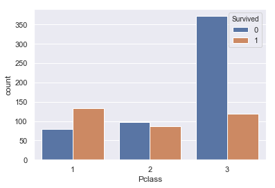
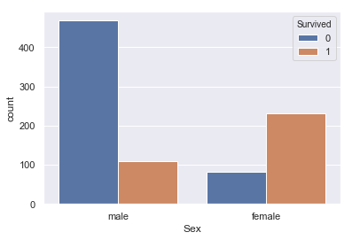
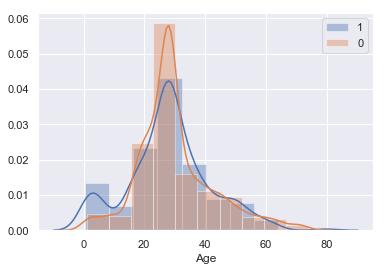
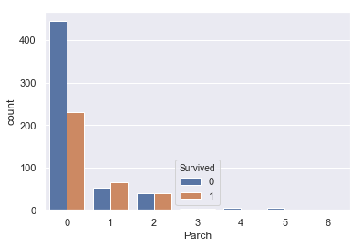
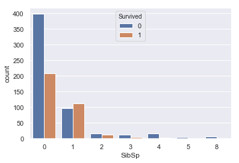
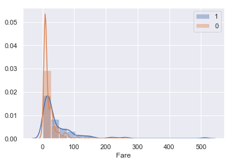
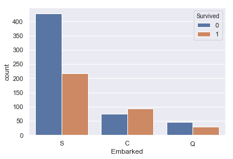
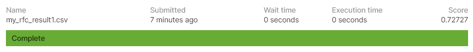

## はじめに

### 背景

Pythonを使った機械学習の勉強をしていたものの、学んだ知識の使いどころに困っていたところ

友人からの「Kaggle始めてみれば？」というアドバイスを受けて始めて見ました。

初心者の拙い分析の結果を残しますので、ご指摘あればお願いします。

### Kaggleとは？

> Kaggleは企業や研究者がデータを投稿し、世界中の統計家やデータ分析家がその最適モデルを競い合う、予測モデリング及び分析手法関連プラットフォーム及びその運営会社である。
> 
> [Wikipedia](https://ja.wikipedia.org/wiki/Kaggle)

要するに、投稿されたデータに対してデータサイエンティストが分析、モデル作成を行い、作成したモデルの精度を競い合うコンペです。

今回挑戦するのは、Kaggleの中で最も

初心者向けのタイタニックというコンペになります。

## コンペの概要

### タイタニックコンペの内容

タイタニックコンペは、タイタニックに乗船していた人の生死を予測する機械学習のモデルの精度を競い合うコンペになってます。

下に公式で説明用の動画が準備されているので視聴してみましょう。

How to Get Started with Kaggle’s Titanic Competition \| Kaggle

という風に全部英語で初心者にはとっつきにくい内容になってます。笑

公式サイトのコンペのルール説明欄なども英語でしか説明ないので、始めるには気合が必要ですね。

### 利用するデータ

分析に利用するデータは「train.csv」と「test.csv」の二種類のデータです。

教師データとテストデータの意味ですね。データの中身は以下のようになっております。

| 変数名 | 変数　日本語訳 | データの中身 |
| --- | --- | --- |
| survival | 生存のフラグ | 0 = 死亡, 1 = 生存 |
| pclass | チケットのランク | 1 = 1等, 2 = 2等, 3 = 3等客室 |
| sex | 性別 |  |
| Age | 年齢 |  |
| sibsp | タイタニックに同乗している兄弟、配偶者の数 |  |
| parch | タイタニックに同乗している親、子供の数 |  |
| ticket | チケット番号 |  |
| fare | 料金 |  |
| cabin | 客室番号 |  |
| embarked | 出港地 | C = Cherbourg, Q = Queenstown, S = Southampton |

予測したい項目は搭乗者の生死であるため、予測するデータ（目的変数）はSuvivedとなります。

それでは上記のデータを使って解析を進めていきます。

## データ前処理

### データ読み込み

とりあえず教師データとテストデータを読み込ませます。

```
#データ読み込み
import pandas as pd
import numpy as np
import matplotlib.pyplot as plt
import seaborn as sns
sns.set()

#train 教師データ
train = pd.read_csv('train.csv') 
#test テストデータ
test = pd.read_csv('test.csv') 
print('The size of the train data:' + str(train.shape))
print('The size of the test data:' + str(test.shape))
```

```
#教師データ確認
train.head()
```

```
	PassengerId	Survived	Pclass	Name	Sex	Age	SibSp	Parch	Ticket	Fare	Cabin	Embarked
0	1	0	3	Braund, Mr. Owen Harris	male	22.0	1	0	A/5 21171	7.2500	NaN	S
1	2	1	1	Cumings, Mrs. John Bradley (Florence Briggs Th...	female	38.0	1	0	PC 17599	71.2833	C85	C
2	3	1	3	Heikkinen, Miss. Laina	female	26.0	0	0	STON/O2. 3101282	7.9250	NaN	S
3	4	1	1	Futrelle, Mrs. Jacques Heath (Lily May Peel)	female	35.0	1	0	113803	53.1000	C123	S
4	5	0	3	Allen, Mr. William Henry	male	35.0	0	0	373450	8.0500	NaN	S
```

入りました。

データを見てみると、Pclass、Sex、Age、SibSp、Parch、Fare、Embarkedのデータはそのまま利用できそうな形となってます。

逆に、Name、Ticketには加工が必要そうで、Cabinのデータには欠損値（Nan）が多く存在するのがわかります。

ほかのデータにも欠損値が多いかもしれないので、確認してみます。

### 欠損値の確認

```
#教師データの欠損値の確認
train.isnull().sum()
```

```
#出力結果
PassengerId      0
Survived         0
Pclass           0
Name             0
Sex              0
Age            177
SibSp            0
Parch            0
Ticket           0
Fare             0
Cabin          687
Embarked         2
dtype: int64
```

```
#テストデータの欠損値の確認
test.isnull().sum()
```

```
#出力結果
PassengerId      0
Pclass           0
Name             0
Sex              0
Age             86
SibSp            0
Parch            0
Ticket           0
Fare             1
Cabin          327
Embarked         0
dtype: int64
```

AgeとCabinに欠損値が多く存在します。

Cabinについては半分以上が欠損しているため、特徴量から省きます。

Ageについては、シンプルに中央値で補間を行います。

```
#Ageの欠損値を中央値で補間
train["Age"] = train["Age"].fillna(train["Age"].median())
test["Age"] = test["Age"].fillna(test["Age"].median())
```

教師データのEmbarkedにも欠損値が2つありますが、こちらは外れ値として省くことにします

続いて、欠損値が2件あったEmbarkedについて、

生存者とEmbarkedの関係を図示していきます。

```
sns.countplot(train['Embarked'], hue=train['Survived'])
```


Sが最頻値で、最も生存率が高いことがわかります。 とりあえずSで補間しましょう。

```
#欠損値を最頻値で補間
train["Embarked"] = train["Embarked"].fillna("S")
train.isnull().sum()
```

```
#出力データ
PassengerId      0
Survived         0
Pclass           0
Name             0
Sex              0
Age              0
SibSp            0
Parch            0
Ticket           0
Fare             0
Cabin          687
Embarked         0
dtype: int64
```

テストデータのFareの欠損値も中央値で補間します。

```
test["Fare"] = test["Fare"].fillna(test["Fare"].median())
test.isnull().sum()
```

欠損値の補間完了です。

## 特徴量の選定

それでは特徴量として使えるデータを選定するため、各パラメータとSurvivedの関係を見ていきます。

なお、使い方がわからなかった「Name」、「Ticket」、欠損値が多かった「Cabin」は今回は省いて解析を行います。

### Pclass（チケットのランク）

まずはPclassとSuvivedの関係です。

```
#PclassとSurvivedの関係
sns.countplot(train['Pclass'], hue=train['Survived'])
```



１が生存率が高く、3が最も低いということが示唆されました。

1がランクの高い客室であるということであったので、長めがいい客室＝高い位置にある客室となって避難しやすかったのではないかと考えられます。

こちらは特徴量に追加しましょう。

### Sex（性別）

```
#SexとSurvivedの関係
sns.countplot(train['Sex'], hue=train['Survived'])
```



こちらはmale（男性）のほうがfemale（女性）に比べて生存率が低いです。

女性を先に逃がしているシーンが思い浮かぶのでこれはイメージしやすいですね。特徴量に入れときます。

### Age（年齢）

```
#AgeとSurvivedの関係

sns.distplot(train[train['Survived']==1]['Age'],kde=True,rug=False,bins=10,label='Survived') #生存者の分布
sns.distplot(train[train['Survived']==0]['Age'],kde=True,rug=False,bins=10,label='Death') #死者の分布
plt.legend()
```



こちらはヒストグラムで生存者と死亡者の分布を確認します。

特徴的なのは、どちらのヒストグラムも正規分布している中で、**10歳以下の生存者数の分布に山ができていることです。**

前項で女性の生存者数のほうが多かったことに加えて、10歳以下の小さな子供の生存者数が高いということは、女性と子供を先に逃がしたという風に考えられるのではないでしょうか？

こちらも特徴量として採用しましょう。

### Parch（兄弟、配偶者数）、SibSp（親、子供の数）

```
#ParchとSurvivedの関係
sns.countplot(train['Parch'], hue=train['Survived'])
```



```
#SibSpとSurvivedの関係
sns.countplot(train['SibSp'], hue=train['Survived'])
```



この二つはどちらも似たような分布をしており、0で死亡率が高く、あとは尾を引くような分布をしています。

今回は提出までが目標なので、特に特徴は見られないこちらのパラメータは外していきます。

（この二つのパラメータを組み合わせた家族数のパラメータが重要な特徴量になるそうなのですが、またの機会にします。）

### **Fare** （料金）

```
#FareとSurvivedの関係

sns.distplot(train[train['Survived']==1]['Fare'],kde=True,rug=False,bins=20,label='1') #生存者の分布
sns.distplot(train[train['Survived']==0]['Fare'],kde=True,rug=False,bins=10,label='0') #死者の分布
plt.legend()
```



少しわかりにくいですが、このデータからは生存率はFareが高かった人間のほうが高いということがわかると思います。

こちらはPclassと同じ考えで、料金が高い＝いい部屋だからという風に考えられると思います。

こちらも特徴量にいれときましょう。

### Embarked（出港地）

```
#EmbarkedとSurvivedの関係
sns.countplot(train['Embarked'], hue=train['Survived'])
```



さっきやったので割愛でもいいんですが、とりあえず。

S（Southampton）から出航した人が明らかに死亡率高いです。これについてはメカニズム不明ですが特徴量に入れておきます。

## モデルの作成、提出

使用する特徴量は「 **Pclass** 」「 **Sex** 」「 **Age** 」「 **Fare** 」「 **Embarked** 」の５つに決まりました。この特徴量を加工して識別機に入れていきましょう！

### 名義変数の離散化

識別器に入れるうえで、「Sex」「Embarked」などのobject型のデータは扱えないので離散化していきます。

教師データ、テストデータともに、「Sex」については男性を0、女性は1に変更。「Embarked」についてはSは0、Cは1、Qは2に変更します。

```
#教師データの名義変数の離散化

#男性は0　女性は1　に変更
train["Sex"][train["Sex"] == "male"] = 0
train["Sex"][train["Sex"] == "female"] = 1

#Sは0　Cは1 Qは2　に変更
train["Embarked"][train["Embarked"] == "S" ] = 0
train["Embarked][train["Embarked"] == "C" ] = 1
train["Embarked"][train["Embarked"] == "Q"] = 2
```

```
#テストデータの名義変数の離散化

#男性は0　女性は1　に変更
test["Sex"][test["Sex"] == "male"] = 0
test["Sex"][test["Sex"] == "female"] = 1

#Sは0　Cは1 Qは2　に変更
test["Embarked"][test["Embarked"] == "S"] = 0
test["Embarked"][test["Embarked"] == "C"] = 1
test["Embarked"][test["Embarked"] == "Q"] = 2
```

離散化完了です。最後にモデルの作成を行います。

### ランダムフォレストを用いた学習

最後に作成した特徴量を識別器に入れて学習させていきます。

識別器にはランダムフォレストを選びました。外れ値にも強く汎化性能も高いということで採用しました。ほかのモデルでの検証などは別の機会にしたいと思います。

```
#ランダムフォレストをセット
from sklearn.ensemble import RandomForestClassifier

# 「train」の目的変数と説明変数の値を取得
target = train["Survived"].values
features_one = train[["Pclass", "Sex", "Age", "Fare","Embarked"]].values


rfc = RandomForestClassifier(random_state=0)
#rfc = RandomForestClassifier(n_estimators=5, random_state=2)
rfc.fit(features_one, target)


# 「test」の説明変数の値を取得
test_features = test[["Pclass", "Sex", "Age", "Fare","Embarked"]].values

# 「test」の説明変数を使って「my_tree_one」のモデルで予測
my_rfc_prediction = rfc.predict(test_features)
```

```
#ランダムフォレストの予測結果をcsvで出力する。
# PassengerIdを取得
PassengerId = np.array(test["PassengerId"]).astype(int)

# my_prediction(予測データ）とPassengerIdをデータフレームへ落とし込む
my_rfc_solution = pd.DataFrame(my_rfc_prediction, PassengerId, columns = ["Survived"])

# csvで書き出し
my_rfc_solution.to_csv("my_rfc_result1.csv", index_label = ["PassengerId"])
```

「my\_rfc\_result1.csv」という名前で結果のデータが出力されました。

### Kaggleに提出

ではこの結果をKaggleに提出していきます。

提出方法は、KaggleのCompetition　→　Your Competitionsの中にあるTitanic　→　Submit Predictions　→　STEP1のSubmit files　から先ほど作成したcsvを提出するという流れです。

今回のScoreは。。。



**Score：0.72727！**

正答率：72.72％という結果となりました。パラメータ調整も特徴量の設定も適当にしてるのでこんなもんかと思います。

## 最後に

Kaggleの入門コンペであるTitanicに挑戦してみました。一番の感想は

おもしろい。

大学で機械学習勉強してたけど、卒業してから使ってないっていう人結構いるかと思います。

そういう人にはうってつけの腕試しの場であることは間違いないです。

次回は、正答率8割を超えることを目標に引き続きタイタニックコンペに挑んでいくつもりです。
