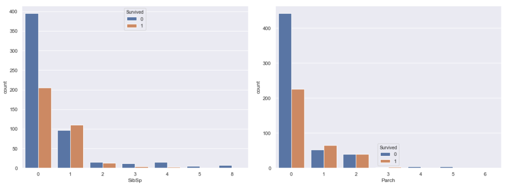
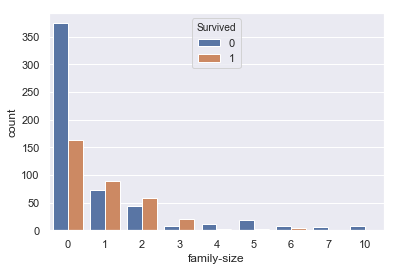
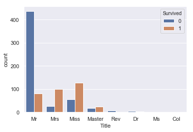
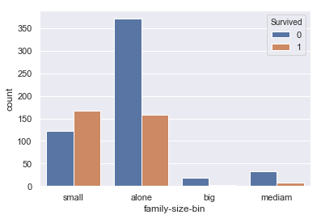
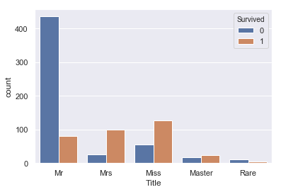
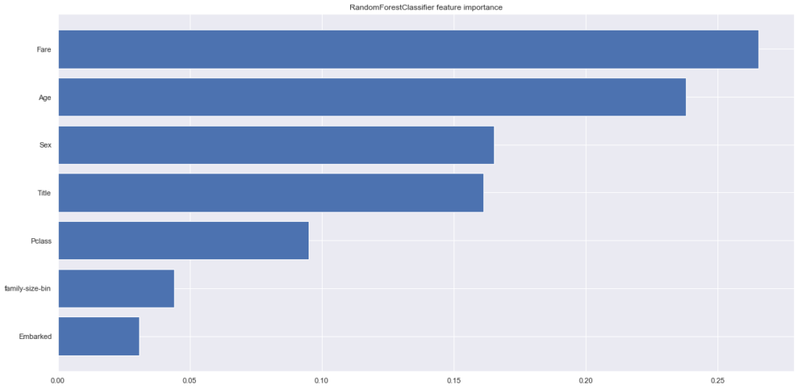
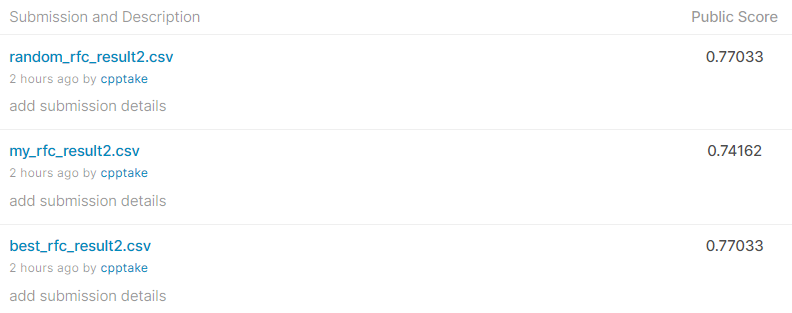

## 背景

Kaggleのタイタニックの続きです。

前回はできなかったEDA、ビニング処理、モデルのパラメータ調整をやっていきます。

なお、前処理などの内容は前回と同様の内容で終了していることを前提に実施します。

## EDAパート

### EDAとは？

EDAとはExploratory data analysis（探索的データ分析）と呼ばれるモデル作成を行う前に実施する作業のことで、Kaggle業界ではよく使われる言葉です。

むちゃくちゃ簡単にいうと、「データを観察して、データのパターンや特徴を発見すること。」ということです。  
詳しくは下記のサイトでわかりやすく説明されてます。

 [【データサイエンティスト入門編】探索的データ解析（EDA）の基礎操作をPythonを使ってやってみよう データサイエンティストの最初の一歩「探索的データ解析（EDA）」をPythonを使ってやってみよう！データの特徴を探求し、構造を理解することを目的としたデータサイエンスの最初の一歩です。 www.codexa.net](https://www.codexa.net/basic-exploratory-data-analysis-with-python/) 

そんなん前からやってるわ！と思ったのですが、

**・未知のデータを扱う上ですごく重要な考え方であると思ったこと**  
**・横文字使いこなせる俺かっけえ**

をしたいので自分も周りに合わせて「EDA」と呼ばせてもらいます。

### Parch（両親、子供の数）とSibSp（兄弟、配偶者の数）

前回使えなかった変数のParchとSibSpをEDAしていきます。

まずは、Parch、SibSpとSurvivedの関係についてグラフ化していきましょう。

```
#SibSp,ParchとSurvivedの関係
fig = plt.figure(figsize=(16,6))

ax = fig.add_subplot(1,2,1)
sns.countplot(train['SibSp'], hue=train['Survived'])

ax = fig.add_subplot(1,2,2)
sns.countplot(train['Parch'], hue=train['Survived'])

plt.tight_layout()
plt.show()
```



どちらも0で生存率が低く、１～2で生存率が上がっていく、似たような分布をしてます。

そもそも、ParchとSibSpは同乗者の数という点では同じような意味のデータであるので、両方の値を足し合わせた**”family-size”**（家族数）というカラムを作成して、分布を確認してみます。

```
#ParchとSibSpの足し算
train["family-size"] = train["Parch"]+train["SibSp"]

#family-sizeとSurvivedの関係
sns.countplot(train['family-size'], hue=train['Survived'])
```



0で死亡者率が高く、１～3で生存率が高い二つの変数をの特徴を足し合わせた変数になりました！

特徴量に追加しましょう。

### Name（名前）

次に前回利用できなかったNameの中身をEDAします。まずは、教師データの上から10データを見ていきます。

```
test["Name"].head(10)
```

```
#出力結果
0                                Kelly, Mr. James
1                Wilkes, Mrs. James (Ellen Needs)
2                       Myles, Mr. Thomas Francis
3                                Wirz, Mr. Albert
4    Hirvonen, Mrs. Alexander (Helga E Lindqvist)
5                      Svensson, Mr. Johan Cervin
6                            Connolly, Miss. Kate
7                    Caldwell, Mr. Albert Francis
8       Abrahim, Mrs. Joseph (Sophie Halaut Easu)
9                         Davies, Mr. John Samuel
```

名前のデータについては、あんまり関係ないかと思いましたが

Mr,Miss,Mrsなどの敬称が，（コンマ）の前に存在していることがわかります。

敬称の部分をsplit関数を利用して分離して、**”Title”**（敬称）のカラムを作成していきます。

```
#Mr,Mssなどを抽出
train['Title'] = train['Name'].map(lambda x: x.split(', ')[1].split('. ')[0])
test['Title'] = test['Name'].map(lambda x: x.split(', ')[1].split('. ')[0])
train['Title'].value_counts()
```

```
#出力結果
Mr              517
Miss            182
Mrs             125
Master           40
Dr                7
Rev               6
Mlle              2
Col               2
Major             2
Sir               1
Lady              1
Ms                1
Jonkheer          1
the Countess      1
Don               1
Mme               1
Capt              1
Name: Title, dtype: int64#
```

Mr,Miss,Mrsのほかにもたくさんの敬称が存在するのがわかります。

テストデータの中身はどうなっているでしょうか？

```
test['Title'].value_counts()
```

```
#出力結果
Mr        240
Miss       78
Mrs        72
Master     21
Rev         2
Col         2
Dona        1
Dr          1
Ms          1
Name: Title, dtype: int64
```

テストデータと比較してわかったことはMajor、Captなどテストデータには存在しないデータが含まれていることです。これを残しておくと精度が下がるのでdropを用いて省いていきます。

```
#省くデータを指定
drop_title = ['Capt','Don','Jonkheer','Lady','Major','Mlle','Mme','Sir','the Countess']
train = train[~train['Title'].isin(drop_title) ].reset_index(drop=True)

train['Title'].value_counts()
```

```
#出力結果
Mr        517
Miss      182
Mrs       125
Master     40
Dr          7
Rev         6
Col         2
Ms          1
Name: Title, dtype: int64
```

はい、テストデータに含まれないデータの削除が終わりました。TitleとSuvivedの関係を確認しましょう。

```
sns.countplot(train['Title'], hue=train['Survived'])
```



Mr（男性）の生存率が極端に低く、Master（老人男性）がやや高い。 また、Mrs（既婚女性）はMiss（未婚女性）に比べ生存率が高いという特徴がみられます。これは年齢の高い人、女性を先に逃がしたという風に考えられるのではないでしょうか？

Sexの上位互換となる特徴量になると考えられます。

Ticket、CabinのEDAについてはまた次回実施していきます。

## 特徴量作成

### ビニング処理

ビニング処理は特徴量をあるエリアで区切って新しいカテゴリ変数に変換する処理のことです。先ほど作ったfamily-size,Titleのデータに対して処理を行っていきます。

### family-size（家族の数）のビニング

family-sizeは0の時に死亡率が高い、１～3の時に生存率が高い、それ以上では死亡率が高い　という特徴がみられます。またデータを見ると、7以降では生存率が0になるので、4つのエリアに分割し、family-size-binというカラムに追加していきましょう。

```
#family-sizeが0の場合”alone”、１～3の場合”small”4～6の場合”medium”,7以上を”big”にする

train['family-size-bin'] = 'big'
train.loc[train['family-size']==0,'family-size-bin'] = 'alone'
train.loc[(train['family-size']>=1) & (train['family-size']<=3),'family-size-bin'] = 'small'
train.loc[(train['family-size']>=5) & (train['family-size']<=7),'family-size-bin'] = 'mediam'

#グラフ描画
sns.countplot(train['family-size-bin'], hue=train['Survived'])
```



データを見ると

・small … 生存率が高い  
・alone … 死亡率が高く,n数も多い  
・big … 生存率が0％ ＝ bigのデータは必ず死亡する  
・medium …　死亡率が高い

この4エリアのデータに分けられたました。テストデータにも反映させます。

```
#testデータにも適用

test['family-size-bin'] = 'big'
test.loc[test['family-size']==0,'family-size-bin'] = 'alone'
test.loc[(test['family-size']>=1) & (test['family-size']<=3),'family-size-bin'] = 'small'
test.loc[(test['family-size']>=5) & (test['family-size']<=7),'family-size-bin'] = 'mediam'
```

### Title（敬称）のビニング

同様にTitleについても処理を行っていきます。

分け方は、登場回数の多いMr,Mrs,Miss,Masterは残し、それ以外はRareで統一します。  
また、Ms,MlleについてもMissの書き間違いとみなしてMissに統一します。

```
# 教師データのTitleの加工
train['Title'].replace(['Col','Dr', 'Rev'], 'Rare',inplace=True) #少数派の敬称を統合
train['Title'].replace('Mlle', 'Miss',inplace=True) #Missに統合
train['Title'].replace('Ms', 'Miss',inplace=True) #Missに統合

sns.countplot(train['Title'], hue=train['Survived'])
```



テストデータでも同じ処理を入れます。

```
# テストデータのTitleの加工
test['Title'].replace(['Col','Dr', 'Rev'], 'Rare',inplace=True) #少数派の敬称を統合
test['Title'].replace('Mlle', 'Miss',inplace=True) #Missに統合
test['Title'].replace('Ms', 'Miss',inplace=True) #Missに統合
```

ビニング終了です。

### LabelEncording

カテゴリ変数の離散化をしていきますが、今回はLabelEncordingという関数を利用します。

LabelEncordingは指定したカテゴリ変数を自動で離散化してくれる便利ツールです。

今回使う特徴量でカテゴリ変数にあたるのは　’Sex’,’family-size-bin’,’Title’,’Embarked’

の4種類です。これらにLabelEncordingをかけていきます。

```
# カテゴリ変数の特徴量についてlabel encoding
from sklearn.preprocessing import LabelEncoder

le_target_col = ['Sex','family-size-bin','Title','Embarked']
le = LabelEncoder()

for col in le_target_col:
    train.loc[:, col] = le.fit_transform(train[col])
    test.loc[:, col] = le.fit_transform(test[col])
```

教師データの目的変数（y\_train）、説明変数（X\_train）、テストデータの説明変数（y\_test）を作成します。

```
# X_trainとy_train作成
target_col ='Survived'
drop_col = ['PassengerId','Survived', 'Name', 'Ticket', 'Cabin', 'family-size', 'Parch', 'SibSp']
drop_col2 = ['PassengerId', 'Name', 'Ticket', 'Cabin', 'family-size', 'Parch', 'SibSp']
# 学習に必要な特徴量のみを保持
X_train = train.drop(columns=drop_col)
X_test = test.drop(columns=drop_col2)

y_train = train[target_col]
```

特徴量作成完了です。

## モデル作成

### ランダムフォレストでfeature importanceの計算

ようやくモデル作成です！今回も前回と同様ランダムフォレスト識別していきますが、特徴量が増えたのでランダムフォレストでfeature importanceを計算して、どの特徴量が一番効いているかをチェックしていきます。

```
#ランダムフォレストでImportanceの計算
from sklearn.ensemble import RandomForestClassifier

rfc = RandomForestClassifier(random_state=0)
rfc.fit(X_train, y_train)

plt.figure(figsize=(20,10))
plt.barh(
    X_train.columns[np.argsort(rfc.feature_importances_)],
    rfc.feature_importances_[np.argsort(rfc.feature_importances_)],
    label='RandomForestClassifier'
)
plt.title('RandomForestClassifier feature importance')
```



追加した特徴量のTitleとfamily-size-binは思ったより効いてなさそうです。

特に、TitleはSexの上位版の特徴量であると思っていたのですが、ほとんど変わらない結果となりました。Rareで頻度の少ない値をまとめてしまったのが悪かったのでしょうか？  
ひとまずこのままでパラメータ調整、モデル作成行います。

### GridSearchを使ったパラメータ調整

最後に前回できなかったパラメータ調整をやっていきます。

パラメータ調整にはGridSearchを利用します。振った水準の中でどのパラメータが最適か計算してくれる便利な奴です。

水準、因子数は適当に決めて動かします。

```
# グリッドサーチでランダムフォレストのパラメータを探索

from sklearn.ensemble import RandomForestClassifier
from sklearn.model_selection import GridSearchCV

rfc = RandomForestClassifier(random_state=0)

#パラメータを振る。水準は適当に決定
param_grid = {'criterion':['gini','entropy'],
              'n_estimators':[25, 100, 500, 1000, 2000],
              'min_samples_split':[0.5, 2,4,10],
              'min_samples_leaf':[1,2,4,10],
              'bootstrap':[True, False]
              }

grid = GridSearchCV(rfc, param_grid=param_grid,cv=5)
grid = grid.fit(X_train, y_train)
grid_best = grid.best_estimator_

print(grid.best_score_)
print("grid_best = ",grid_best)
print("best params = ",grid.best_params_)
```

```
#出力結果
0.8386363636363636
grid_best =  RandomForestClassifier(bootstrap=True, class_weight=None, criterion='entropy',
            max_depth=None, max_features='auto', max_leaf_nodes=None,
            min_impurity_decrease=0.0, min_impurity_split=None,
            min_samples_leaf=1, min_samples_split=10,
            min_weight_fraction_leaf=0.0, n_estimators=25, n_jobs=None,
            oob_score=False, random_state=0, verbose=0, warm_start=False)
best params =  {'bootstrap': True, 'criterion': 'entropy', 'min_samples_leaf': 1, 'min_samples_split': 10, 'n_estimators': 25}
```

でました。ちなみにこの計算に1時間くらい経過。。。ラップトップのローカル環境でやるとこうなります。

### モデルの作成と提出

パラメータ調整も終了したのでいよいよモデル作成＋提出です！

今回はパラメータ調整結果の比較のために

**・ベストパラメータでのモデル**

**・パラメータ調整なしのモデル**

**・パラメータ適当に決めたモデル**

の3つを作成して結果を比較していきます。

```
# ベストパラメータRandomForest
rfc_best = RandomForestClassifier(n_estimators=25, \
                               criterion='entropy', \
                               min_samples_split=10, \
                               min_samples_leaf=1, \
                               bootstrap=True, \
                               random_state=0)
rfc_best.fit(X_train, y_train)

#パラメータ調整なし
rfc = RandomForestClassifier(random_state=0)
rfc.fit(X_train, y_train)

#パラメータ調整適当
rfc_random = RandomForestClassifier(n_estimators=500, \
                               criterion='gini', \
                               min_samples_split=2, \
                               min_samples_leaf=10, \
                               max_features = 2, \
                               bootstrap=True, \
                               random_state=0)
rfc_random.fit(X_train, y_train)


print(f'パラメータ調整後のrfc: {rfc_best.score(X_train, y_train)}')
print(f'パラメータ調整なしのrfc: {rfc.score(X_train, y_train)}')
print(f'パラメータ適当のrfc: {rfc_random.score(X_train, y_train)}')
```

```
#出力結果
パラメータ調整後のrfc: 0.8977272727272727
パラメータ調整なしのrfc: 0.9715909090909091
パラメータ適当のrfc: 0.8477272727272728
```

Scoreの結果を見るとパラメータ調整なしは過学習してそうですね。

それでは分類結果をcsvに出力してKaggleに提出してみましょう。

```
#ランダムフォレストの予測結果をcsvで出力する。
best_rfc_prediction = rfc_best.predict(X_test)#パラメータ調整後
my_rfc_prediction = rfc.predict(X_test)#調整なし
random_rfc_prediction = rfc_random.predict(X_test)#パラメータ適当


# PassengerIdを取得
PassengerId = np.array(test["PassengerId"]).astype(int)

# 予測データとPassengerIdをデータフレームへ書き込み
best_rfc_solution = pd.DataFrame(best_rfc_prediction, PassengerId, columns = ["Survived"])
my_rfc_solution = pd.DataFrame(my_rfc_prediction, PassengerId, columns = ["Survived"])
random_rfc_solution = pd.DataFrame(random_rfc_prediction, PassengerId, columns = ["Survived"])


# csv書き出し
best_rfc_solution.to_csv("best_rfc_result2.csv", index_label = ["PassengerId"])
my_rfc_solution.to_csv("my_rfc_result2.csv", index_label = ["PassengerId"])
random_rfc_solution.to_csv("random_rfc_result2.csv", index_label = ["PassengerId"])
```

提出結果は、、、



・**ベストパラメータ　Score：0.77033**

**・パラメータ調整なし　Score：0.74162**

**・適当パラメータ　Score:0.77033**

でした！

前回のScoreが0.72727だったので、特徴量の追加だけで。約1.4％のScoreの向上  
パラメータ調整の有無でScoreが2.8％の向上につながりました！

（適当パラメータとベストパラメータのスコアが変わらないのが気になりますが。）

目標としている8割までもう少しです。特徴量の追い込みとモデルの変更などをして8割めざしていきます！
