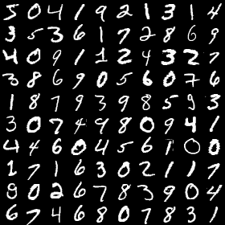
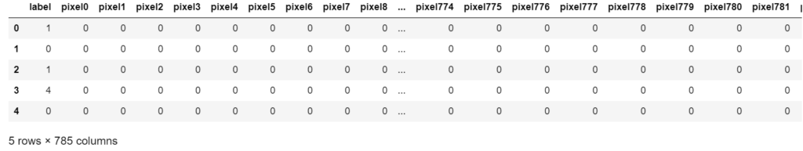
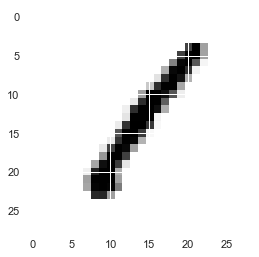
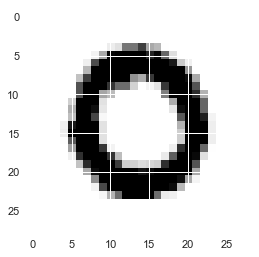
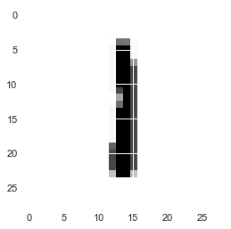
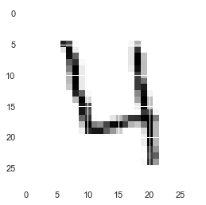
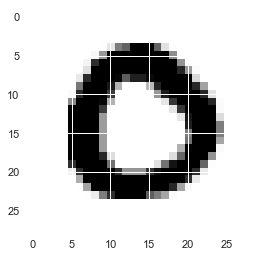

## 背景

### 前置き

KaggleのDigit Recognizerコンペに参加しました。

 [Digit Recognizer Learn computer vision fundamentals with the famous MNIST data kaggle.com](https://www.kaggle.com/c/digit-recognizer) 

有名なMNISTのデータセットを使った手書き数字の識別精度を競うコンペになります。

### MNISTとは

MNISTは　Mixed National Institute of Standards and Technology databaseの略で、手書き数字画像60,000枚と、テスト画像10,000枚を集めた、画像データセットです。

↓↓下の図がMNISTの画像データの一部になってます。



画像処理やったことある人は1度は見たことある有名なデータセットです。

学生の時に画像処理の研究していたのにMNIST触るのが今回が初めてですが。。。笑

### やりたい事

MNISTのデータセットは、csv形式でデータが準備されており画像データとして扱うためには面倒くさめの前処理が必要だったので方法を残しときます。

この記事のゴールとしては、与えられたcsvデータを行列形式に変換して画像データとして扱えるよう処理を行うところまでとなっております。

早く識別器作りたいのでちゃっちゃとやっていきます。

## 前処理

### データの観察

Kaggleからtest.csvとtran.csvを落としてから、データをインポートします。

```
#テストデータのインポート

import pandas as pd
import numpy as np
 
import matplotlib.pyplot as plt
import seaborn as sns
sns.set()
 
train = pd.read_csv('dataset/train.csv') #教師データ
test = pd.read_csv('dataset/test.csv') #テストデータ
print('The size of the train data:' + str(train.shape))
print('The size of the test data:' + str(test.shape))
```

```
#出力結果
The size of the train data:(42000, 785)
The size of the test data:(28000, 784)
```

教師データが42000件、テストデータが28000件。

普通のMNISTのデータセットよりテストデータが多くなってますね。

まずは教師データのデータの形を見ていきます。

```
#データの形をチェック
train.head()
```


**

1列目のlabelの欄に文字の正解データが入っており、それ以降の列は各ピクセルの輝度値が入力されているという具合になってます。

MNISTの画像データは28×28pixelの画像なので、カラム数は28×28＝784 列＋正解データ1列の785カラムで構成されています。

現在データは横積みのベクトル形式になっているので、画像データとして扱うためには28列ごとに分割して縦積みしていく必要があります。

## データの形状を変更

### reshape関数

ベクトルのデータを行列に変換する方法わからなかったのでforループで28行づつ区切っていこうと思ったのですが、どうやらNumPyのreshape関数で一発でできるみたいので使っていきます。

なお、reshape関数の公式リファレンスは下記になります。

 [numpy.reshape — NumPy v1.15 Manual docs.scipy.org](https://docs.scipy.org/doc/numpy-1.15.0/reference/generated/numpy.reshape.html) 

```
for i in range(5):#とりあえず5枚出力
　　#reshape関数で画像化
    plt.imshow(X_train[i,:].reshape(28,28), cmap=plt.cm.gray_r)
    plt.show()
```

出力結果

- 
- 
- 
- 
- 

reshape完了しました。便利ですね。

これでベクトルデータの行列か（画像化）終了です。

次回からこちらのデータを用いて文字の識別を行っていきたいと思います。
