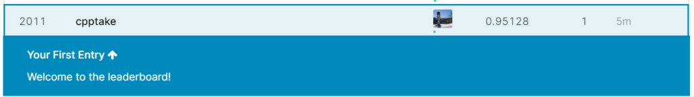
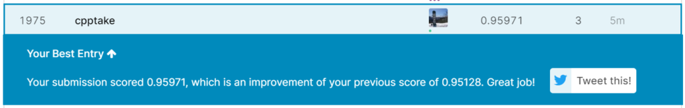

しぃたけ

sikit-learnの MLPClassifier（多層パーセプトロン）を用いてMNISTの文字分類を行っていきます。

## やりたい事

前回前処理を実施したMNISTデータセットの文字分類を行っていきます。

前回記事

[http://cpptake.com/2020/05/04/【digit-recognizer】mnistの数字識別コンペ-前処理編/](http://cpptake.com/2020/05/04/%E3%80%90digit-recognizer%E3%80%91mnist%E3%81%AE%E6%95%B0%E5%AD%97%E8%AD%98%E5%88%A5%E3%82%B3%E3%83%B3%E3%83%9A-%E5%89%8D%E5%87%A6%E7%90%86%E7%B7%A8/)

今回は識別器に多層パーセプトロンを使って識別を行い、Kaggleに提出するとところまでやっていきます。

多層パーセプトロンは、scikit-learnを利用しました。

参考文献はこちらです。

## 多層パーセプトロンについて

### 多層パーセプトロンとは？

自分自身認識がふわふわしてるんですが、一言でいうと

近年注目されているディープラーニングの技術の一番基本的な形のもの。

という認識です。

多層パーセプトロンにシグモイドなどの活性化関数を利用したものがニューラルネットワーク。

ニューラルネットワークの隠れ層が2層以上あるものディープラーニングやと思ってます。

今回は、活性化関数を使う　＋　隠れ層が2層以上　なので広い意味ではディープラーニングだと思うのですが、関数の名前がMLP（Multi Layer Perceptron)なので、本文では多層パーセプトロンで統一します。

もし認識に間違いあればコメントとかいただければと思います。

### scikit-learnのMLPClassifierのパラメータ

今回使うscikit-learnのMLPClassifierのパラメータは下記に説明されてます。

 [ニューラルネットワークのパラメータ設定方法(scikit-learnのMLPClassifier) あらすじ ニューラルネットワークを作成する際に、層の数、ニューロンの数、活性化関数の種類等考えるべきパラメータは非常に多くあります。 そこで、これらのパラメータがどのようにモデルや学習に影響を与えるかということをscik ... spjai.com](https://spjai.com/neural-network-parameter/#9_max_iter) 

リンク先を見るとMLPClassifierはパラメータ数が　**21種類**　存在することがわかります。

これを１つ１つ振っていたらきりがないので今回使うのはよく使われる、

batch\_size（ミニバッチのサイズ）、hidden\_layer\_sizes（隠れ層のサイズ）、max\_iter（反復学習の最大回数）、activation（活性化関数）

くらいに絞って使っていきます。

それでは早速モデルを作成しましょう。

## モデル作成

### 教師データとテストデータの分割

まずは、MLPの精度を確認するために、正解ラベルのある教師データ（X\_train）をtrain\_test\_split関数で、もう一度教師データ、テストデータに分割していきます。

```
#MLPの精度確認のため、教師データをさらに教師データ、テストデータに分割
from sklearn.model_selection import train_test_split

X_train2, X_test2, y_train2, y_test2 = train_test_split(X_train,
                                                        y_train, 
                                                        test_size = 0.2,
                                                        train_size = 0.8,#教師データ少なくなるのが怖いので4:1で分割
                                                        stratify = y_train)
print(f'X_train2 の長さ: {len(X_train2)}')
print(f'X_test2 の長さ: {len(X_test2)}')
```

```
#出力結果
X_train2 の長さ: 33600
X_test2 の長さ: 8400
```

n数が40000存在した教師データ（X\_train,y\_train）が33600個のX\_train2、8400個のX\_test2に分割できました。

これで、モデルを作成した際の精度の検証が可能になりました。

こちらのデータをつかってモデルを作成していきましょう。

### 多層パーセプトロンを用いたモデルの作成

scikitlearnのMLPClassifierを利用してモデルを作成します。

パラメータは 適当に設定して、隠れ層は2層（　100、100）　活性化関数　relu　最適化手法 adam　学習反復回数　20　で実装します。その他はデフォルトでやってみます。

```
#MLPClassifierをインポート
from sklearn.neural_network import MLPClassifier

#隠れ層　100、100　活性化関数　relu で実装　その他は適当
def sklearn_mlp():
    mlf = MLPClassifier(hidden_layer_sizes=(100,100), solver='adam', max_iter=20, verbose=10, random_state=0)
    mlf.fit(X_train2, y_train2)
    print('accuracy_score: %.3f' % mlf.score(X_test2, y_test2))
%time sklearn_mlp()
```

```
#出力結果
Iteration 1, loss = 2.89878361
Iteration 2, loss = 0.86191602
Iteration 3, loss = 0.51868066
Iteration 4, loss = 0.35139667
Iteration 5, loss = 0.24289586
Iteration 6, loss = 0.19045142
Iteration 7, loss = 0.15612827
Iteration 8, loss = 0.12213968
Iteration 9, loss = 0.11302399
Iteration 10, loss = 0.11097013
Iteration 11, loss = 0.08837336
Iteration 12, loss = 0.08776405
Iteration 13, loss = 0.09631755
Iteration 14, loss = 0.08548279
Iteration 15, loss = 0.09076070
Iteration 16, loss = 0.08660899
Iteration 17, loss = 0.08626077
Iteration 18, loss = 0.11242479
Iteration 19, loss = 0.11499695
Iteration 20, loss = 0.09038487
accuracy_score: 0.951
Wall time: 21 s
```

accuracy\_score : 0.951 (正答率：95.1%）

lossも10回目の反復付近で収束していることがわかります。

適当にパラメータ決めた割には悪くない結果ではないでしょうか？

一度この状態でKaggle提出してみます。

### csv出力と提出

教師データをX\_train2　→　X\_trainに、テストデータをy\_test2　→　y\_test変更してからcsv出力を行います。

```
#上記のパラメータで提出する。
from sklearn.neural_network import MLPClassifier

#def sklearn_mlp():
mlp = MLPClassifier(hidden_layer_sizes=(100,100), solver='adam', max_iter=20, verbose=10, random_state=0)
mlp.fit(X_train, y_train)
#y_pred = mlf.predict(X_test)


#ImageIdを1からスタートさせる処理
#my_mlf.to_csv("my_mlf_1.csv", index_label = ["imageid"])

my_mlp = pd.DataFrame()
imageid = []

for i in range(len(X_test)):
    imageid.append(i+1)
    
my_mlp['ImageId'] = imageid
my_mlp["label"] = mlf.predict(X_test)
my_mlp.to_csv("my_mlp_1.csv", index=False)


print('csv書き出し終了')
```

```
#出力結果
Iteration 1, loss = 2.57687918
Iteration 2, loss = 0.73848053
Iteration 3, loss = 0.44846465
Iteration 4, loss = 0.31059447
Iteration 5, loss = 0.23657482
Iteration 6, loss = 0.18961008
Iteration 7, loss = 0.15171713
Iteration 8, loss = 0.13450295
Iteration 9, loss = 0.12637660
Iteration 10, loss = 0.10477283
Iteration 11, loss = 0.10241580
Iteration 12, loss = 0.10472031
Iteration 13, loss = 0.07978529
Iteration 14, loss = 0.08796402
Iteration 15, loss = 0.09168370
Iteration 16, loss = 0.08982356
Iteration 17, loss = 0.09578159
Iteration 18, loss = 0.09221845
Iteration 19, loss = 0.10897262
Iteration 20, loss = 0.09681042
csv書き出し終了
```

結果は、、、



**Score:0.95128（正答率：95.128%)**

**順位：2011位/2352位中（上位85.5%）**

95%悪くない結果かと思いきや、という下から数えたほうがはるかに速いという結果になりました笑。

プライド的に上位50%くらいには入りたいところですが、適当に設定したパラメータではだめだったのでしょうか？

ということで上位50%くらいに入れるようにパラメータチューニングを行っていきます！

### RandomizedSearchCVを利用したパラメータチューニング

調べてみたところ、ニューラルネットワークではパラメータが多いのでRandomizedSearchCVが適しているとのこと。 使ってみようと思います。

（ 出展：[https://zerofromlight.com/blogs/detail/28/](https://zerofromlight.com/blogs/detail/28/)）

なお、設定するパラメータも根拠はなく適当に下記の通りの値で設定しました。

```
#RandomizedSearchCVをセット
from sklearn.model_selection import RandomizedSearchCV

mlp = MLPClassifier(random_state=0)


#　ランダムサーチに渡すためのパラメータ値の設定
#　特に根拠はなく下記の値で設定

random_search = {'batch_size': [300, 350, 400, 450],
               'hidden_layer_sizes': [(150, 150), (100, 100, 50), (150, 100, 50)],
               'max_iter': [400, 500, 600, 700, 800],
               'activation':['tanh','relu'],
               'random_state': [0]}

mlp_random_search = RandomizedSearchCV(mlp, random_search, cv=4,
                                   n_jobs=-1, scoring='accuracy', random_state=0)

mlp_random_search = mlp_random_search.fit(X_train, y_train)
#best_param = mlp_random_search.best_params_
best_param = mlp_random_search.best_estimator_


print(mlp_random_search.best_score_)
print("grid_best = ",best_param)
```

```
#出力結果
0.9514523809523809
grid_best =  MLPClassifier(activation='tanh', alpha=0.0001, batch_size=450, beta_1=0.9,
       beta_2=0.999, early_stopping=False, epsilon=1e-08,
       hidden_layer_sizes=(150, 150), learning_rate='constant',
       learning_rate_init=0.001, max_iter=700, momentum=0.9,
       n_iter_no_change=10, nesterovs_momentum=True, power_t=0.5,
       random_state=0, shuffle=True, solver='adam', tol=0.0001,
       validation_fraction=0.1, verbose=False, warm_start=False)
```

ベストパラメータ決まりました！

上記のパラメータで再設定してもう一度提出してみます。

```
#ベストパラメータで提出
mlp_best = MLPClassifier(activation='tanh', alpha=0.0001, batch_size=450, beta_1=0.9,
              beta_2=0.999, early_stopping=False, epsilon=1e-08,
              hidden_layer_sizes=(150, 150), learning_rate='constant',
              learning_rate_init=0.001, max_iter=700, momentum=0.9,
              n_iter_no_change=10, nesterovs_momentum=True, power_t=0.5,
              random_state=0, shuffle=True, solver='adam', tol=0.0001,
              validation_fraction=0.1, verbose=False, warm_start=False)

mlp_best.fit(X_train, y_train)


my_mlp2 = pd.DataFrame()
imageid2 = []

for i in range(len(X_test)):
    imageid2.append(i+1)
    
my_mlp2['ImageId'] = imageid
my_mlp2["label"] = mlp_best.predict(X_test)
my_mlp2.to_csv("my_mlp_2.csv", index=False)
```

提出結果は、、



**Score : 95.971%**

**順位 : 1975位/2367位（上位83.4%）**

。。。。。

全然あかんやん。

一応順位は50位くらい上がってますが、パラメータ調整だけではこれが限界ってことですね。

上位50%なんて夢のまた夢みたいな場所にいるってことですね。

## 感想、今後の展望

MNISTデータセットは世界的に有名なデータセットなので、ぽっと出が上位に食い込むのは難しいということがわかりました。調子乗ってすみませんでした。

調べてみると、このコンペで上位1000位以内に入るためにはScoreが99%を目指す必要があるみたいです。

そうなってくると多層パーセプトロンだけでは相当頑張らないとむすかしそうなので、根本的にモデルを考え直す必要がありそうです。

画像処理といえばCNN（畳み込みニューラルネットワーク）が有名です。次回はCNNを利用して1000位以内は入りたいですね。
