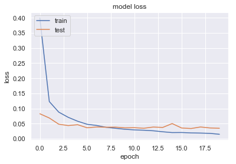
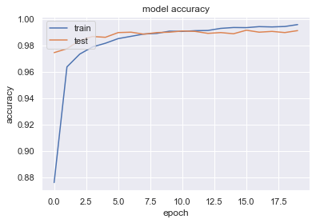
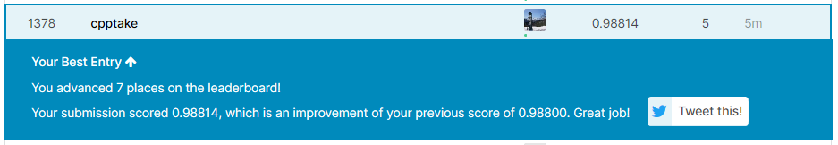

しぃ たけ

KerasでCNN（畳み込みニューラルネットワーク）を作成してMNISTデータセットの識別を行ったら99％近い識別率が出せたので記事を書きました。

## 概要

前回、MLP（多層パーセプトロン）を使って、KaggleのDigit Recognizerコンペに挑戦し

**Score : 95.971%**

**順位 : 1975位/2367位（上位83.4%）**

というクソみたいな結果でした。

順位を上げるために、アルゴリズムをMLPからCNN（畳み込みニューラルネットワーク）に変更して再挑戦したので記録を残します。

参加したコンペ、前回の記事は下記のとおりです。

 [Digit Recognizer Learn computer vision fundamentals with the famous MNIST data kaggle.com](https://www.kaggle.com/c/digit-recognizer) 

[http://cpptake.com/2020/05/05/ cpptake.com](http://cpptake.com/2020/05/05/)【digit-recognizer】多層パーセプトロン%ef%bc%88ディープラーニン/

## CNN（畳み込みニューラルネットワーク）について

### CNNとは？

CNN（Convolution Neural Network)は畳み込みニューラルネットワークと呼ばれる、ニューラルネットワークの一つで、画像認識や音声認識に効果を発揮する手法です。

前回利用したMLP（多層パーセプトロン）との違いは、畳み込み層とプーリング層という層がネットワークの中に組み込みこまれていることにあるのですが、詳しくは下記を参照ください。

 [畳み込みニューラルネットワークとは？手順も丁寧に解説｜Udemy メディア 画像認識などに使われている畳み込みニューラルネットワークについて、人工知能に関する知識があまりない初心者でもわかるよう、丁寧に解説しています。また、手順もわかりやすく紹介しています。 udemy.benesse.co.jp](https://udemy.benesse.co.jp/ai/convolution-neural-network.html)   

### Kerasとは？

Keras（ケラス）とは、Pythonで書かれたディープラーニングのライブラリです。

ほかのディープラーニングライブラリと比べて簡単に実装できるという点が優れているそうなので、サクッと作りたい自分は今回Kerasを利用しました。

使い方を調べていると、Kerasには日本語の公式ドキュメントがありました！

初めて利用する自分としては非常にありがたかったです。（[公式ドキュメント](https://keras.io/ja/)）

## モデルの作成

それでは早速モデル作成していきます。

なお、これ以前の前処理の内容については前回の記事を参照してください。

### Kerasのインポートとデータ前処理

Kerasをインポートしていきます。

```
#Kerasのインポート
import keras
from keras.models import Sequential
from keras.layers import Dense, Dropout, Flatten
from keras.layers import Conv2D, MaxPooling2D

import matplotlib
matplotlib.use("Agg")
import matplotlib.pyplot as plt

import numpy as np
```

keras.modelsはネットワークのモデルを指定する部分であり、今回実装するCNNは1直線のネットワークであるので最もシンプルなSequentialモデルでOKです。

keras.layersで中間層の中身を決めることができます。

データを入れる前に、データを行列に変換が必要なので28×28の行列に変換していきます。

```
#データ前処理
img_rows, img_cols = 28, 28
num_classes = 10

#本番用データの前処理（28×28の行列に変換）
X_train = X_train2.reshape(X_train.shape[0], img_rows, img_cols, 1)
X_test = X_test2.reshape(X_test.shape[0], img_rows, img_cols, 1)

#y_trainのデータをto_categoricalで2値クラスの行列へ変換
y_train= keras.utils.to_categorical(y_train, num_classes)
```

これでデータの前処理は終了です。

### モデルの構造について

モデルの作成は簡単です。

まずはmodel（今回はSequential）を作成して、そこに.addを用いて結合する層を追加していくだけです。

今回の構造はこのようになってます。

```
#モデルの構造
model = Sequential()

model.add(Conv2D(32, kernel_size=(3, 3),
                 activation='relu',
                 input_shape=(img_rows, img_cols, 1)))
model.add(Conv2D(64, (3, 3), activation='relu'))
model.add(MaxPooling2D(pool_size=(2, 2)))
model.add(Dropout(0.25))
model.add(Flatten())
model.add(Dense(128, activation='relu'))
model.add(Dropout(0.5))
model.add(Dense(num_classes, activation='softmax'))
```

今回はあまり深く考えず、お手本通りに

畳み込み層　→　畳み込み層　→　プーリング層　→　Dropout層　→　平準化層　→　全結合層　→　Dropout層　→　全結合層

というネットワーク構築にしました。

### 学習とスコア算出

上記の構造で学習させて、scoreの確認していきます。

なお今回はepocs（学習反復回数）を20に設定したので、20回学習が行われます。

```
model2.compile(loss=keras.losses.categorical_crossentropy,
              optimizer=keras.optimizers.Adadelta(),
              metrics=['accuracy'])
```

```
#学習を開始
hist = model.fit(X_train, y_train,
                 batch_size=128,
                 epochs=20,
                 validation_split=0.1,
                 verbose=1)

#スコア算出
scores = model.evaluate(X_train, y_train)
print('accuracy={}'.format(*scores))
```

```
#出力結果
・
・
・
Epoch 19/20
37800/37800 [==============================] - 60s 2ms/step - loss: 0.0167 - accuracy: 0.9948 - val_loss: 0.0359 - val_accuracy: 0.9888
Epoch 20/20
37800/37800 [==============================] - 60s 2ms/step - loss: 0.0169 - accuracy: 0.9944 - val_loss: 0.0364 - val_accuracy: 0.9902

accuracy=0.9967857003211975
```

**accuracy=0.9967（正答率：99.67%)**

前回のMLPでは　**accuracy : 0.951**　であったので非常に精度が向上しています！

本番データではないですが、なかなかの結果が期待できます。

### 学習曲線の確認

過学習していないか確認のため、学習曲線を図示していきます。

```
#loss
plt.plot(hist.history['loss'])
plt.plot(hist.history['val_loss'])
plt.title('model loss')
plt.ylabel('loss')
plt.xlabel('epoch')
plt.legend(['train', 'test'], loc='upper left')
plt.show()

#Accuracy
plt.figure()
plt.plot(hist.history['accuracy'])
plt.plot(hist.history['val_accuracy'])
plt.title('model accuracy')
plt.ylabel('accuracy')
plt.xlabel('epoch')
plt.legend(['train', 'test'], loc='upper left')
plt.show()
```





loss、accuracyどちらについても、教師データは訓練が進むにつれて精度が上がっていく傾向にあり、

テストデータについても5回目くらいで精度の向上は止まるが、その後も過学習せず横ばいになっていることがわかります。

問題なさそうですね。

### **csv出力と提出**

それではテストデータに対してCNNで識別を行った結果をKaggleに提出していきます。

ちなみに、テストデータの予測クラスの出力にはpredeict\_classesという関数が利用できます。

```
#テストデータの予測結果を出力（predeict_classes)
y_pred = model.predict_classes(X_test)

#データをcsvに書き出し
my_cnn = pd.DataFrame()
imageid = []

for i in range(len(X_test)):
    imageid.append(i+1)
    
my_cnn['ImageId'] = imageid
my_cnn["label"] = y_pred
my_cnn.to_csv("my_cnn_2.csv", index=False)

print('csv書き出し終了')
```

my\_cnn\_2.csvという名前で出力されました。Scoreと順位は。。。



**Score：98.814%**

**順位：1378位/2854位中**　（5月7日現在）

MLPで識別した前回と比較して、**Scoreが2.843ptの向上**、順位が**597位向上**しました！

パラメータもモデルもそこまで考えずに作ったにもかかわらず、99％近い精度が出せたことが非常に驚きです。

## 感想、今後の展望

今回はKerasを用いたCNNでMNISTの識別を行い、99％近い識別率を達成しました。

感想は2つです。

・Kerasめちゃめちゃ使いやすい。

・CNNすごい

実は99％超えを目指して、モデルの構造を変えてトライしてみたり（BatchNormalization層の追加、Dropout層の位置変更など）、パラメータをいじったりしましたが、精度が上がらず諦めてしまってました。

まだCNN初心者であるのでKaggleのnotebookを参考にして、モデル構築の方法を探っていきたいです。
