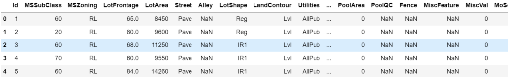
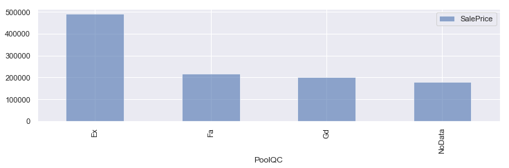
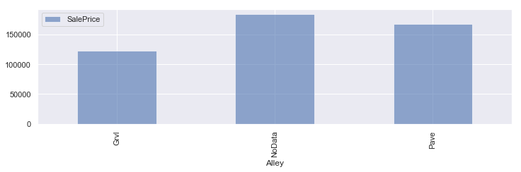
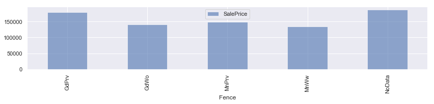
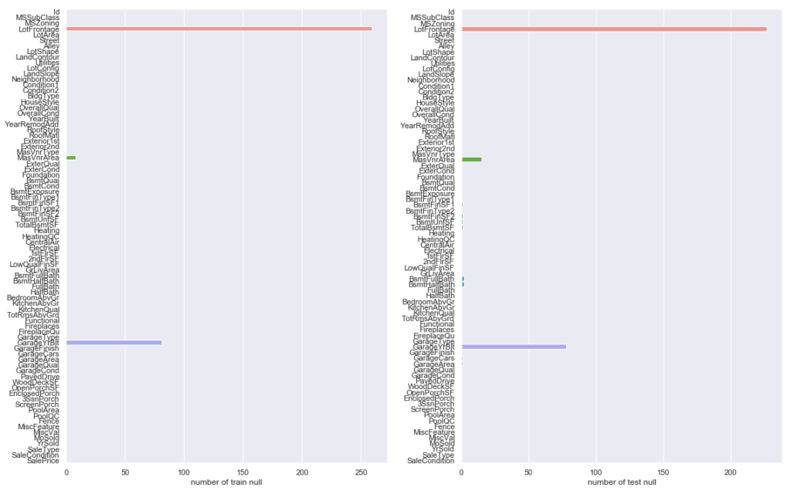
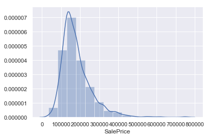
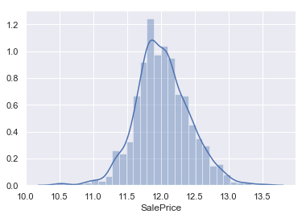

## 概要

Kaggleのチュートリアルの1つ、house priceのコンペに参加しました。

パラメータの加工に時間かかったので、前処理編として記事にします。

## コンペについて

house priceのコンペは名前の通り、住宅価格を予想するコンペになってます。

価格の予測となるので、タイタニックやMNISTのようなクラスを予想する分類問題（classification）ではなく、数値を予想する回帰問題（regression）となるのがこのコンペの特徴です。

コンペのURLは下記になります。

 [Checking your browser - reCAPTCHA www.kaggle.com](https://www.kaggle.com/c/house-prices-advanced-regression-techniques)  

ということでまずはデータの中身を確認していきます。

## 前処理

### データ確認

まずはデータの取得と中身を確認していきます。

```
#データのインポート
import pandas as pd
import numpy as np
 
import matplotlib.pyplot as plt
import seaborn as sns
sns.set()
 
train = pd.read_csv('dataset/train.csv') #学習データ
test = pd.read_csv('dataset/test.csv') #テストデータ
print('The size of the train data:' + str(train.shape))
print('The size of the test data:' + str(test.shape))
```

```
#出力結果
The size of the train data:(1460, 81)
The size of the test data:(1459, 80)
```

最初に気になるのは、カラムが81個存在することです。

全てのデータを特徴量として使うのはしんどそうです。中身を確認して内容を精査していきます。

```
#データ確認
train.head()
```



データの内容も欠損値が多そうですね。欠損値が多いものは特徴量から省いてしまおうかと思いましたが、まずは欠損値を含むデータとデータの型の確認します。

```
#欠損値の確認
train.isnull().sum()
```

```
#出力結果
Id                  0
MSSubClass          0
MSZoning            0
LotFrontage       259
LotArea             0
Street              0
Alley            1369
LotShape            0
LandContour         0
Utilities           0
                 ... 
PoolArea            0
PoolQC           1453
Fence            1179
MiscFeature      1406
MiscVal             0
MoSold              0
YrSold              0
SaleType            0
SaleCondition       0
SalePrice           0
Length: 81, dtype: int64
```

```
#データの型確認
train.dtypes
```

```
#出力結果
Id                 int64
MSSubClass         int64
MSZoning          object
LotFrontage      float64
LotArea            int64
Street            object
Alley             object
LotShape          object
LandContour       object
Utilities         object
                  ...   
PoolArea           int64
PoolQC            object
Fence             object
MiscFeature       object
MiscVal            int64
MoSold             int64
YrSold             int64
SaleType          object
SaleCondition     object
SalePrice          int64
Length: 81, dtype: object
```

object型、float,int型など、数値、名義どちらのデータでも欠損値が含まれてます。

これは分けて考える必要がありそうですね。

PoolQC、Fence、MiscFeatureなどのObject変数のデータに欠損値が多いので、まずはobject変数のデータから加工していきましょう。

### Object変数の加工

このコンペにはdata\_description.txtというデータの内容を説明するドキュメントが添付されており、データの意味について理解することができます。

確認してみると欠損値が多かったPoolQCは備え付けのプールのクオリティを表しており欠損値であるNAはNo Pool（プールのない物件）と記載されていました。

つまり、欠損値のデータ自体に意味があると考えられるので、むやみにdropしてはいけないデータだと考えられます。

欠損値が多かったパラメータについて、欠損値をダミーで埋めたうえで、価格との関係を見てみましょう。

```
#欠損値が多かったパラメータの欠損値をNoDataに変換
train_cp = train
train_cp['PoolQC'] = train_cp["PoolQC"].fillna('NoData')
train_cp['Alley'] = train_cp["Alley"].fillna('NoData')
train_cp['Fence'] = train_cp["Fence"].fillna('NoData')
#平均値算出
df1 = train_cp.groupby('PoolQC').mean()
df2 = train_cp.groupby('Alley').mean()
df3 = train_cp.groupby('Fence').mean()
fig = plt.figure(figsize=(16,6))
ax = fig.add_subplot(1,2,1)
#グラフ化
df1.plot.bar(y=['SalePrice'], alpha=0.6, figsize=(12,3))
df2.plot.bar(y=['SalePrice'], alpha=0.6, figsize=(12,3))
df3.plot.bar(y=['SalePrice'], alpha=0.6, figsize=(12,3))
plt.tight_layout()
plt.show()
```







PoolQC,Alley,FenceともにNoDataが特徴のあるデータになってます。

Alley（路地）、Fence（フェンス）もデータの内容を確認しましたが、同様に欠損値そのものに意味があるデータでした。

そのためこのコンペでは欠損値自体もデータとして扱うことにしましょう。

obfect変数で、欠損値を含むカラムをNoDataで補間していきます。

```
#na_col_listに欠損値を含む説明変数のリストを作成
na_col_list_tra = train.isnull().sum()[train.isnull().sum()>0].index.tolist()
na_col_list_test = test.isnull().sum()[test.isnull().sum()>0].index.tolist()
na_obj_tra = train[na_col_list_tra].dtypes[train[na_col_list_tra].dtypes=='object'].index.tolist() #教師データのobject抽出
na_obj_test = test[na_col_list_test].dtypes[test[na_col_list_test].dtypes=='object'].index.tolist() #テストデータのobject抽出
#教師データの欠損値をNoDataで補間
for i in na_obj_tra:
    train.loc[train[i].isnull(),i] = 'NoData'
#テストデータの欠損値をNoDataで補間
for j in na_obj_test:
    test.loc[test[j].isnull(),j] = 'NoData'
```

### 数値データの加工

object変数の処理は終了したのでint,float型の確認をしていきます。

object変数の欠損値は補間済みなので、欠損値　＝　数値データ　と考えられます。

説明変数ごとの欠損値の数をグラフ化してみます。

```
#欠損値の確認
countnull = train.isnull().sum()
f, ax = plt.subplots(figsize=(11, 9))
sns.barplot(x=countnull, y=train.columns.values, orient='h')
#sns.barplot(x=train2.columns.values, y=countnull, orient='h')
ax.set_xlabel("null count")
plt.tight_layout()
plt.show()
```



教師データの方は欠損値を含む数値データのカラムが3件、テストデータの方は9件程度見られました。

欠損値が多かった、LotFrontageとGarageYtBltについてですが、

GarageYtBltは、ガレージの築年数。LotFrontageはpropety（資産？）までの直線距離というデータとなっています。

どちらも欠損値にも意味がありそうなデータだと思いましたが、変に補間するとややこしいので省いていきます。

残りの欠損値を含むカラムについては、全部見るの面倒なので中央値で補間することにします。

```
#LotFrontageとMasVnrAreaを省く
train = train.drop(['LotFrontage','MasVnrArea'], axis=1)
test = test.drop(['LotFrontage','MasVnrArea'], axis=1)
#残りの欠損値を中央値で補間する
train = train.fillna(train.median())
test = test.fillna(test.median())
```

データを確認したところ問題なだそうだったので、説明変数の前処理は終了です。

### 目的変数の分布を確認

最後に目的変数の分布を確認しておきます。

```
#目的変数の分布を確認
sns.distplot(train['SalePrice'],bins=15,label='SalePrice')
```



やや右側に尾を引くような分布になっており、きれいな正規分布とはなってません。

回帰分析をする上では正規分布にならなければ精度が下がるそうなので、対数変換を利用して正規分布に変換します。

```
#対数変換
SalesPrice = np.log(train2['SalePrice'])
sns.distplot(SalesPrice,bins=30,label='SalePrice')
```



正規分布に変換できました。これで前処理終了です。

## 次したい事

今回は説明変数が多かったため、前処理だけの記事となりましたが、次回モデル作成までやっていきます。
