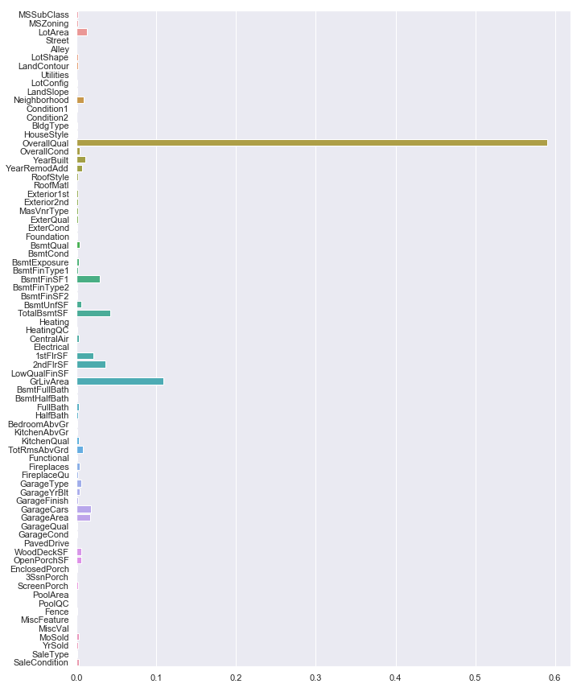
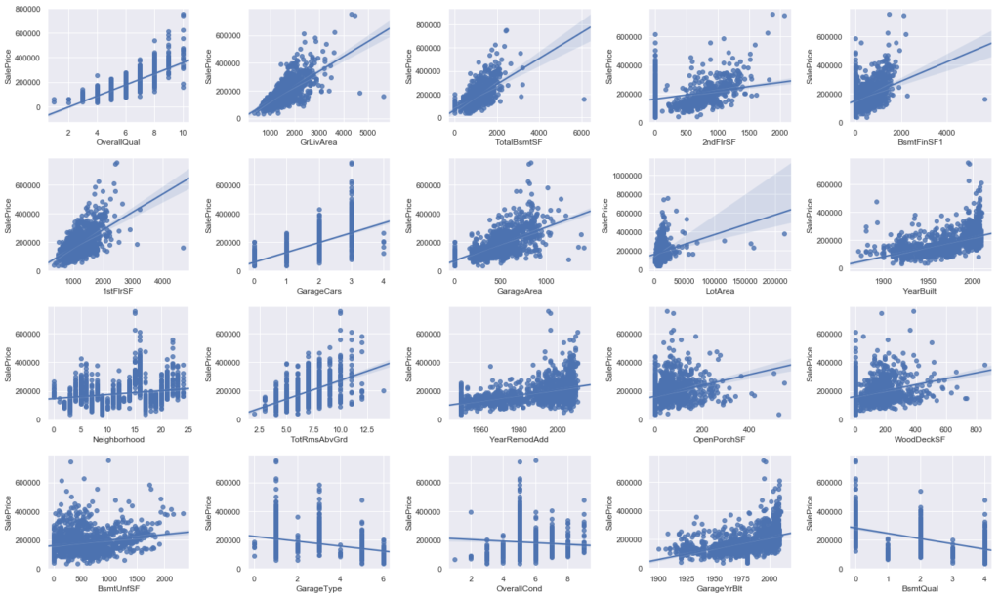
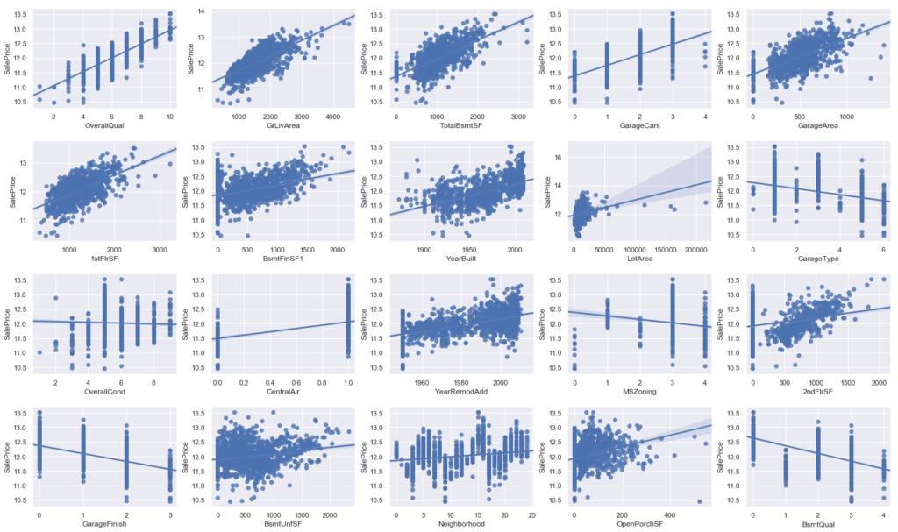
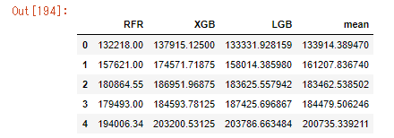
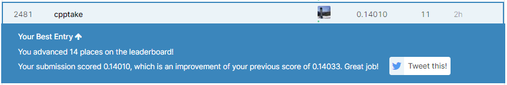

しぃ たけ

Kaggle本によく書かれているアンサンブル学習試してみました。

## 概要

前回、前処理まで行ったHousePriceのコンペの続きをやっていきます。

今回一番やりたいことは、アンサンブル学習を使ってどれくらい精度が向上するのかを検証することです。

前処理の方法については前回の記事をご覧ください。

[404 NOT FOUND \| しぃたけ LOG Pythonと機械学習をメインで発信してます。 cpptake.com](https://cpptake.com/2020/05/13/)【house-price】住宅価格予測コンペ前処理編/

それでは進めていきます。

## 特徴量の選定

### LabelEncording

特徴量を選定するため、

Object変数をLabelEncordingで離散化していきます。

```python
# ラベルエンコーダーセット
from sklearn.preprocessing import LabelEncoder
Z
le= LabelEncoder()

#カテゴリカル変数のみを離散化する。
for i in range(train2.shape[1]):
    if train2.iloc[:,i].dtypes == object:
        
        le.fit(list(train2.iloc[:,i].values) + list(test2.iloc[:,i].values))
        train2.iloc[:,i] = le.transform(list(train2.iloc[:,i].values))
        test2.iloc[:,i] = le.transform(list(test2.iloc[:,i].values))

#結果の確認
train2.dtypes
```

```python
#出力結果
Id                 int64
MSSubClass         int64
MSZoning           int64
LotArea            int64
Street             int64
Alley              int64
LotShape           int64
LandContour        int64
Utilities          int64
LotConfig          int64
LandSlope          int64
                  ...   
ScreenPorch        int64
PoolArea           int64
PoolQC             int64
Fence              int64
MiscFeature        int64
MiscVal            int64
MoSold             int64
YrSold             int64
SaleType           int64
SaleCondition      int64
SalePrice          int64
Length: 79, dtype: object
```

確認したところ離散化できていたので、教師データとテストデータを準備していきます。

```python
#教師データ、テストデータ設定
y_train = train2['SalePrice']
X_train = train2.drop(['Id','SalePrice'], axis=1)
X_test = test2.drop(['Id'], axis=1)
```

### feature importanceで重要度の確認

全部で70個以上の説明変数が存在するので、すべてを特徴量には使えなさそうなので住宅価格に効いているもののみを選び、学習させていきます。

特徴量の選定には効いている目的変数と相関が強い説明変数を計算してくれる、ランダムフォレストのfeature importancesメソッドを使っていきます。

```python

#ランダムフォレスト回帰木セット
from sklearn.ensemble import RandomForestRegressor as RFR
rf = RFR(n_estimators=80, max_features='auto')
rf.fit(X_train, y_train)


f, ax = plt.subplots(figsize=(11, 15))
sns.barplot(x=rf.feature_importances_, y=X_train.columns.values, orient='h')
```



‘OverallQual’,’GrLivArea’の重要度が高く、それ以外は大きく寄与していなさそうです。  
全部の説明変数を特徴量に使う必要ないので、省いていきます。

数えてみたところ、上位20項目くらいで全体の9割以上寄与しているので、上から20項目のみ抽出します。

```python
#影響度の順番に並び替え 
org_sort = np.argsort(-rf.feature_importances_)

#f, ax = plt.subplots(figsize=(11, 19))
#sns.barplot(rf.feature_importances_[org_sort], y=X_train.columns.values[org_sort], orient='h')

X_train = X_train.iloc[:,org_sort[:20]]
X_test = X_test.iloc[:,org_sort[:20]]

X_train.head()
```

### 特徴量と目的変数の関係と外れ値の削除

目的変数である、’SalesPrice’と選んだ20個の特徴量の関係を可視化してみます。

```plane
#目的変数と説明変数の2変量の関係を描画
fig = plt.figure(figsize=(20,12))

for i in range(20):
    
    #4×5のグラフを作成。
    ax = fig.add_subplot(4,5,i+1)
    #目的変数（SalePrice)をy軸に、説明変数をx軸にプロット
    sns.regplot(x=X_train.iloc[:,i], y=y_train)

plt.tight_layout()
plt.show()
```



グラフ化してみると、

‘OverallQual’,’GrLivArea’,’TotalBsmtSF’などの上位のデータと’SalesPrice’の間にきれいに線形の相関がみられること、

‘GrLivArea’,’TotalBsmtSF’,’1stFlrSF’,’BsmtFinSF1′ あたりに外れ値らしきデータが存在すること

などがわかります。とりあえず外れ値は消していきましょう。

```plane
# 'GrLivArea','TotalBsmtSF'の外れ値削除
Xmat = X_train
Xmat['SalePrice'] = y_train
Xmat = Xmat.drop(Xmat[(Xmat['GrLivArea']>4500)].index)
Xmat = Xmat.drop(Xmat[(Xmat['TotalBsmtSF']>4000)].index)


# 結果を教師データに反映
y_train = Xmat['SalePrice']
X_train = Xmat.drop(['SalePrice'], axis=1)


# 外れ値除外できているか確認。
fig = plt.figure(figsize=(20,12))

for i in range(20):
    
    ax = fig.add_subplot(4,5,i+1)
    sns.regplot(x=X_train.iloc[:,i], y=y_train)

plt.tight_layout()
plt.show()
```



外れ値消えてますね。

これで特徴量加工終了です。

## モデル作成とパラメータ調整

### モデルの作成

まずは、モデル作成前に特徴量を標準化していきます。

```plane
# z-scoreにて標準化
X_train = (X_train - X_train.mean()) / X_train.std()
X_test = (X_test - X_test.mean()) / X_test.std()
```

ようやくモデル作成パートです。上記で準備した特徴量を使って学習させていきます。

今回は、RandomForest、XGBoost、LightGBM　の3つのアルゴリズムを学習に利用することにします。

こいつらを選んだ理由は、特徴量の離散化にLabelEncordingを使っているので、決定木系のアルゴリズムを選ぶ必要があったためです。

まずは、インポートと学習をさせていきます。

```plane
#利用するモデルをインポート
from sklearn.ensemble import RandomForestRegressor as RFR
import xgboost as XGB
from lightgbm import LGBMRegressor

#ランダムフォレスト
rfr = RFR().fit(X_train,y_train)

#XGBoost
xgb = XGB.XGBRegressor().fit(X_train,y_train)

#lightgbm 
lgb = LGBMRegressor().fit(X_train, y_train)
```

### パラメータ調整

次に、GridSearchを利用してハイパーパラメータの調整をしていきます。

パラメータの水準は効きそうな項目を適当に設定します。

```plane
from sklearn.model_selection import GridSearchCV

#ランダムフォレストのパラメータ調整
rfr_grid = GridSearchCV(rfr,cv=5,param_grid = {'n_estimators':[25, 100, 500, 1000],
              'min_samples_split':[0.5,2,4,10],
              'min_samples_leaf':[1,2,4,10],
              'max_features':[2,4,8],
              'bootstrap':[True, False]
              })

rfr_grid = rfr_grid.fit(X_train, y_train)
rfr_grid_best = rfr_grid.best_estimator_

print("best params = ",rfr_grid.best_params_)


# XGBoostのパラメータ調整
from sklearn.model_selection import GridSearchCV
                
xgb_grid = GridSearchCV(xgb, cv=5, param_grid = {'max_depth': [2,4,6],
                'n_estimators': [50,100,200],
                 'gamma':[0.1, 0.5, 1.0],
                 'min_child_weight':[1,3,5]
                 })
xgb_grid = xgb_grid.fit(X_train, y_train)
xgb_grid_best = xgb_grid.best_estimator_

print("best params = ",xgb_grid.best_params_)


#LightGBMのパラメータ調整
lgb_best = GridSearchCV(lgb,cv=5,param_grid = {
    'max_depth':[-1,5,7,9],
    'bagging_fraction':[0.1,0.5,0.7,0.9],
    'learning_rate': [0.0001,0.001,0.01,0.1],
    'bootstrap':[True, False]
     })

lgb_best = lgb_best.fit(X_train, y_train)
rfr_grid_best = lgb_best.best_estimator_

print("best params = ",lgb_best.best_params_)
```

計算終了です。ベストパラメータの中身については割愛しますが、上記のパラメータで学習させてまずは普通に提出してみましょう。

### csv出力と提出

前項で計算終わった、パラメータを使って学習、提出していきます。

まずは、ベストパラメータで学習させます。

```plane
#ランダムフォレストのベストのパラメータを入れて学習。
rfr_best = RFR(n_estimators=100,
                max_features = 8,
                min_samples_split = 2,
                min_samples_leaf = 1,
                bootstrap = False,
                random_state = 0)
rfr_best.fit(X_train,y_train)


#XGBoostのベストパラメータを入れて学習
xgb_best = XGB.XGBRegressor(n_estimators=200,
                max_depth = 2,
                min_child_weight = 3,
                gamma = 0.1)
xgb_best.fit(X_train,y_train)


#LightGBMのベストパラメータを入れて学習
lgb_best = LGBMRegressor(bagging_fraction = 0.1,
                        bootstrap = True,
                        learning_rate = 0.1,
                        max_depth = 5)
lgb_best.fit(X_train,y_train)
```

```plane
#ランダムフォレスト（パラメータ調整後）予測結果の出力
y_pred_rfr_best = rfr_best.predict(X_test)
Id = np.array(test['Id']).astype(int)
my_rfr_solution = pd.DataFrame(y_pred_rfr_best, Id, columns = ["SalePrice"])

# csvに書き出し
my_rfr_solution.to_csv("my_rfr_best.csv", index_label = ["Id"])


#XGBoost（パラメータ調整後）の予測結果出力
y_pred_xgb_best = xgb_best.predict(X_test)
my_xbg_solution = pd.DataFrame(y_pred_xgb_best, Id, columns = ["SalePrice"])
my_xbg_solution.to_csv("my_xbg_best.csv", index_label = ["Id"])


#LightGBMの（パラメータ調整後）予測結果の出力
y_pred_lgb_best =lgb_best.predict(X_test)
my_lgb_solution = pd.DataFrame(y_pred_lgb_best, Id, columns = ["SalePrice"])
my_lgb_solution.to_csv("my_lbg_best.csv", index_label = ["Id"])
```

上記の３つのモデルをKaggleに提出した結果、下記のような結果となりました。

・RandomForestのモデル　　　 Score ： 0.14859

・XGBoostのモデル　　　　　　Score： 0.14977

・LightGBMのモデル　　　　　Score ： 0.14118

ScoreはRMSEの値となるので、**Scoreが低いほど精度が高いモデル**といえます。

そのため今回のモデルの精度は

LightGBM　＞　RandomForest　＞　XGBoost

ということになりますね。

さぁ、この3つのモデルの結果を使ってアンサンブル学習のパートに移っていきましょう！

## アンサンブル学習

最後に、前章で作成した3つのモデルを使って、

**アンサンブル学習を試していきたいと思います。**

正直、今回の記事はこれがしたかっただけといっても過言ではないです。

### アンサンブル学習とは？

アンサンブル学習は、

**複数のモデルを組み合わせて予測をすることで、予測精度を高める手法のことです。**

手法としては、いくつかモデルを作って平均値で予測をする手法と、スタッキングと呼ばれる方法で予測をする手法が存在します。

今回は簡単に、前章で作成した３つのモデルの加重平均で予測モデルを作成する方法を試していきます。

### 加重平均の重みを決定

まずは、3つモデルの予測結果をDaraFrameに入れていきます。

```plane
#3つのモデルの予測値を集めたDataFrame作成
emsemble_train = pd.DataFrame( {'RFR': rfr_best.predict(X_train),
    'XGB': xgb_best.predict(X_train),
    'LGB': lgb_best.predict(X_train)
    })

#テストデータの予測値
emsemble_test = pd.DataFrame( {'RFR': rfr_best.predict(X_test),
    'XGB': xgb_best.predict(X_test),
    'LGB': lgb_best.predict(X_test)
    })
```

emsemble\_testにテストデータの予測値が格納されている状態になりました。

次に、各モデルにつける加重平均の重みづけを考えます。

作成した3つのモデルは、下記の順番で精度が高かったです。

LightGBM　＞　RandomForest　＞　XGBoost

そのため、精度が高いLightGBMモデルに重みを強くする設定し、精度が悪かったXGBoostの重みは小さくする必要があるので、下記の重み付でモデル作成してみます。

**アンサンブルモデル = LGB ×0.5 + RFR × 0.3 + XGB ×0.2**

```plane
#加重平均で3つのモデルの平均値を算出
#LightGBMの予測値の重み付けを強くに、XGBoostを弱くする。
mean = emsemble_test['LGB']*0.5 + emsemble_test['RFR']*0.3 + emsemble_test['XGB']*0.2

#予測値の結果確認
pred_total = pd.DataFrame({'RFR': rfr_best.predict(X_test),
    'XGB': xgb_best.predict(X_test),
    'LGB': lgb_best.predict(X_test),
    'mean': mean
    })
pred_total.head()
```



mean列が今回作成した、アンサンブル学習の結果となりました。

ほかのモデルの平均くらいの値になっているので、うまくいってますね。

このデータでKaggle提出してみましょう。

### 提出

Kaggleに提出した結果がこちらになります！



荷重平均のアンサンブルモデル　　　Score： 0.14010

前回一番精度の高かったLightGBMのモデルのScoreが ****0.14118****であったため

**荷重平均をとるだけで精度が向上しました！**

## 感想

今回はHousePriceのコンペで、アンサンブル学習を利用して精度が向上することがわかりました。

最後の精度の追い込みで使えそうですね。
