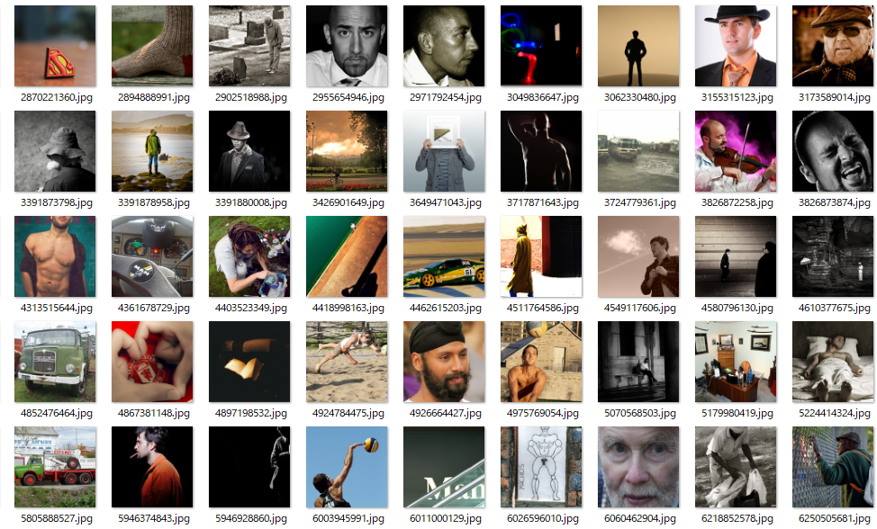
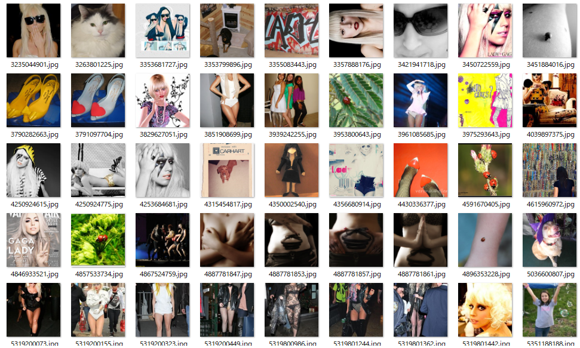
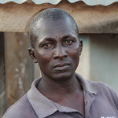
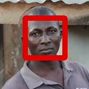
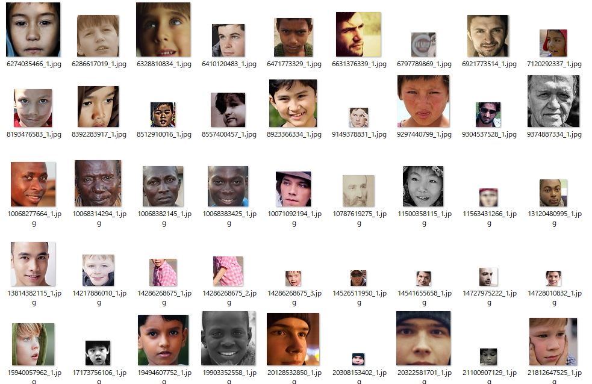
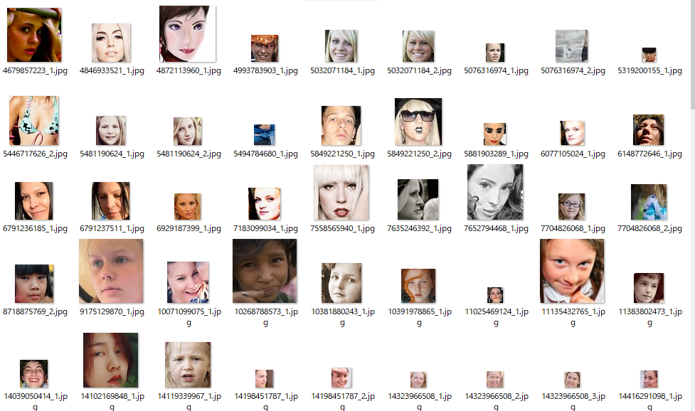

しぃたけ

機械学習のための、スクレイピング、顔検出の方法を残します。

## 概要

### なんでやるか

Udemyや、Kaggleで得た知識で何か作りたくて、AIアプリケーション作成に挑戦しました。

### 作りたいもの

男女の写真をCNN（畳み込みニューラルネットワーク）を使って学習させて、次に来る人物の性別を予測するモデルを作成します。

完成したら、Webアプリケーション化してサーバーにアップロードするところまでやりたいと思います。

ちなみに最初は可愛い子判別システム作ろうかと思ったんですが、倫理的に完全にアレなのでシンプルに男女識別にしました。

ブログを始めて1か月ちょっと、文章力よりリテラシーが上がりましたね。はい。

### 今回の記事のゴール

男女識別のモデル作成の手順は、

- ネット上からフリーの人物画像集めてくる（スクレイピング）
- 集めた画像から、顔の部分だけ切り取って保存する（顔検出）
- 顔部分の画像を学習に用いて、モデル作成（CNN予定）
- モデル評価

の流れになります。この中で今回の記事では、上から2つ目までの

**スクレイピング　～　顔検出**

までをやっていきます。

環境はWindows10、JupyterNotebook、Python3.6となっております。

### 21/5/26追記

本記事のソースコードはgithubにアップしているので、興味あればご覧ください。

 [GitHub - cpptake/man\_woman\_cnn\_part1 Contribute to cpptake/man\_woman\_cnn\_part1 development by creating an account on GitHub. github.com](https://github.com/cpptake/man_woman_cnn_part1)  

## スクレイピング

### Flickrの利用

画像の収集には、APIで簡単に画像の収集が可能なFlickrを利用します。（[サイト](https://www.flickr.com/)）

サイトに登録して、APIキーとを取得する必要があるので、詳しくはこちらを参照ください。

 [https://syncer.jp/flickr-api-matome syncer.jp](https://syncer.jp/flickr-api-matome)   

### スクレイピングツール作成

FlickrAPIを利用して画像を収集します。

コードは下記の通りです。

なお、第一引数に検索したい画像の単語を入力する形になったいます。

```
#import
from flickrapi import FlickrAPI#flickrapiはあらかじめpip installが必要
from urllib.request import urlretrieve
from pprint import pprint
import os, time , sys
#APIキーの情報
key="この部分は自分のAPIキーを利用"
secret = "この部分は自分のAPIキーを利用"
wait_time = 1 #処理が速すぎるとサーバーに負荷がかかるため時間を設定
#保存フォルダの指定
search_name = sys.argv[1]#第一引数に抽出したい画像のキーワードを入力する。
savedir = "./" + search_name
flickr = FlickrAPI(key,secret,format = 'parsed-json')
result = flickr.photos.search(
    text = search_name,#検索したい画像のキーワード
    per_page = 400,#最大枚数
    media ='photos',#検索するデータの種類
    sort = 'relevance',#検索の関連順
    safe_search = 1,#有害コンテンツを非表示にするオプション
    extras = 'url_q, licence'#画像のURLを取得
)
photos = result['photos']
#取得したURLにある画像を格納する。
for i,photo in enumerate(photos['photo']):
    url_q = photo['url_q']
    filepath = savedir + '/' + photo['id']+'.jpg'
    if  os.path.exists(filepath):continue
    urlretrieve(url_q,filepath)
    time.sleep(wait_time)
print("done.")
```

1秒間に1枚画像を取得、最大400枚までデータを取得します。

### 出力結果

上記のスクレイピングツールで男性、女性のそれぞれのデータを抽出してみました。

なお男性は、「man」の検索語で抽出、女性は「lady」で検索した抽出した結果が以下になります。


***「man」の抽出結果***


***「lady」の抽出結果***

どちらの画像も400枚づつ抽出できました。

女性の画像は**明らかにLady GaGaが多い**のが気になります。とりあえず女性なので置いときましょう。

画像を見ると、

- 人間が写ってない画像
- 顔が鮮明に写ってない画像

などが多く見られます。

今回欲しい画像は人間の顔が写ってる画像なので削除する必要があります。

### 外れ値の削除

人間でない画像、顔が映ってない画像など、学習用のデータとして適してない画像は手動で消していきます。

外れ値を消した結果、画像の総数は

- 男性の画像数　400枚　→　101枚
- 女性の画像数　400枚　→　141枚

とデータが半分以下になってしまいました。

**しかも女性の画像の多くはLady GaGaです。**

もう男女識別じゃなくてLady GaGa識別システムになりかねません。

### ｎ増し

足りないデータを補うために、検索方法をいろいろ変更してデータ量を増やしていきます。

男性は「boy」「gentleman」「male」などの言葉で検索、

女性は「woman」「girl」「female」を使って検索をかけ、上記と同様の手順で外れ値の削除をおこないました。（詳細は割愛）

結果は下記のとおりです。こんだけあればOKでしょう。

- 男性の画像数　・・・　493枚
- 女性の画像数　・・・　548枚

余談ですが、Flickrの検索だけでは人物の画像があまり手に入らなかったため、一部ChromeのImageDownloaderの機能を利用してデータ集めを行いました。

男性の画像が欲しくて「male」で検索をかけたところ、人間じゃなくて大量の雄の動物の画像が取得されたりしたためです。

Flickrで抽出した画像だと、実際に使える人物の画像は400枚中40枚くらいだったりしたので、データの取得方法は１つに限る必要ないかと思います。

## 顔領域の抽出

次に抽出したデータから顔部分のみを切り取って保存していきます。

ここの処理方法については下記のnishipyさんのコードを参考に作らせていただきました。ありがとうございます。

 [機械学習でオバマとスモーリングを判別したい-前編- Nishipyある界隈で似ていると評判のオバマとスモーリングを、機械学習を使って判別します。前編では、訓練データを用意していきます。1. はじめに1.1. 背景遡ること2014年、ブラジルでサッカーW杯が開催されていました。サッカーの母国イ nishipy.com](https://nishipy.com/archives/630)  

### 顔検出練習

顔検出には、openCVのCascadeClassifierを用います。

ちなみにCascadeClassifierに必要なxmlファイルはあらかじめローカルに保存する必要があります。

githubに必要なファイルがあるので利用する際は、こちら参照ください。（[opencv/haarcascades](https://github.com/opencv/opencv/tree/master/data/haarcascades)）

自分は、正面の顔検知のhaarcascade\_frontalface\_alt2.xmlを利用しました。

まずは、抽出したデータを使って顔検出の練習してみます。

```
import cv2
import matplotlib.pyplot as plt
import numpy as np
import sys, os
from PIL import Image
#適当な画像を一枚読み込み、表示
imtest = cv2.imread('./rowdata/man/10068382145.jpg')
plt.imshow(imtest)
```

出力画像



適当に選ばれたこのダンディなおじさんの顔領域をCascadeClassifierで抽出してみます。

```
cascade_path = "./opencv/data/haarcascades/haarcascade_frontalface_alt2.xml"
cascade = cv2.CascadeClassifier(cascade_path)
facerect = cascade.detectMultiScale(imtest, scaleFactor=1.1, minNeighbors=1, minSize=(1, 1))
for rect in facerect:
    #認識結果の保存
    x = rect[0]
    y = rect[1]
    width = rect[2]
    height = rect[3]
    dst = imtest[y:y + height, x:x + width]
    
        #for [xx, yy, w, h] in facerect:
    print("顔の座標 =", facerect)
    color2 = (0, 0, 225)
    pen_w = 8
    cv2.rectangle(imtest, (x, y), (x+width, y+height), color2, thickness = pen_w)
    cv2.imwrite("after.jpg", imtest)
```

顔検出後出力画像



赤枠が顔の領域を表すエリアになっています。

きれいに顔の認識ができていますね。この方法で全データの顔領域を切り取る処理を書いていきます。

### 顔領域抽出

前項のCascadeClassifierでの顔検出の方法を全データに適用し、顔の領域のみを切り取っていきます。

コードは以下になります。

```
#入力ファイルのパスを指定
in_img_man = "./rowdata/man/"
in_img_woman = "./rowdata/woman/"
out_img_man = "./facedata/man/"
out_img_woman = "./facedata/woman/"
cascade_path = "./opencv/data/haarcascades/haarcascade_frontalface_alt2.xml"
#画像データのリストを取得
in_man_files = os.listdir(in_img_man)
in_woman_files= os.listdir(in_img_woman)
#全データに対して適用
for im in in_man_files:
    
    image_path = os.path.join(in_img_man, im)
    print("-----------------------------------------------------------------------------------------")
    print(image_path)
    
    cascade_path = "./opencv/data/haarcascades/haarcascade_frontalface_alt2.xml"
    image_gs = cv2.imread(image_path)
    #image_gray = cv2.cvtColor(image, cv2.IMREAD_GRAYSCALE) #グレースケール変換
    cascade = cv2.CascadeClassifier(cascade_path)
    facerect = cascade.detectMultiScale(image_gs, scaleFactor=1.1, minNeighbors=1, minSize=(1, 1))
    
    i_faces = 1
    if len(facerect) > 0:
        #検出した顔を囲む矩形の作成
        for rect in facerect:
            #cv2.rectangle(image, tuple(rect[0:2]),tuple(rect[0:2]+rect[2:4]), color, thickness=2)
            #認識結果の保存
            x = rect[0]
            y = rect[1]
            width = rect[2]
            height = rect[3]
            dst = image_gs[y:y + height, x:x + width]
            
            out_man_name = im.split(".")[0] + "_" + str(i_faces) + ".jpg"
            save_path = os.path.join(out_img_man, out_man_name)
            print(save_path)
            cv2.imwrite(save_path, dst)
            
            i_faces += 1
    else:
        print("No faces detected.")
        continue
    print("done.")
```

出力された顔領域の画像がこちらです。


***男性顔画像***


***女性顔画像***

大小様々なお顔が取得できました。

案の定Lady GaGaが多いですがほかの女性もいるのでこのままにしときます。

時々顔でない画像が混ざってるので、こちらも目視で削除していきます。

学習に用いる顔の画像データは下記のようになりました。

- 男性画像　・・・　231枚
- 女性画像　・・・　258枚

これで前処理終了です。

## まとめ

男女識別アプリケーションを作成するための、

- データ収集（スクレイピング）
- 顔検出

を実施しました。

次回はCNNでモデル作成していきます。
