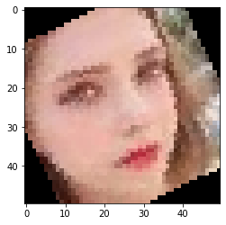
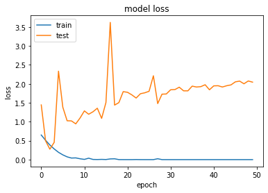
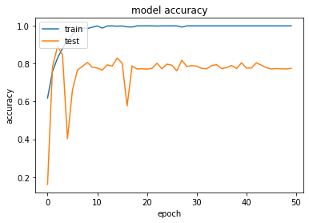
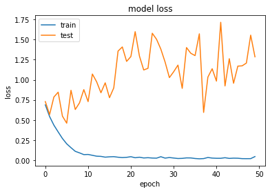
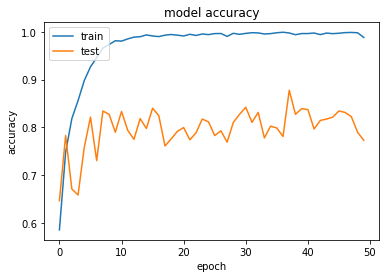

## 概要

男女識別アプリケーションの2回目です。

前回、データのスクレイピング　～　顔エリアの抽出　を実施したので今回はこのデータを利用してCNNを使った男女識別器を作成していきます。

データ収集などの方法については前回の記事をご参照ください。

[CNNで男女識別器を作るまで【スクレイピング～顔検出編】 しぃたけ機械学習のための、スクレイピング、顔検出の方法を残します。概要なんでやるかUdemyや、Kaggleで得た知識で何か作りたくて、AIアプリケーション作成に挑戦しました。作りたいもの... cpptake.com 2020.06.02](http://cpptake.com/archives/268)

### 21/5/26追記

今本記事のソースコードはgithubにアップしているので、興味あればご覧ください。

 [GitHub - cpptake/man\_woman\_cnn\_part1 Contribute to cpptake/man\_woman\_cnn\_part1 development by creating an account on GitHub. github.com](https://github.com/cpptake/man_woman_cnn_part1) 

[画像](https://ir-jp.amazon-adsystem.com/e/ir?t=cpptake-22&l=am2&o=9&a=B084HPGQ9W)[画像](https://ir-jp.amazon-adsystem.com/e/ir?t=cpptake-22&l=am2&o=9&a=B084HPGQ9W)[画像](https://ir-jp.amazon-adsystem.com/e/ir?t=cpptake-22&l=am2&o=9&a=B084HPGQ9W)[画像](https://ir-jp.amazon-adsystem.com/e/ir?t=cpptake-22&l=am2&o=9&a=B084HPGQ9W)[画像](https://ir-jp.amazon-adsystem.com/e/ir?t=cpptake-22&l=am2&o=9&a=B084HPGQ9W)

## 顔データの水増し

### データのインポート

まずは、顔画像が保存されている場所を設定します。

```python
#データの保存場所のパスを設定
base_dir = "./facedata/"

train_dir = os.path.join(base_dir, 'train')
test_dir = os.path.join(base_dir, 'test')
train_man = os.path.join(train_dir, '/man')
test_man = os.path.join(test_dir, '/man')
train_woman = os.path.join(train_dir, 'woman')
test_woman = os.path.join(test_dir, 'woman')
dir_list = [train_dir, test_dir, train_man, test_man, train_woman, test_woman]

org_man_dir = './facedata/man/'
org_woman_dir = './facedata/woman/'
man_faces = os.listdir(org_man_dir)
woman_faces = os.listdir(org_woman_dir)
```

教師データ、テストデータの設定をします。

```python
classes = ["man","woman"]
num_classes = len(classes)
image_size = 50
num_testdata = 50

#データの箱準備
X_train = []
X_test = []
Y_train = []
Y_test = []
```

### データの水増し

前回用意した画像は

- 男性　・・・　252枚
- 女性　・・・　253枚

と、CNNで学習するにはn数が少ないため、データの水増しを行います。

データの水増しは、教師データの画像を回転させたり、反転させたりすることで同様の画像から複数の画像を生成していきます。

自分は手動で回転させましたが、KerasのライブラリにはImageGeneratorというデータの水増し機能が備わっているみたいです。（[Keras ImageGenerator](https://keras.io/ja/preprocessing/image/)）

使ってみたい方は参照ください。

```python
#データの水増し
import os,glob
import numpy as np
from PIL import Image

#男性女性のデータを選択するパート
for index, classlabel in enumerate(classes):
    photos_dir = "./facedata/" + classlabel
    files = glob.glob(photos_dir+"/*.jpg")

#画像データを50×50のnumpy形式に変換
    for i, file in enumerate(files):
        if i >= 253: break
        image = Image.open(file)
        image = image.convert("RGB")
        image = image.resize((image_size,image_size))
        data = np.asarray(image)
        
#50枚をテストデータにする
        if i < num_testdata:
            X_test.append(data)
            Y_test.append(index)
            
        else:
            X_train.append(data)
            Y_train.append(index)
            
            #角度を5度づつ、±30度までずらしてｎ増し（trainデータのみ）
            for angle in range(-30,30,5):
                num = 1
                img_r = image.rotate(angle)
                data = np.asarray(img_r)
                
                X_train.append(data)
                Y_train.append(index)

                #反転
                img_trans = image.transpose(Image.FLIP_LEFT_RIGHT)
                data = np.asarray(img_trans)
                X_train.append(data)
                Y_train.append(index)
                
                num += num
```

おそらく処理が完了しました。最後に処理された画像を確認してみましょう。

```python
import matplotlib.pyplot as plt
plt.figure
plt.imshow(img_r)
plt.figure
```


*出力結果*

女性の画像が30度ほど傾いてます。おそらくできてると思われます。

念のため、教師データ、テストデータのデータ数を確認します。

```python
print(len(X_train),len(X_test),len(y_train),len(y_test))
```

```python
#出力結果
10125 100 10125 100
```

教師データのみ、データ数が増加してます。これで水増し完了です。

## モデル作成

### テスト、教師データの整理

テストデータと、教師データをnumpy方式に変換します。

```python
X_train = np.array(X_train)
X_test = np.array(X_test)
y_train = np.array(Y_train)
y_test = np.array(Y_test)

#分割したデータを保存
xy = (X_train,X_test,y_train,y_test)
np.save("./face_aug.npy",xy)
```

### モデル作成

モデル作成は以前の記事に使ったKerasを用いて行います。

まずはインポートから。

```python
#Kerasインポート
from keras.models import Sequential
from keras.layers import Conv2D,MaxPooling2D
from keras.layers import Activation,Dropout,Flatten,Dense
from keras.utils import np_utils
import keras
import numpy as np

#データの正規化、カテゴリカル化
X_train = X_train.astype("float")/256
X_test = X_test.astype("float")/256
y_train = np_utils.to_categorical(y_train, num_classes)
y_test = np_utils.to_categorical(y_test,num_classes)
```

次にCNN（畳み込みニューラルネットワーク）を実装していきます。

モデルについては以前MNISTの記事で使ったものを参考に作ってます。

```python
#モデル1
model = Sequential()
 
model.add(Conv2D(32, kernel_size=(3, 3),activation='relu',input_shape = X_train.shape[1:]))
model.add(MaxPooling2D(pool_size=(2, 2)))
model.add(Conv2D(64, (3, 3), activation='relu'))
model.add(MaxPooling2D((2, 2)))
model.add(Conv2D(128, (3, 3), activation='relu'))
model.add(MaxPooling2D((2, 2)))
model.add(Flatten())
model.add(Dense(128, activation='relu'))
model.add(Dropout(0.25))
model.add(Dense(num_classes, activation='softmax'))


#モデル１　コンパイル
model.compile(loss=keras.losses.binary_crossentropy,
              optimizer=keras.optimizers.Adadelta(),
              metrics=['accuracy'])


#学習を開始
hist = model.fit(X_train, y_train,
                 batch_size=128,
                 epochs=50,
                 validation_split=0.1,
                 verbose=1)

#スコア
scores1 = model.evaluate(X_test, y_test)
print('loss = {:.4} '.format(scores1[0]))
print('accuracy = {:.4%} '.format(scores1[1]))
```

```plane
#出力結果
・
・
・
Epoch 48/50
9112/9112 [==============================] - 25s 3ms/step - loss: 1.5701e-05 - accuracy: 1.0000 - val_loss: 2.0014 - val_accuracy: 0.7730
Epoch 49/50
9112/9112 [==============================] - 27s 3ms/step - loss: 1.5779e-05 - accuracy: 1.0000 - val_loss: 2.0755 - val_accuracy: 0.7720
Epoch 50/50
9112/9112 [==============================] - 25s 3ms/step - loss: 1.5762e-05 - accuracy: 1.0000 - val_loss: 2.0442 - val_accuracy: 0.7749

loss = 1.324
accuracy =　69.9999%
```

accuracyもlossもあんまりよくなさそうです。

学習の過程を見ていきましょう。

```python
#loss
plt.plot(hist.history['loss'])
plt.plot(hist.history['val_loss'])
plt.title('model loss')
plt.ylabel('loss')
plt.xlabel('epoch')
plt.legend(['train', 'test'], loc='upper left')
plt.show()
 
#Accuracy
plt.figure()
plt.plot(hist.history['accuracy'])
plt.plot(hist.history['val_accuracy'])
plt.title('model accuracy')
plt.ylabel('accuracy')
plt.xlabel('epoch')
plt.legend(['train', 'test'], loc='upper left')
plt.show()
```





学習が進むごとに、テストデータのlossが増えていっていて明らかに過学習していることがわかります。

これはいかんので、過学習に対応したモデルを作成しなおします。

### モデル再作成

前回の結果を活かして、過学習対策をしたモデルに変更します。

対策として今回は下記を追加することにします。

- **Dropout層の追加**
- **L2正則化項を追加**

```python
#モデル2　ドロップアウト層、L2正則化項の追加
from keras import regularizers

model2 = Sequential()
 
model2.add(Conv2D(32, kernel_size=(3, 3),activation='relu',input_shape = X_train.shape[1:]))
model2.add(MaxPooling2D(pool_size=(2, 2)))
model2.add(Dropout(0.25))#Doropout層追加
model2.add(Conv2D(64, (3, 3), activation='relu'))
model2.add(MaxPooling2D((2, 2)))
model2.add(Dropout(0.25))#Doropout層追加
model2.add(Conv2D(128, (3, 3), activation='relu'))
model2.add(MaxPooling2D((2, 2)))
model2.add(Flatten())
model2.add(Dense(128,kernel_regularizer=regularizers.l2(0.0001), activation='relu'))#L2正則化項追加
model2.add(Dropout(0.5))#Doropout引数変更
model2.add(Dense(num_classes, activation='softmax'))

#モデル2コンパイル
model2.compile(loss=keras.losses.categorical_crossentropy,
              optimizer=keras.optimizers.Adam(),#Adamの方がスコアがよかった。
              metrics=['accuracy'])


#学習を開始
hist2 = model2.fit(X_train, y_train,
                 batch_size=128,
                 epochs=50,
                 validation_split=0.1,
                 verbose=1)

#スコア
scores2 = model2.evaluate(X_test, y_test)
print('loss = {:.4} '.format(scores2[0]))
print('accuracy = {:.4%} '.format(scores2[1]))
```

```python
#出力結果
・
・
・
Epoch 48/50
9112/9112 [==============================] - 29s 3ms/step - loss: 0.0187 - accuracy: 0.9985 - val_loss: 1.2081 - val_accuracy: 0.8223
Epoch 49/50
9112/9112 [==============================] - 30s 3ms/step - loss: 0.0190 - accuracy: 0.9978 - val_loss: 1.5558 - val_accuracy: 0.7897
Epoch 50/50
9112/9112 [==============================] - 31s 3ms/step - loss: 0.0447 - accuracy: 0.9879 - val_loss: 1.2859 - val_accuracy: 0.7730
100/100 [==============================] - 0s 1ms/step
loss =　1.199
accuracy = 75.0000% 
```





結果は上記のようになりました。（グラフ描画のコードは割愛）

多少過学習はましになりましたが、20回目くらいでlossが高くなってきているので同様のモデルで20回で学習を打ち切ってみます。

```plane
#モデル2の過学習前に学習を打ち切る
model2.compile(loss=keras.losses.categorical_crossentropy,
              optimizer=keras.optimizers.Adam(),
              metrics=['accuracy'])


#学習を開始
hist2 = model2.fit(X_train, y_train,
                 batch_size=128,
                 epochs=20,#過学習はじまる前に学習打ち切り
                 validation_split=0.1,
                 verbose=1)

#スコア再計算
score27 = model2.evaluate(X_test, y_test)
print('loss = {:.4} '.format(scores3[0]))
print('accuracy = {:.4%} '.format(scores3[1]))
```

```plane
#出力結果
loss = 0.9604 
accuracy = 78.0000% 
```

少しAccuracyもlossも少し上がりました。それでも精度としてはあんまりですが、とりあえず学習の結果を保存します。

```python
    #モデルの保存
    model2.save('./man_woman_cnn.h5')
```

## 結果の考察と次したい事

### 考察

男女識別器の作成を行いましたが、精度は8割弱というあんまりな結果でした。

この原因についてのざっくり考察ですが、下記の二点が主な原因かなと考えられます。

- **学習に利用した画像が、人種、年齢、背景などに統一性がなく多様であること。**
- **教師データの元画像のn数が200枚程度しか存在しないこと。**

n数については回転、反転などを利用して水増しを行っているのですが、水増しされた画像に統一性がないので、精度も上がりにくかったのではないかと考察してます。（レディガガ画像も多いのも関係あるかも。）

これ以上精度を上げるためには、

- 学習に使う画像を限定する。（20代の日本人　など）
- 画像の限定はせず、データ数増やしてゴリ押す。

どっちかが必要だと思いました。時間とやる気があったら挑戦してみます。（やらんやつ。）

精度向上のアイデアなど詳しい方おられたら、コメントなどで教えていただけると幸いです。お待ちしてます。

なおこの考察は、同程度の画像の枚数でオバマとスモーリングの分類に成功しているnishipyさんの記事を参考にしてます。

似てる人の分類だと画像のブレがなくてやりやすいのかもですね。

 [機械学習でオバマとスモーリングを判別したい-後編- Nishipyある界隈で似ていると評判のオバマとスモーリングを、機械学習を使って判別します。後編では、前編で用意した画像を用いて、CNNを学習していきます。1. はじめに1.1. 背景詳しくは、前編の記事をご覧ください。1.2. 今回やりた nishipy.com](https://nishipy.com/archives/662)   

### 次したい事

・モデルの精度上げる

・アプリケーション化

どっちかします。
