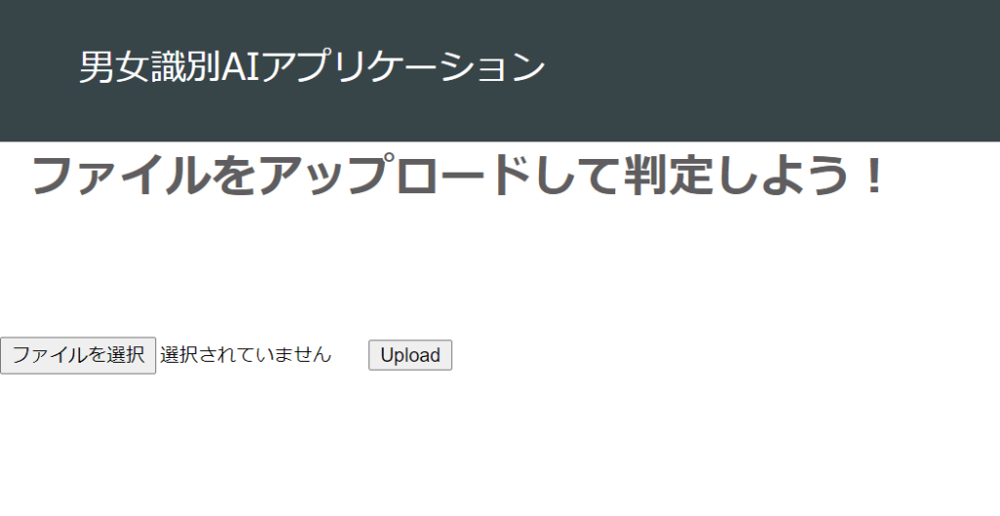
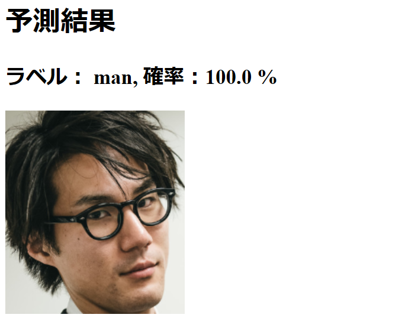
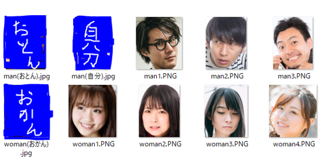
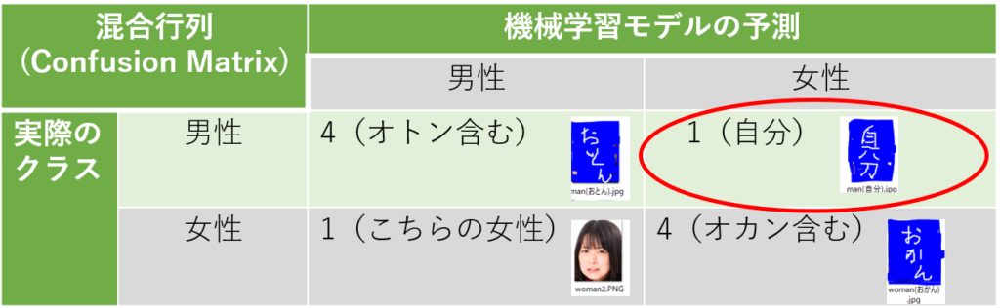

しぃたけ

PythonのWebアプリケーションのフレームワークであるFlaskを使ってアプリ作成しました。オトンとオカンの画像を、男女識別器にかけましましたが結果は如何に。

## 概要

### 概要

前回の記事で作った男女識別器を用いて、

- Flaskを使った男女識別Webアプリケーションの作成（ローカル環境）
- 家族の画像を男女識別器で分類

を行いました。

前回の記事については下記をご参照ください。

[CNNで男女識別器を作るまで【ｎ増し～モデル作成まで】 概要男女識別アプリケーションの2回目です。前回、データのスクレイピング ～ 顔エリアの抽出 を実施したので今回はこのデータを利用してCNNを使った男女識別器を作成していきます。データ収集などの方法については前回の記... cpptake.com 2020.06.13](http://cpptake.com/archives/303?_thumbnail_id=326)

### 21/5/26追記

今回の記事の内容をgithubにアップしたので気になる方は参照ください。

 [GitHub - cpptake/man\_woman\_cnn\_flaskapp Contribute to cpptake/man\_woman\_cnn\_flaskapp development by creating an account on GitHub. github.com](https://github.com/cpptake/man_woman_cnn_flaskapp)  

### 開発環境

windows10、Python3.6、Flask 1.1.2を利用してます。

## Webアプリ作成

### Flaskとは？

Falsk（フラスク）はPython用のWebアプリケーションフレームワークです。

ちなみにPythonのWebアプリケーションフレームワークとしては、FlaskとDjango（ジャンゴ）の2つが人気ですが、FlaskはDjangoに比べ軽量で、簡易にアプリケーションを作成できるという点に利点があります。

なお、Flaskの公式ドキュメントはこちらにあるので参照ください。適度に日本語約されていて利用しやすいです。（[Flask公式](https://a2c.bitbucket.io/flask/)）

ということで今回はFlaskを利用してアプリケーションを作成していきます。

### Flaskインストール

まずはAnacondaの仮想環境上にFlaskをインストールします。

コマンドプロンプト上で利用する仮想環境をactivateしていきます。

```plane
$activate 利用する仮想環境名
```

仮想環境が立ち上がったら、Flaskをpip installします。

```plane
$pip install Flask
```

Successfully installed Flask-(バージョン)が表示されたら完了です。

### 実装

下記に顔識別、ルーティングなどの実装コードを記します。

ファイル名は「app.py」となってます。

```python
import os
from flask import Flask, flash, request, redirect, url_for, render_template, send_from_directory
from werkzeug.utils import secure_filename#ファイル名をチェックする関数
from keras.models import Sequential,load_model
from PIL import Image
import keras,sys
import numpy as np

#ラベル名、識別するクラス数、リサイズ後の画像サイズ指定
classes = ["man","woman"]
num_classes = len(classes)
image_size = 50


UPLOAD_FOLDER = './uploads'
ALLOWED_EXTENSIONS = set(['png', 'jpg', 'gif'])

app = Flask(__name__)
app.config['UPLOAD_FOLDER'] = UPLOAD_FOLDER

def allowed_file(filename):
    #ファイル名に拡張子が存在するか,判定ALLOWED_EXTENSIONSで定義した拡張子であるかを判定
    return '.' in filename and filename.rsplit('.',1)[1].lower() in ALLOWED_EXTENSIONS

#TOPにルーティングした際の処理
@app.route('/', methods=['GET','POST'])#GETとPOSTのみ受け取る
def upload_file():
    if request.method == 'POST':
        if 'file' not in request.files:
            flash('ファイルがありません')
            return redirect(request.url)
        file = request.files['file']
        if file.filename == '':
            flash('ファイルがありません')
            return redirect(request.url)
        if file and allowed_file(file.filename):
            filename = secure_filename(file.filename)
            file.save(os.path.join(app.config['UPLOAD_FOLDER'],filename))

            #ファイルを識別器に渡して答えを返す。学習済みの識別器は.h5が拡張子
            filepath = os.path.join(app.config['UPLOAD_FOLDER'],filename)
            model = load_model('./man_woman_cnn.h5')

            image = Image.open(filepath)
            image = image.convert('RGB')
            image = image.resize((image_size, image_size))
            data = np.asarray(image)
            X = []
            X.append(data)
            X = np.array(X)#Xをリスト型からnumpyの型に変換

            result = model.predict([X])[0]
            predicted = result.argmax()
            percentage = float(result[predicted] * 100)

            resultmsg = "ラベル： " + classes[predicted] + ", 確率："+ str(percentage) + " %"
            return render_template('kekka.html', resultmsg=resultmsg, filepath=filepath)

    return render_template('index.html')


from flask import send_from_directory

#画像を受け取ってからの処理
@app.route('/uploads/<filename>')
def uploaded_file(filename):
    return send_from_directory(app.config['UPLOAD_FOLDER'], filename)

#おまじない
if __name__ == '__main__':
    app.run()
```

こちらがアプリのTOP画面にあたるHTML文となります。

ファイル名は「index.html」です。

```html
<!doctype html>
<html>
<head>
  <meta charset="utf-8">
  <title>男女識別AIアプリ</title>
  <link rel="stylesheet" href="{{ url_for('static', filename='style.css') }}">
</head>

<header>
  <div class="container">
    <div class="header-left">
      男女識別AIアプリケーション！
    </div>
  </div>
</header>

<body>
  <div class="heading">
      <h1>ファイルをアップロードして判定しよう！</h1>
  </div>
  <form method = post enctype = multipart/form-data>
    <p><input type=file name=file>
      <input type=submit value=Upload>
  </form>
</body>
</html>
```

最後に識別結果を返す、「kekka.html」です。

```html
<p><h1>予測結果</h1></p>

  <h2>{{resultmsg}}</h2>
  
```

CSSは割愛します。

### ローカルサーバー起動

前項の実装部分の準備ができたら、Flaskをローカル環境下で動かしてみます！

Flaskを起動する際は、下記のコマンドを入力します。

```plane
$python -m flask run --without-threads
```

なお、「–without-threads」部分については、Flaskのバージョンアップに伴い記載しないとエラーを吐くため追記しています。

上記のコマンドを実行するとこのようなメッセージが出ます。

表示されるURLにブラウザからアクセスすると画面の確認ができます。

```plane
#出力メッセージ 
* Running on http://127.0.0.1:5000/ (Press CTRL+C to quit)
```

## アプリケーションの起動

### アプリ画面

アプリの起動は、前章に記載されたURL「http://127.0.0.1:5000/」にブラウザでアクセスするとローカルホスト上でアプリが起動します。

アプリ画面はこんな感じです。


*アプリTOP画面*

「ファイルを選択」ボタンで判定したい画像を選んで「Upload」ボタンを押すと男女の判定をしてくれるという機能です。

実際に画像を選択して返ってきた予測結果の画面は下記のようになります。


*予測結果*

正しく分類できてますね。

ちなみに、CSSの設定こだわっておしゃれな感じにしようかと思ったんですが面倒なのであきらめました。

画像はぱくたそさんのフリー画像から、モデルの顔部分のみを切り取って利用しています。（[ぱくたそ](https://www.pakutaso.com/)）

### 精度評価用テストデータ

折角アプリ化できたので、テストデータを使って識別モデルの精度評価をアプリ上でしてみましょう。

テストデータは下記の男性5枚、女性5枚のデータを使います。


*テストデータ*

テストデータには男性女性5枚ずつ、計10枚の画像を用意し、**男性画像に自分とオトン（父）の画像、女性画像にオカン（母）の画像を潜りこませて**遊んでみることにします。（顔出しNGです。）

自分が作った識別器なので、自分の身内には精度高くフィットしてくれていると信じていますが、実際はどうでしょうか。

### 評価結果

テストデータを使って精度評価実施します。

方法はシンプルに下記の方法で実践します。

1枚ずつアプリに画像を判別させる　→　判別の結果（正誤判定）を記録　→　混合行列にまとめる。

自分としては、**オトンとオカンが誤判定されて実家帰ってネタにするという流れを期待しているのですがどうでしょうか。**

結果は以下の通りになりました！


*判別結果*

**制作者が誤判定されとるやないか。**

きれいにオトンとオカンだけ正しく判別され、生みの親の自分だけ誤判定するというお手本のようなボケをかましてくれる関西人のようなAIが出来上がりました。

ボケと突っ込みの概念を学習してたのでしょうか。

ちなみに今回の評価での精度は　正答率　＝　8/10　で80％。

前回の記事での評価では78％であったので、精度的にはそんなもんかなという印象です。

## まとめ　次にすること

今回は下記の2つに取り組みました。

- Flaskを使って画像識別アプリをローカル環境下で作成した。
- 家族の画像を男女識別させた結果、身内では自分の画像のみ誤判定された。

最後の誤判定については、記事にオチをつけてくれたということを考えると**非常に空気の読めるAIを作成できた**とポジティブに考える事もできるかと思います。

次回やりたい事は

- アプリケーションをクラウド（AWS or GCP）にアップロード
- モデルの精度向上
- アプリのブラッシュアップ（CSS実装など）

をやっていきます。

## 参考文献

なお、本記事は下記の記事、講義を参考に作成してます。

参考にさせていただいた皆様ありがとうございます。

 [https://www.udemy.com/course/tensorflow-advanced/learn/lecture/16684624?start=1#questions www.udemy.com](https://www.udemy.com/course/tensorflow-advanced/learn/lecture/16684624?start=1#questions) [Flask/Kerasで機械学習アプリケーションを作る – 前編 Nishipy仕事ではインフラ周りのことしかしないので、お盆休みを利用し、FlaskとKerasで簡単なAIアプリケーションを作ってみます。前編では、作ったアプリケーションをローカルPCで動かしてみます。概要作ったFlaskアプリケーション nishipy.com](https://nishipy.com/archives/1162#toc4)
