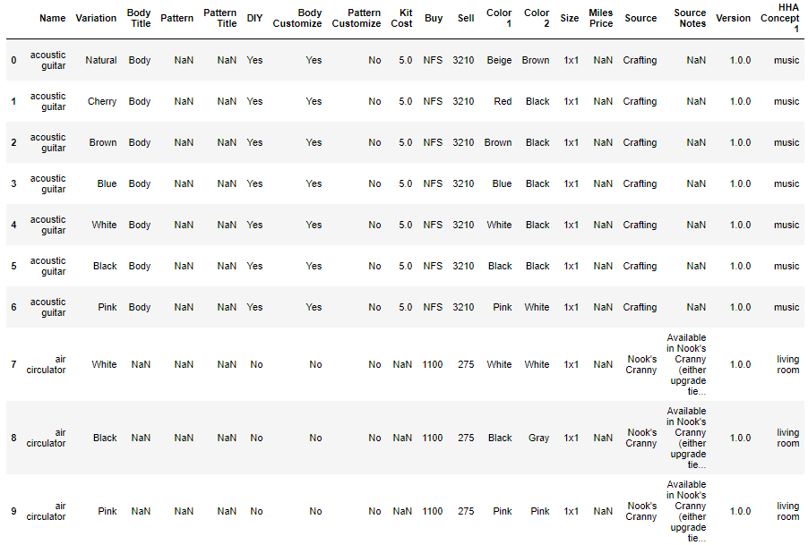
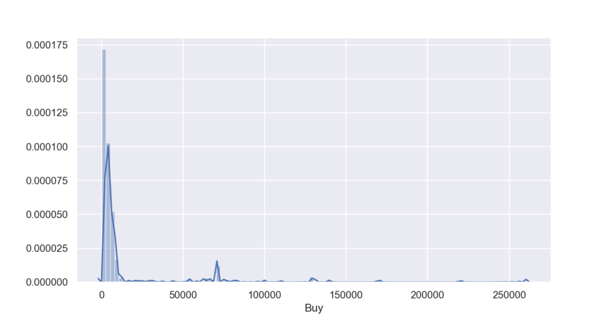
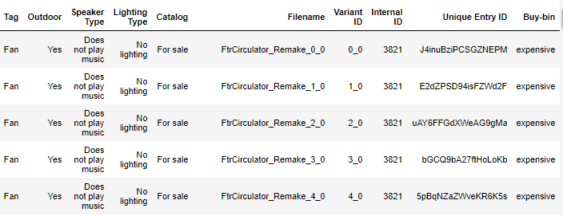
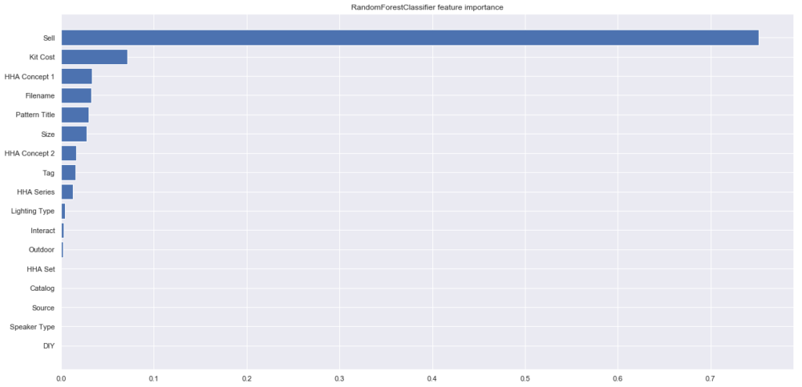
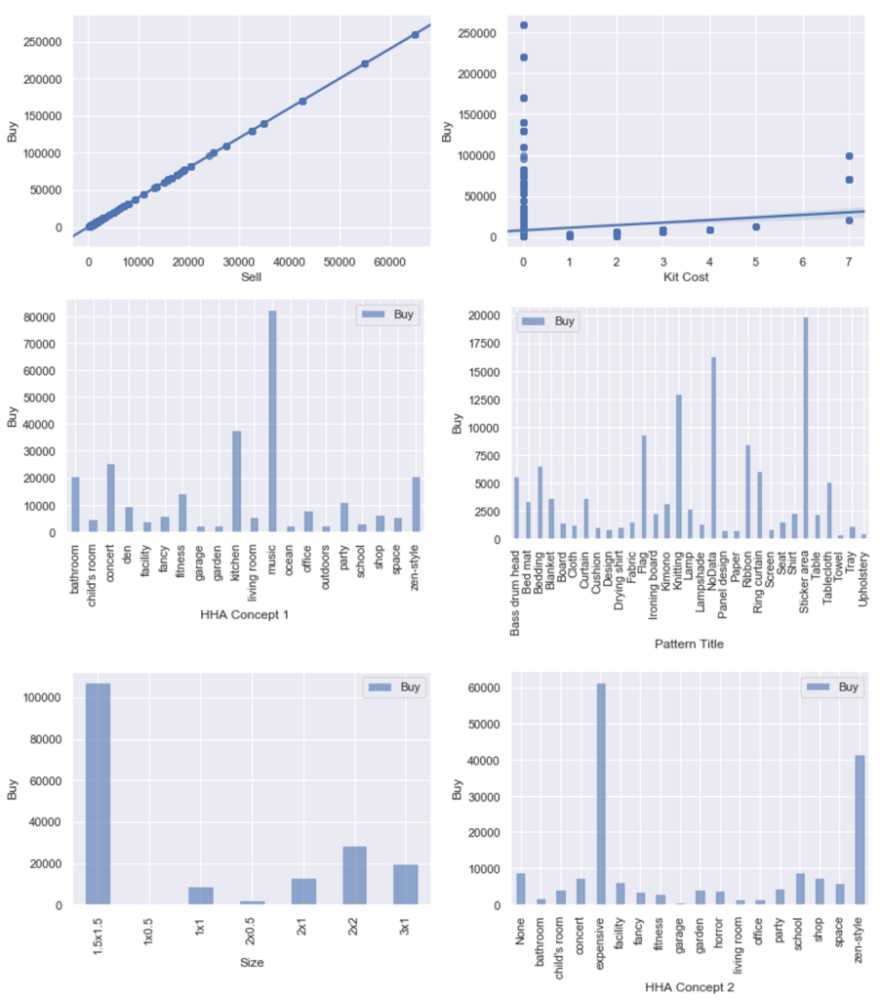
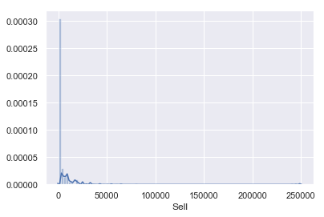
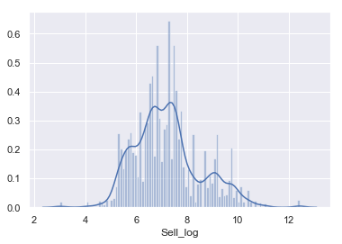
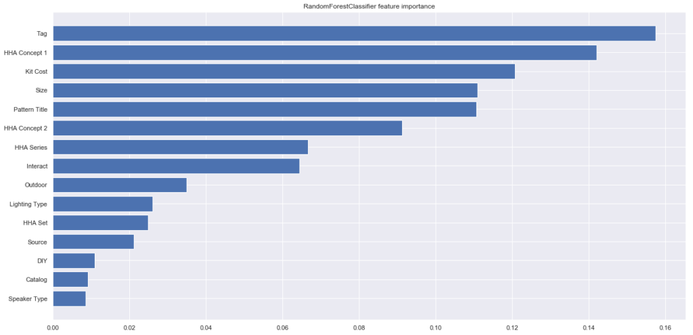
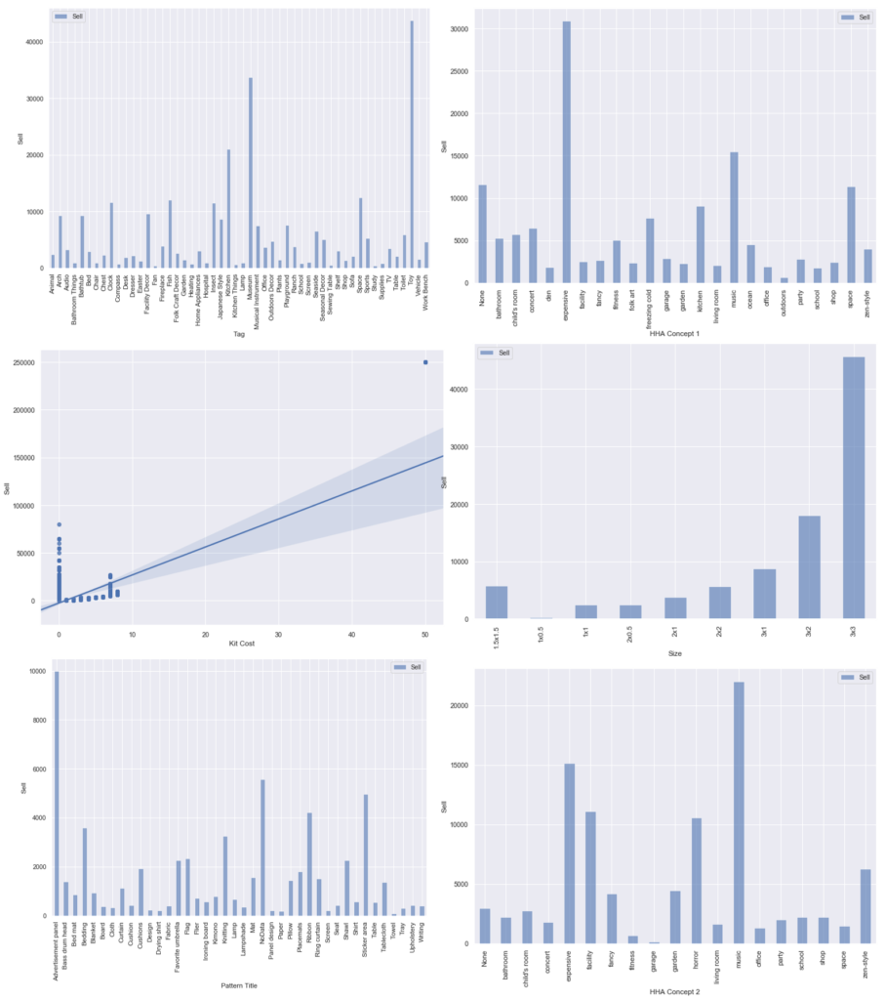

しぃたけ

あつ森未プレイの自分が、あつ森のデータを解析したので記録します。

## 背景

最近、Nintendoから発売されている「あつまれ　どうぶつの森」が大人気なようで、周りでプレイしている方がたくさんおられます。定額給付金で買ったという方も多いのではないでしょうか？

**ちなみに自分は全くプレイしておりません。**

Switchすら持ってません。

そんなこんなで、周りの会話についていけなくて困っていたところ、Kaggleでこんなデータセットを発見しました。

 [Animal Crossing New Horizons Catalog A comprehensive inventory of ACNH items, villagers, clothing, fish/bugs etc www.kaggle.com](https://www.kaggle.com/jessicali9530/animal-crossing-new-horizons-nookplaza-dataset?select=housewares.csv)  

会話についていけてなかった自分も、**このデータを解析したらあつ森のことを知った風に話せるかと思い、解析してみました。**

自分みたいにあつ森の話についてこれない方で知ったかぶりしたい方、ぜひご覧ください。

[画像](https://ir-jp.amazon-adsystem.com/e/ir?t=cpptake-22&l=am2&o=9&a=B084HPGQ9W)

[画像](https://ir-jp.amazon-adsystem.com/e/ir?t=cpptake-22&l=am2&o=9&a=B084HPGQ9W)[画像](https://ir-jp.amazon-adsystem.com/e/ir?t=cpptake-22&l=am2&o=9&a=B084HPGQ9W)[画像](https://ir-jp.amazon-adsystem.com/e/ir?t=cpptake-22&l=am2&o=9&a=B084HPGQ9W)[画像](https://ir-jp.amazon-adsystem.com/e/ir?t=cpptake-22&l=am2&o=9&a=B084HPGQ9W)[画像](https://ir-jp.amazon-adsystem.com/e/ir?t=cpptake-22&l=am2&o=9&a=B084HPGQ9W)[画像](https://ir-jp.amazon-adsystem.com/e/ir?t=cpptake-22&l=am2&o=9&a=B084HPGQ9W)[画像](https://ir-jp.amazon-adsystem.com/e/ir?t=cpptake-22&l=am2&o=9&a=B084HPGQ9W)[画像](https://ir-jp.amazon-adsystem.com/e/ir?t=cpptake-22&l=am2&o=9&a=B084HPGQ9W)[画像](https://ir-jp.amazon-adsystem.com/e/ir?t=cpptake-22&l=am2&o=9&a=B084HPGQ9W)[画像](https://ir-jp.amazon-adsystem.com/e/ir?t=cpptake-22&l=am2&o=9&a=B084HPGQ9W)[画像](https://ir-jp.amazon-adsystem.com/e/ir?t=cpptake-22&l=am2&o=9&a=B084HPGQ9W)

## データセット

### データセット内容

あつ森内で取得できるアイテムについてのデータとなっていて、全30テーブル存在します。

データの内容は、例えばfish（魚）のデータテーブルであれば

魚の種類、売値、取得できる（釣れる？）場所、時間などの情報が載っています。

### 解析するデータ

30種類のデータテーブルを全て解析するのは時間かかるので、今回は**「houseware（家庭用品）」のデータを対象に解析しようと思います。**

選定理由は、n数、カラム数がほかに比べて多かったため解析し甲斐があると考えたためです。（n数=3275、カラム数＝32）

### データの内容

データの内容としては、

ベッド、ランプなどの家具のデータが中心で、各項目に対しての　塗装のバリエーション、売値、買値、サイズ、入手場所　などのデータがそろってます。

詳細に書こうとおもいましたが、量が多いので生データをご確認ください。

## 解析①　Buy（買値）の解析

### データの観察

まずは、データのインポートをしていきます。

```python
#データのインポート
import pandas as pd
import numpy as np
 
import matplotlib.pyplot as plt
import seaborn as sns
sns.set()
 
housewares = pd.read_csv('dataset/housewares.csv') #家具データ
print('The size of the test data:' + str(housewares.shape))


#display max_columnsを利用すると列数が省略されなくなる
pd.get_option("display.max_columns")
pd.set_option('display.max_columns', 33)

housewares.head(10)
```

```python
#出力結果
The size of the test data:(3275, 32)
```

- 

*データテーブル*

データを観察すると、アイテムごとではなく、色違い、模様違いのアイテムも1つのアイテムとして登録されています。

目的変数には、「Buy（買値）」のデータを用いて、値段が高いアイテムと安いアイテムを決める要素について調べてみたいと思います。

### 目的変数の加工

まずは、目的変数のBuyのヒストグラムを作って分布を確認します。

また、前項のテーブルを見てみると、目的変数のBuyの中に、「NFS」というデータが含まれていることがわかります。

これは「Not For Sale」の略で非売品を表すものであるので、省いてからヒストグラムを作成します。

```python
#NFSのデータを削除
housewares_nfsdrop=housewares[~housewares['Buy'].str.contains('NFS', na = False)]

#目的変数の型をintに変換
housewares_nfsdrop['Buy']=housewares_nfsdrop['Buy'].astype(int)

%matplotlib notebook
sns.distplot(housewares_nfsdrop['Buy'],bins=100,label='Buy')
```


*Buyのヒストグラム*

ヒストグラムを見ると、0～10000 円（金額の単位あってるかは不明）のレンジに大きな山があり、それ以降の金額が高いエリアにもぽつぽつデータが存在するような分布となってます。

分布が正規分布していないので、エリアを区切るビニングの処理で、0～10000の価格が安いエリアと、10000以降の価格が高いエリアに分割していきます。

```plane
#売値の高い安いの分類
housewares_nfsdrop['Buy-bin'] = 'cheap'
housewares_nfsdrop.loc[(housewares_nfsdrop['Buy']<=10000),'Buy-bin'] = 'expensive'
housewares_nfsdrop
```


*出力結果*

「Buy-bin」のカラムが追加され、価格が高い、安いエリアに分割されました。

### 欠損値の補間

欠損値を確認します。

```python
#欠損値の確認
housewares_nfsdrop.isnull().sum()
```

```python
#出力結果
Name                    0
Variation               0
Body Title           1870
Pattern               888
Pattern Title         888
DIY                     0
Body Customize          0
Pattern Customize       0
Kit Cost              867
Buy                     0
Sell                    0
Color 1                 0
Color 2                 0
Size                    0
Miles Price          1897
Source                  0
Source Notes           35
Version                 0
HHA Concept 1           0
HHA Concept 2           0
HHA Series              0
HHA Set                 0
Interact                0
Tag                     0
Outdoor                 0
Speaker Type            0
Lighting Type           0
Catalog                 0
Filename                0
Variant ID             42
Internal ID             0
Unique Entry ID         0
Buy-bin                 0
Name variation          0
dtype: int64
```

「Body Title」「Miles Price」はほとんどの値が欠損値だったので、特徴量から外します。

欠損値があるデータで特徴量には使えそうなの「Pattern」「Pattern Title」「Kit Cost」の欠損値を埋めていきます。

```python
#Pattern ,Pattern Title はNodataで補間、KitCostは0で補間する。正しいかは不明。
housewares_nfsdrop['Pattern']=housewares_nfsdrop['Pattern'].fillna('NoData')
housewares_nfsdrop['Pattern Title']=housewares_nfsdrop['Pattern Title'].fillna('NoData')
housewares_nfsdrop['Kit Cost']=housewares_nfsdrop['Kit Cost'].fillna(0)
```

欠損値の補間終了しました。

特徴量と、目的変数を設定して、ラベルエンコーディングで離散化いきます。

目的変数は、前項で作成した「Buy-bin」を利用します。選んだ特徴量は下記の通りです。

```python
# X_trainとy_train作成
target_col ='Buy-bin'
feture_col = ['Pattern Title','DIY','Kit Cost','Sell','Size','Source','HHA Concept 1','HHA Concept 2','HHA Series','HHA Set','Interact','Tag','Outdoor','Speaker Type','Lighting Type','Catalog','Filename']

# 学習に必要な特徴量のみを保持
X_train = housewares_nfsdrop[feture_col]
y_train = housewares_nfsdrop[target_col]

#Label Encordingで離散化
from sklearn.preprocessing import LabelEncoder

le = LabelEncoder()

for i in range(X_train .shape[1]):
　　#object変数のみ離散化
    if X_train .iloc[:,i].dtypes == object:
        
        le.fit(list(X_train .iloc[:,i].values) + list(X_train .iloc[:,i].values))
        X_train .iloc[:,i] = le.transform(list(X_train .iloc[:,i].values))
```

特徴量作成終了です。

### feature importance

選んだ特徴量のどれが効いているか、feature importanceを利用して確認します。

```python
#ランダムフォレストでImportanceの計算
from sklearn.ensemble import RandomForestClassifier
 
rfc = RandomForestClassifier(random_state=0)
rfc.fit(X_train, y_train)
 
plt.figure(figsize=(20,10))
plt.barh(
    X_train.columns[np.argsort(rfc.feature_importances_)],
    rfc.feature_importances_[np.argsort(rfc.feature_importances_)],
    label='RandomForestClassifier'
)
plt.title('RandomForestClassifier feature importance')
```


*feature importance*

「Sell（売値）」の影響度が極端に高く、「Kit Cost」「HHA Concept 1」などが続いています。

「Sell（売値）」については「Buy（買値）」によって決まっている値な気がしますが、視覚化して確認してみましょう。

### Buyと特徴量の関係

最後に、目的変数の「Buy」と重要度の高かった6つの特徴量との関係をグラフ化していきます。

グラフ化の方法ですが、int,floatの数値データの場合は、2変量の線形グラフで表し、object変数の場合は平均値のグラフ化する方法で図示します。（本来なら分布、分散なども同時に知りたいので平均値だけでは不十分ですが、簡単のためこうします。）

```python
#特徴量とBuyの関係
featurelist = ['Sell','Kit Cost','HHA Concept 1','Pattern Title','Size','HHA Concept 2']
length = len(featurelist)

df = pd.DataFrame()
%matplotlib inline

#グラフ描画
for i in range(length):

    #int,floatの時の処理
    if featurelist[i] == 'Sell':
        print('OK')
        fig = plt.figure()
        sns.regplot(y=X_train2['Buy'], x=X_train2['Sell'])
        
    elif featurelist[i] == 'Kit Cost':
        fig = plt.figure()
        sns.regplot(y=X_train2['Buy'], x=X_train2['Kit Cost'])

    #object変数の時の処理
    else:
        df = X_train2.groupby(featurelist[i]).mean()
        df.plot.bar(y=['Buy'], alpha=0.6)
        plt.xlabel(featurelist[i])
        plt.ylabel('Buy')
```



**「Sell」については、予想通り「Buy」と1対1の関係でした。**買値の4分の1が売値になるという設定みたいですね。

次に影響度が高かった「Kit Cost」は、値が0のものを除けばほとんどBuyの値とKitCostの値が比例関係にあります。（KitCostの欠損値を0で補間してしまったのがよくなかったみたいです。）

残りは、HHA Concept 1の「music」、Sizeの「1.5×1.5」、HHA Concept 2の「expensive」「zen-sytle」などの特徴を持っているとBuyの値が高くなる傾向があるみたいです。

## 解析②　Sell（売値）の解析

「Buy」の値は、非売品のデータが多く含まれていた事を考慮し、次は「Sell（売値）」を目的変数に解析を実施します。

先ほどの解析でSellとBuyの値は、線形で表される関係であるとわかっているので、Sellの方がデータ数が多いのであれば、より精度の高い解析が期待できます。

### 目的変数の加工

まずはSellの分布の確認をします。

```python
sns.distplot(housewares['Sell'],bins=100,label='Sell')
```


*Sellのヒストグラム*

片側に偏った分布になっているので、対数変換を実施します。

```python
#対数変換
housewares['Sell_log'] = np.log(housewares['Sell'])
sns.distplot(housewares['Sell_log'],bins=100,label='Sell')
```


*Sell\_logのヒストグラム*

正規分布とは言えませんが、こちらを目的変数にfeature importanceを計算していきます。

### feature importance

前項の「Sell\_log」を目的変数にfeature importanceを計算します。

やってることは「Buy」編の内容と変わらないので説明は割愛します。

```python
# X_train3とy_train3作成
target_col ='Sell_log'
feture_col = ['Pattern Title','DIY','Kit Cost','Size','Source','HHA Concept 1','HHA Concept 2','HHA Series','HHA Set','Interact','Tag','Outdoor','Speaker Type','Lighting Type','Catalog']
# 学習に必要な特徴量のみを保持
X_train3 = housewares[feture_col]
y_train3 = housewares[target_col]

#欠損値の補間
X_train3['Pattern Title']=X_train3['Pattern Title'].fillna('NoData')
X_train3['Kit Cost']=X_train3['Kit Cost'].fillna(0)

# カテゴリ変数の特徴量についてlabel encoding
from sklearn.preprocessing import LabelEncoder

le = LabelEncoder()

for i in range(housewares_nfsdrop.shape[1]):
    if X_train3.iloc[:,i].dtypes == object:
        
        le.fit(list(X_train3.iloc[:,i].values) + list(X_train3.iloc[:,i].values))
        X_train3.iloc[:,i] = le.transform(list(X_train3.iloc[:,i].values))
```


*Sell feature importance*

影響度が視覚化されました。

### Sellと特徴量の関係

最後にfeature importanceが高かった特徴量と、Sellの関係を視覚化していきます。

```python
#影響度が高かった特徴量のリスト
featurelist = ['Tag','HHA Concept 1','Kit Cost','Size','Pattern Title','HHA Concept 2']
length = len(featurelist)

df = pd.DataFrame()
#fig = plt.figure()
%matplotlib inline

for i in range(length):
    
    if featurelist[i] == 'Kit Cost':
        fig = plt.figure(figsize=(12,8))
        sns.regplot(y=housewares2['Sell'], x=housewares2['Kit Cost'])
        
    else:
        df = housewares2.groupby(featurelist[i]).mean()
        fig = plt.figure(figsize=(20,12))
        df.plot.bar(y=['Sell'], alpha=0.6,figsize=(12,8))
        plt.xlabel(featurelist[i])
        plt.ylabel('Sell')
```


*Sell と特徴量の関係*

前回の解析と異なる部分は、**「Tag」の要素の影響度が一番高く、その中の「Toy」のラベルの売値が一番高くなっているという部分です。**

この要因を調べてみると、housewareの中で一番高い「robot hero」というアイテムが平均値を大きく引き上げていることが原因でした。

robot heroは Kit Cost=50 、size = 3×3 なので、ほかの特徴量にも影響を与えていることがわかります。（Kit Cost、Sizeのグラフ参照。）

つまり、あつ森の家庭用品中で「robot hero」が一番高価なアイテムであるということがわかりました。これで友人にどや顔できそうです。

## まとめ

あつ森素人の自分がデータ解析を通じて、下記の気づきを得ました。

- houseware(家庭用品)の中で、「hero robot」がダントツで高価なアイテムである。
- あつ森の知識が少し増えた。

**皆さんはこんなアホなことせずに、普通にゲームをプレイしてください。**
