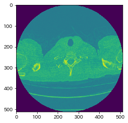
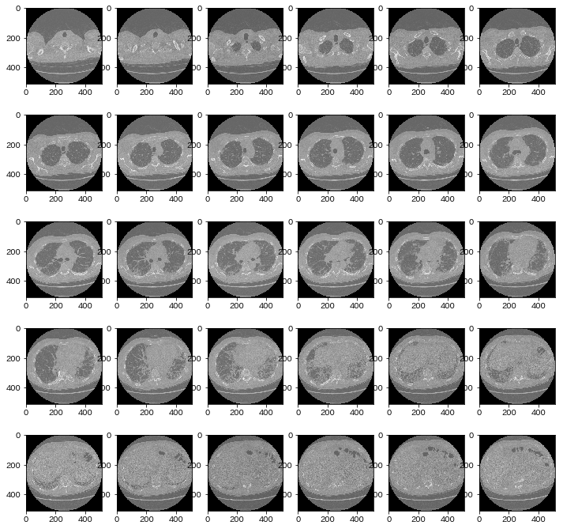

しぃたけ

医療用画像の標準規格、DICOMをPythonで扱う方法を備忘録としてまとめます。

## 背景

**男の子なら誰でも一度は、MRIやCTなどの医療用画像を解析したいと思ったことがあるのではないでしょうか？？**

ちなみに自分は思ったことありません。

何故こんな記事を書いているかというと、Kaggleの「OSIC Pulmonary Fibrosis Progression」というCTの画像を扱うコンペに参加したところ、DICOM（ダイコム）とかいう初めて見る形式の画像を扱うことになったためです。（[コンペ詳細](https://www.kaggle.com/c/osic-pulmonary-fibrosis-progression)）

自分のようにDICOM形式初めての人の力になれればと思います。

## DICOMの扱い方

### DICOM（ダイコム）とは？

以下、Wikipediaからの引用です。

> DICOMとは、CTやMRI、CRなどで撮影した医用画像のフォーマットと、それらを扱う医用画像機器間の通信プロトコルを定義した標準規格である。 名称はDigital Imaging and COmmunications in Medicineの略である。
> 
> [https://ja.wikipedia.org/wiki/DICOM](https://ja.wikipedia.org/wiki/DICOM)

CT、MRI、CRなどの画像診断では、DICOMという規格で統一されているみたいです。

拡張子は\[.dcm」になります。

### pydicomインストール

Python上でDICOM形式のデータを扱う場合は、「pydicom」を利用するのが一般的です。公式ドキュメントこちらです。（[pydicom公式](https://pydicom.github.io/pydicom/stable/)）

とりあえずインストールします。

```python
pip install pydicom
```

```python
#出力結果
Collecting pydicom
  Downloading https://files.pythonhosted.org/packages/d3/56/342e1f8ce5afe63bf65c23d0b2c1cd5a05600caad1c211c39725d3a4cc56/pydicom-2.0.0-py3-none-any.whl (35.4MB)
Installing collected packages: pydicom
Successfully installed pydicom-2.0.0
Note: you may need to restart the kernel to use updated packages.
```

できました。

### メタデータの確認

インストールが完了したので、遊んでみます。

なお、データは上記の「OSIC Pulmonary Fibrosis Progression」のデータを利用しています。

まずは、DICOM形式のデータがどのような情報をもっているか確認しましょう。

```python
import pydicom
import os
import matplotlib.pyplot as plt

#DICOM形式はdsと表記することが多い
dir = "./image/CT/1.dcm"
ds = pydicom.dcmread(dir)

#DICOM形式のメタデータを確認
print(ds)
```

```python
#出力結果
Dataset.file_meta -------------------------------
(0002, 0000) File Meta Information Group Length  UL: 200
(0002, 0001) File Meta Information Version       OB: b'\x00\x01'
(0002, 0002) Media Storage SOP Class UID         UI: CT Image Storage
(0002, 0003) Media Storage SOP Instance UID      UI: 2.25.12297650151329871895440507938349160734
(0002, 0010) Transfer Syntax UID                 UI: Explicit VR Little Endian
(0002, 0012) Implementation Class UID            UI: 1.2.276.0.7230010.3.0.3.6.1
(0002, 0013) Implementation Version Name         SH: 'OSIRIX_361'
(0002, 0016) Source Application Entity Title     AE: 'ANONYMOUS'
-------------------------------------------------
(0008, 0005) Specific Character Set              CS: 'ISO_IR 100'
(0008, 0008) Image Type                          CS: ['ORIGINAL', 'PRIMARY', 'AXIAL']
(0008, 0018) SOP Instance UID                    UI: 2.25.12297650151329871895440507938349160734
(0008, 0060) Modality                            CS: 'CT'
(0008, 0070) Manufacturer                        LO: 'GE MEDICAL SYSTEMS'
(0008, 1090) Manufacturer's Model Name           LO: 'LightSpeed VCT'
(0010, 0010) Patient's Name                      PN: 'ID00007637202177411956430'
(0010, 0020) Patient ID                          LO: 'ID00007637202177411956430'
(0010, 0040) Patient's Sex                       CS: ''
(0012, 0063) De-identification Method            LO: 'Table;'
(0018, 0015) Body Part Examined                  CS: 'Chest'
(0018, 0050) Slice Thickness                     DS: "1.25"
(0018, 0060) KVP                                 DS: "120.0"
(0018, 1110) Distance Source to Detector         DS: "949.075012"
(0018, 1111) Distance Source to Patient          DS: "541.0"
(0018, 1120) Gantry/Detector Tilt                DS: "0.0"
(0018, 1130) Table Height                        DS: "130.0"
(0018, 1140) Rotation Direction                  CS: 'CW'
(0018, 1151) X-Ray Tube Current                  IS: "79"
(0018, 1170) Generator Power                     IS: "9600"
(0018, 1190) Focal Spot(s)                       DS: "0.7"
(0018, 1210) Convolution Kernel                  SH: 'BONE'
(0018, 5100) Patient Position                    CS: 'FFS'
(0020, 000d) Study Instance UID                  UI: 2.25.80896671862726099888461805953012988790
(0020, 000e) Series Instance UID                 UI: 2.25.51769600465874599901723496946193454321
(0020, 0010) Study ID                            SH: ''
(0020, 0013) Instance Number                     IS: "1"
(0020, 0032) Image Position (Patient)            DS: [-158.700, -153.500, -69.750]
(0020, 0037) Image Orientation (Patient)         DS: [1.000000, 0.000000, 0.000000, 0.000000, 1.000000, 0.000000]
(0020, 0052) Frame of Reference UID              UI: 2.25.64058019325784235774105718339367403144
(0020, 1040) Position Reference Indicator        LO: 'SN'
(0020, 1041) Slice Location                      DS: "-69.75"
(0028, 0002) Samples per Pixel                   US: 1
(0028, 0004) Photometric Interpretation          CS: 'MONOCHROME2'
(0028, 0010) Rows                                US: 512
(0028, 0011) Columns                             US: 512
(0028, 0030) Pixel Spacing                       DS: [0.652344, 0.652344]
(0028, 0100) Bits Allocated                      US: 16
(0028, 0101) Bits Stored                         US: 16
(0028, 0102) High Bit                            US: 15
(0028, 0103) Pixel Representation                US: 1
(0028, 0120) Pixel Padding Value                 SS: -2000
(0028, 1050) Window Center                       DS: "-500.0"
(0028, 1051) Window Width                        DS: "-1500.0"
(0028, 1052) Rescale Intercept                   DS: "-1024.0"
(0028, 1053) Rescale Slope                       DS: "1.0"
(0028, 1054) Rescale Type                        LO: 'HU'
(7fe0, 0010) Pixel Data                          OW: Array of 524288 elements
```

なんかめっちゃ出た。

中身を見てみると「Patient’s Name」（患者の名前）、「Manufacturer」（医療機器の製造会社）、「Rows」「Columns」（画像のサイズ）　など様々なデータがDICOMデータの中に格納されています。

### 各データの取り出し

メタデータから欲しい情報を取り出していきます。

患者のIDを知りたいときは、PatientID

メーカー名を知りたい時は、Manufacturer

CTのスライスの厚さは、\[0x0018,0x0050\]

で取得できます。

```python
#患者のID
print(ds.PatientID)
#医療機器製造会社
print(ds.Manufacturer)
#スライス厚さ
print(ds[0x0018,0x0050],"mm")
```

```python
#出力結果
ID00007637202177411956430
GE MEDICAL SYSTEMS
(0018, 0050) Slice Thickness                     DS: "1.25" mm
```

できました。

CT機械はGE製で、CTのスライス厚さは1.25mmみたいです。

### 画像を取得

最後に画像を取得します。

画像は、pixel\_array　で取得できます。

```python
#画像の取得
ct_image = ds.pixel_array
plt.imshow(ct_image)
```


*出力結果*

出ました。

ちなみにコンペでは、30枚のdicom形式のデータが与えられているので並べてみます。

```python
%matplotlib inline

imdir = "./image/CT"
print("total images for patient ID00123637202217151272140: ", len(os.listdir(imdir)))

#CT画像を並べる
fig=plt.figure(figsize=(12, 12))
columns = 6
rows = 5
imglist = os.listdir(imdir)
for i in range(1, columns*rows +1):
    filename = imdir + "/" + str(i) + ".dcm"
    ds = pydicom.dcmread(filename)
    fig.add_subplot(rows, columns, i)
    plt.imshow(ds.pixel_array, cmap='gray')#グレースケールで出力
plt.show()
```

```python
total images for patient ID00123637202217151272140:  30
```


*出力結果*

気分は外科医ですね。

## まとめ

pydicomを使って医療画像を扱う方法を記載しました。

お医者さんの気分を味わえるのでお勧めです。
