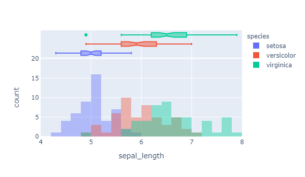
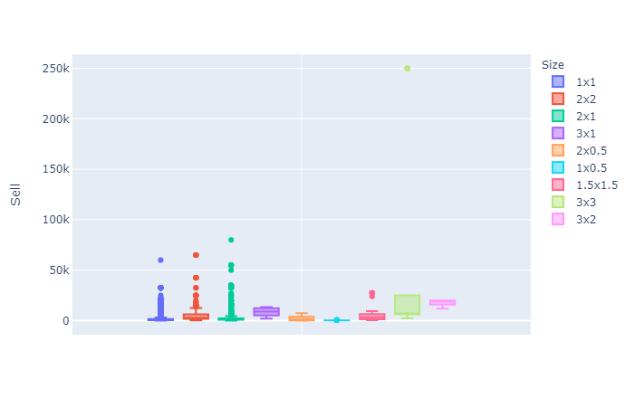
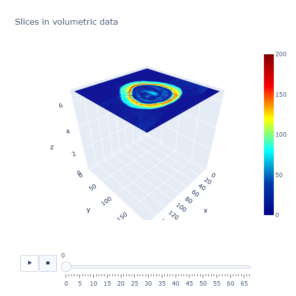

しぃたけ

Pythonのデータ可視化ライブラリ「plotly」の使い方の備忘録です。

個人的にmatplotlib,seabornより使いやすいです。

## 概要

### 背景

Pythonでグラフを書くとき、matplotlib、seabornを使うのが一般的ですが、

**図示するだけの静的なグラフは描けても、データとグラフが紐づいた動的なグラフを書くことができない**

という欠点があります。

この弱点を補う、動的なデータ可視化ライブラリである「plotly」を使ってみたので、使い方を残します。

### 環境

Windows10、Python3.6、JupyterNotebook　を利用してます。

## 使ってみた

### plotlyとは

データ可視化のためのプラットフォームです。（[plotly公式](https://plotly.com/)）

今回はPythonの使い方に絞って書きますが、Matlab、R、Juliaなどにも対応しているみたいです。

- グラフにマウスをあてることで、データの内容を表示できる。
- グラフのズーム、回転などがマウスでできる。

などの特徴があります。

### インストール

まずはインストールしましょう。

これまで通り、pip install で対応可能です。

```python
$pip install plotly
```

Anaconda環境の方はconda installで実施ください。

```python
$conda install plotly
```

### 可視化①　irisデータセット

まずは、一般的に知られているirisのデータセットを利用してデータを可視化してみます。

```plane
import matplotlib.pyplot as plt
import pandas as pd
import plotly.express as px
import plotly.offline as pf
from plotly.subplots import make_subplots

#irisのデータセットをロードする
iris = sns.load_dataset('iris')

fig = px.histogram(iris, x='sepal_length', color='species', 
                           nbins=19, range_x=[4,8], width=600, height=350,
                           opacity=0.4, marginal='box')

fig.update_layout(barmode='overlay')
fig.update_yaxes(range=[0,20],row=1, col=1)

# html形式で表示
pf.plot(fig)
```


*出力イメージ（グリグリ動かせない版）*

**グリグリ動くグラフはこちら**：[http://cpptake.com/plotly\_test/iris\_plot.html](http://cpptake.com/plotly_test/iris_plot.html)

plotlyの仕様の都合上、ブラウザで見ないとグリグリ感を味わえないので、出力結果は上記のリンク先を参照ください。

（Webページ上にplotlyのグラフを載せてるページもいくつかあったんですが、誰かやり方教えていただけると嬉しいです。

出力先のグラフにマウスをあてると、

データのラベル名、最大値、最小値、n数、信頼区間など、様々な情報が表示されます。

さらに、クリック一つでズームやスライドなど簡単にできて非常に便利です。

### 可視化②　あつもりデータセット

続いて以前記事にした、Kaggleのあつ森データセットを可視化してみます。

あつもりのデータセットについては下記の記事をご参照ください。

[【Animal Crossing】Kaggleのあつまれ どうぶつの森データセットで遊んでみた しぃたけあつ森未プレイの自分が、あつ森のデータを解析したので記録します。背景最近、Nintendoから発売されている「あつまれ どうぶつの森」が大人気なようで、周りでプレイしている方がたくさんおられます。定額給付金で買... cpptake.com 2020.07.06](http://cpptake.com/archives/374)

上記のデータを利用して、アイテムの大きさ「Size」ごとの、アイテムの売値「Sell」の値を箱ひげ図を用いて可視化してみます。

```python
housewares = pd.read_csv('data/housewares.csv') #家具データ
print('The size of the test data:' + str(housewares.shape))

#Sellの値をSizeごとに箱ひげ図で図示する。
fig = px.box(housewares, y="Sell", color="Size")
# html形式で表示
pf.plot(fig)
```


*出力イメージ（グリグリ動かせない版）*

**グリグリ動くグラフはこちら**：[http://cpptake.com/plotly\_test/temp-plot.html](http://cpptake.com/plotly_test/temp-plot.html)

例によって、リンク先を参照ください。

グラフ見てみると、Sizeが 3×3 の所に明らかな外れ値が存在します。どう見ても「robot hero」のデータですね。（詳しくはあつもりの記事参照）

plotlyを使うことで、外れ値の値などもグラフ上で確認することができます。

### 可視化③　MRI画像の3Dマップ化

最後に、最近Kaggleで挑戦している医療用画像の可視化をplotlyを使って行ってみます。

なお、データセット、記載するコードについては、こちらにあるplotly公式リファレンスのものをまるパクリしてます。悪しからず。（[plotly公式MRI画像3Dマップ化](https://plotly.com/python/visualizing-mri-volume-slices/)）

やりたい事としては、数ミリ間隔でスライスされたMRIの画像を3次元座標上に順番に表示させていくような処理を書きたいと思います。

```python
import time
import numpy as np
from skimage import io
import plotly.graph_objects as go

vol = io.imread("https://s3.amazonaws.com/assets.datacamp.com/blog_assets/attention-mri.tif")
volume = vol.T
r, c = volume[0].shape


nb_frames = 68

fig = go.Figure(frames=[go.Frame(data=go.Surface(
    z=(6.7 - k * 0.1) * np.ones((r, c)),
    surfacecolor=np.flipud(volume[67 - k]),
    cmin=0, cmax=200
    ),
    name=str(k)
    )
    for k in range(nb_frames)])

fig.add_trace(go.Surface(
    z=6.7 * np.ones((r, c)),
    surfacecolor=np.flipud(volume[67]),
    colorscale='jet',
    cmin=0, cmax=200,
    colorbar=dict(thickness=20, ticklen=4)
    ))


def frame_args(duration):
    return {
            "frame": {"duration": duration},
            "mode": "immediate",
            "fromcurrent": True,
            "transition": {"duration": duration, "easing": "linear"},
        }

sliders = [
            {
                "pad": {"b": 10, "t": 60},
                "len": 0.9,
                "x": 0.1,
                "y": 0,
                "steps": [
                    {
                        "args": [[f.name], frame_args(0)],
                        "label": str(k),
                        "method": "animate",
                    }
                    for k, f in enumerate(fig.frames)
                ],
            }
        ]

fig.update_layout(
         title='Slices in volumetric data',
         width=600,
         height=600,
         scene=dict(
                    zaxis=dict(range=[-0.1, 6.8], autorange=False),
                    aspectratio=dict(x=1, y=1, z=1),
                    ),
         updatemenus = [
            {
                "buttons": [
                    {
                        "args": [None, frame_args(50)],
                        "label": "▶",
                        "method": "animate",
                    },
                    {
                        "args": [[None], frame_args(0)],
                        "label": "◼",
                        "method": "animate",
                    },
                ],
                "direction": "left",
                "pad": {"r": 10, "t": 70},
                "type": "buttons",
                "x": 0.1,
                "y": 0,
            }
         ],
         sliders=sliders
)

pf.plot(fig)
```


*出力イメージ（グリグリ動かせない版）*

**グリグリ動くグラフはこちら**：[http://cpptake.com/plotly\_test/mri\_plot.html](http://cpptake.com/plotly_test/mri_plot.html)

リンク先を参照いただくと、MRI画像が上から順番に流れていく３Dマップが見れるかと思います。

plotlyを使うと3次元のグラフも感覚的に動かせてすごく楽しいですね。

## まとめ

インタラクティブなデータ可視化ライブラリのplotlyを使ってみました。

動的なデータ分析をしたい方にお勧めです。

自分は業務でSAS社のデータ分析ツールを利用しているのですが、plotlyはSASの仕様と似ている部分があるため、個人的には非常に使いやすいツールだと感じました。

今後は練習もかねて、matplotlib,seabornの代わりに使っていこうかと思います。

**リファレンスが少ないのが課題ですが、KaggleのNotebookを見ていても、EDAをする際にplotlyを利用している人が多いと感じているので、今後増えていくと思ってます。**

皆さん使っていきましょう。
