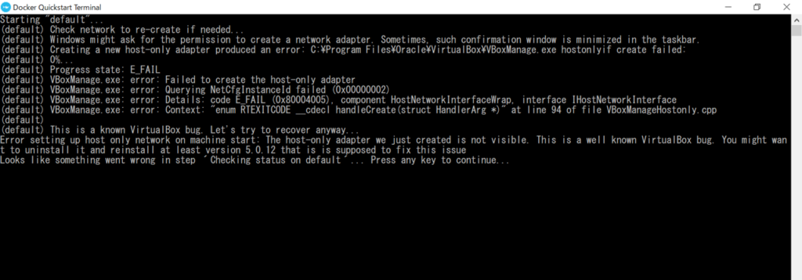
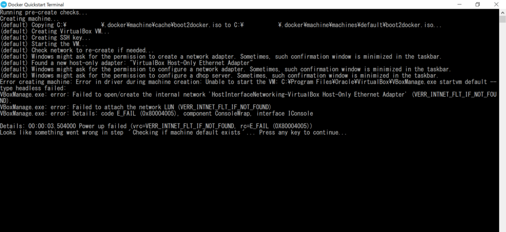
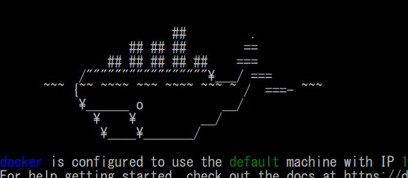
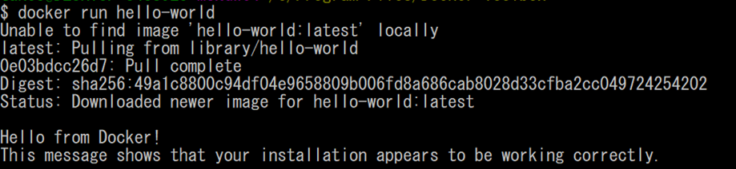

## 背景

なんとなく難しそうだという理由で使ってなかった、Dockerを利用してみたんですが、いろいろと不具合が発生したのでまとめておきます。

同じ不具合発生した人の参考になればと思います。

### 参考文献

こちらの動画を参考にインストールしました。

良ければ参考にしてください。

理屈はさておき、Dockerを使って、あっという間にPythonのデータ分析の環境構築をする｜WindowsとMacの説明あり

### 環境

OSはWindow10 Homeを利用しています。

Home版は仮想環境の対応されていないため、Docker for windowsは使えないので

今回は、Docker toolboxを利用しています。

## 不具合①　´Checking status on default´

### 症状

手順通りにDocker toolboxをインストールして、Docker Quickstart Terminalでセットアップを進めていたところ、下記のようなエラーが発生しました。



> (default) VBoxManage.exe: error: Failed to create the host-only adapter
> 
> 
> 
> (default) VBoxManage.exe: error: Querying NetCfgInstanceId failed (0x00000002)
> 
> 
> 
> (default) VBoxManage.exe: error: Details: code E\_FAIL (0x80004005), component HostNetworkInterfaceWrap, interface IHostNetworkInterface
> 
> 
> 
> (default) VBoxManage.exe: error: Context: “[enum](http://d.hatena.ne.jp/keyword/enum) RTEXITCODE \_\_cdecl handleCreate(struct HandlerArg \*)” at line 94 of file VBoxManageHostonly.cpp
> 
> 
> 
> (default)
> 
> 
> 
> (default) This is a known [VirtualBox](http://d.hatena.ne.jp/keyword/VirtualBox) bug. Let’s try to recover anyway…
> 
> 
> 
> Error setting up host only network on machine start: The host-only adapter we just created is not visible. This is a well known [VirtualBox](http://d.hatena.ne.jp/keyword/VirtualBox) bug. You might want to uninstall it and reinstall at least version 5.0.12 that is is supposed to fix this issue
> 
> 
> 
> Looks like something went wrong in step ´Checking status on default´… Press any key to continue…
> 
> エラー文　コピペ

要約すると、VBoxManage.exeの部分でエラーが発生しているため、一度アンインストールしろというような記載です。

しかし、アンインストールしても、同様のバグが発生しました。

### 対策

こちらの記事を参考に対策しました。

[埋め込みコンテンツ](https://smilemichael.hatenablog.com/entry/2020/02/23/163224)

どうやら、Docker ToolBoxと同時にVirtualBoxをインストールすると発生するみたいです。

対策としては下記の手順で対応しました。

- Docker ToolBox、VirtualBoxをアンインストール。
- Docker ToolBoxを再度インストール。（**同時にVirtualBoxをインストールしない事。**）
- VirtualBoxを個別にインストール。（最新版でおｋ）
- PC再起動

これで1つめのバグが取れました。

## 不具合② ‘Checking if machine default exists’

### 症状

上記エラーを解消して、再度Docker Quickstart Terminalを再インストールしていると今度は別のエラー発生しました。



```
VBoxManage.exe:Failed to open/create the internal network 'HostInterfaceNetworking-VirtualBox Host-Only Ethernet Adapter' (VERR_INTNET_FLT_IF_NOT_FOUND).
VBoxManage.exe:Failed to attach the network LUN (VERR_INTNET_FLT_IF_NOT_FOUND).
VBoxManage.exe:Details: code_EFAIL (0×80004005),component ConsoleWrap,interface IConsole
Details: 00:00:03.50400 Power up failed (vcr=VERR_INTNET_FLT_IF_NOT_FOUND, rc=E_FAIL(0×80004005))
Looks like something went wrong in step 'Checking if machine default exists'... Press any key to continue...
```

ネットワークらへんでトラブってるみたいです。

### 対策

こちらを参考にしました。というかそのままです。

 [VirtualBox で Failed to open/create the internal network 'HostInterfaceNetworking-VirtualBox Host-Only Ethernet Adapter' が出た時の対処 - Qiita VirtualBox で表題のエラーが出て困った。ググったところ直し方が書いてあったものの、自分の場合、もうひと手間が必要だったのでメモ。なお、Win10 64bit環境です。 エラー内容 Failed to open/create the internal networ... qiita.com](https://qiita.com/ExA_DEV/items/ae80a7d767144c2e1992) 

やったことは、リンク先そのままで

- “ネットワークと共有センター” を開く
- “アダプターの設定の変更” を開く
- “VirtualBox Host-Only Network #N” のプロパティを開く
- “VirtualBox NDIS6 Bridged Networking Driver” にチェックを入れる
- “インターネットプロトコル バージョン6(TCP/IPv6)” のチェックを外す
- \[OK\] を押し、プロパティウィンドウを閉じる
- “VirtualBox Host-Only Network #N” の右クリックメニューで「無効」にする
- 再度、「有効」にし直す

です。これで解消しました。

## Docker起動

### Docker Quickstart Terminal起動

上記の2つを解消した後、Docker Quickstart Terminalを起動したところ、元気よくクジラ君が出てきてくれました。


*クジラ君*

### はろわ

最後にはろわだけやっときます。docker run hello-worldを入力して「Hello from Docker」と表示されれば成功です。

```plane
#入力
$docker run hello-world
```


*出力結果*

できました。

## さいごに

クジラ君かわいい。
