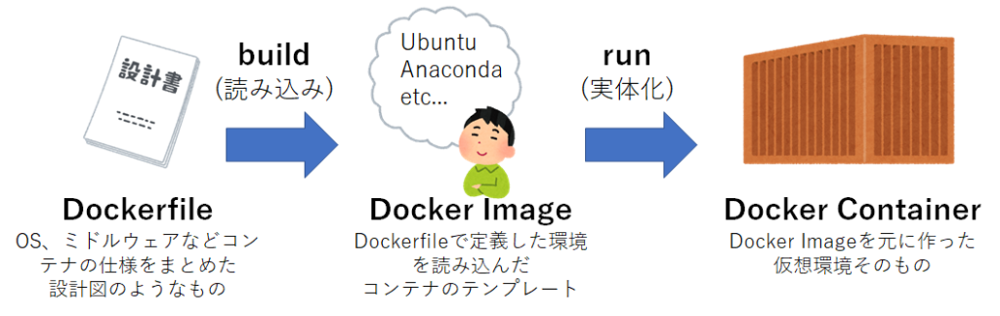
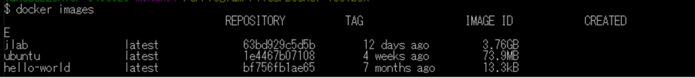
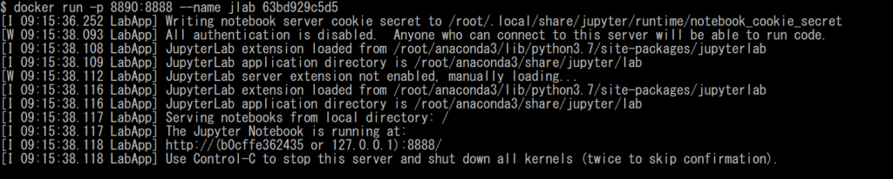
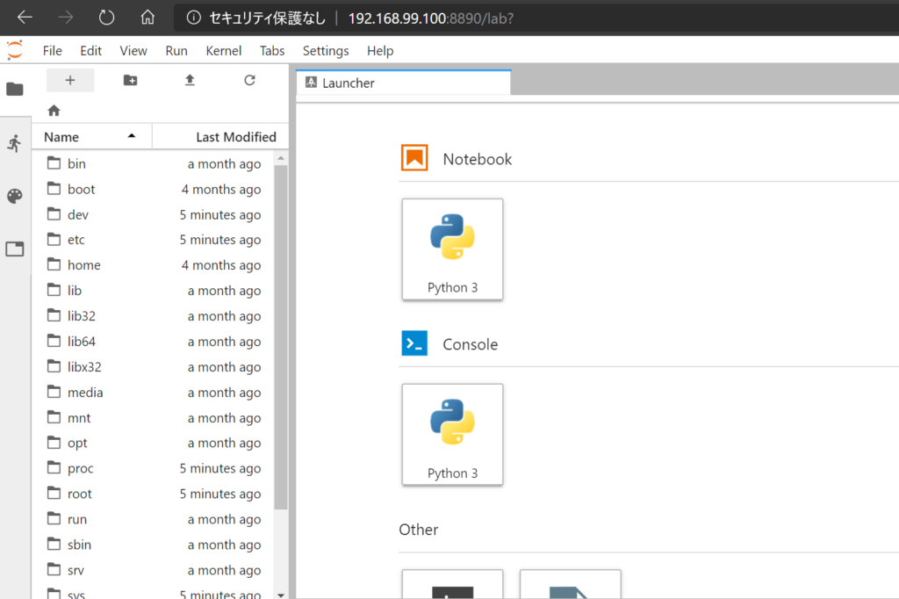

しぃたけ

Dockerの構造の超基本の部分をまとめます。Docker初心者向けです。

## 背景

Docker初心者の自分がDocker使う上での超基礎的な部分をまとめます。

Docker使ったことない方で、今後使ってみたい方向けなので、つよつよの方はスルーしてください。

### 環境

Windows10 home、Python3.6、Docker tooldoxを利用しています。

## Dockerについて

### Dockerとは

DockerはDocker社が提供するコンテナ型仮想化技術です。

VirtualBoxのような仮想環境と違い、コンテナ化という方式を利用することで、簡単、高速に環境構築ができるていう点がメリットだそうです。

ちなみに日本語の公式リファレンスも存在するので、非常に良心的です。

 [Docker ドキュメント日本語化プロジェクト — Docker-docs-ja 27.0 ドキュメント docs.docker.jp](https://docs.docker.jp/)  

今回はDockerを扱う上で最も基本となる

**Dockerfile,Docker Image ,Docker Containerの3要素の構造について理解します。**

### Dockerfileとは

Docker Imageの仮想環境の中身を指定するファイルの事で、**Dockerの設計図のようなファイルとなります。**

Dockerfileは、拡張子抜きのテキストファイルとなっており、Dockerを利用する際に準備するのは基本的にDockerfileのみでOKです。

### Docker Imageとは

Dockerfileを参照（build）することで作られる、Docker Containerを作る際の型のようなもの。

正直この理解ができずに苦労しました。

### Docker Containerとは

Dockerを使って作られる仮想環境そのもの。

このDocker ContainerはDocker Imageをdocker runすることで作成できます。

### 理解する

これら3つの要素のを絵で書くとこんな感じになります。（自分理解なので間違いあれば指摘ください。）


*Docker概要*

この中で、自分的に一番理解が難しかったのがDockerImageです。

コンテナとイメージは何が違うのか最初は理解ができなかったのですが、

**イメージは実態を持たない仮想環境の情報そのもので、コンテナはイメージの内容を実体化したもの**と考えると感覚的にも理解しやすいかと思います。

Docker Imageを共有さえすれば、どのPCでも同じ環境を作成できるのですね。

## 使ってみた

だいたいの概要が理解できたところで実際に使ってみました。

今回は、Dockerのコンテナ上にJupyterLabを動かすところまで実装します。

### Dockerfile

Dockerfileは以下のように作成しました。

ちなみに、前回参照したキノコードさんの動画を参照してます。

```plane
# ベースイメージの指定（最新のubuntuを指定）
FROM ubuntu:latest

RUN apt-get update && apt-get install -y sudo wget vim curl gawk make gcc

# anacondaをインストール
RUN wget https://repo.continuum.io/archive/Anaconda3-2019.03-Linux-x86_64.sh && \
    sh Anaconda3-2019.03-Linux-x86_64.sh -b  && \
    rm -f Anaconda3-2019.03-Linux-x86_64.sh && \
    sudo curl -sL https://deb.nodesource.com/setup_10.x | sudo bash -  && \
    sudo apt-get install -y nodejs

ENV PATH $PATH:/root/anaconda3/bin

# 作業ディレクトリを作成
RUN mkdir /workspace

# コンテナ内での実行コマンド
CMD ["jupyter-lab", "--ip=0.0.0.0","--port=8888" ,"--no-browser", "--allow-root", "--LabApp.token=''"]
```

内容はまるパクリですが、Ubuntu上にAnacondaを入れて環境を構築してます。

### Docker Image

次に作成したDockerfileを読み込み、DockerImageを構築します。DockerImageの構築には、docker buildが必要です。（前項の絵参照）

コマンドプロンプト上で下記のコマンドを入力します。

```plane
#入力
$docker build -t jlab:latest DockerfileのPATH
```

”Successfully build”と表示されたら完了です。

作成したImageの内容を確認します。

```plane
#入力
$docker images
```


*出力結果*

jlabという名前のImageが存在しているので成功です。

コンテナ化するのに、IMAGE IDを指定する必要があるので、jlabのIMAGE IDをメモっておきます。

### Docker Container

最後に、構築したImageをコンテナ化していきます。

コンテナ化にはdocker runを用います。

IMAGE ID、ポート番号、環境名が引数に必要です。

```plane
#入力
$ docker run -p 8890:8888 --name jlab 63bd929c5d5b
```


*出力結果*

このように表示されたら完成です。

### Jupyter Lab起動

Windowdの場合、でブラウザ上で　http://192.168.99.100:8890/ にアクセスすれば接続できます。

Macの場合、localhost:8890にアクセスすればOKみたいです。

（今回、ポートを8890に変更してますが、デフォルトは8888です。）


*Jupyter Lab起動*

できました。

## 参考文献

下記の記事、動画参考にしました。

ありがとうございます。

 [【図解】Dockerの全体像を理解する -前編- - Qiita この記事は何か イメージやコンテナなどの基本からdocker-compose、docker-machine, docker swarmなどのDocker周りの様々な概念の全体像を整理して、Dockerの仕組みを理解するための記事 前編では「コンテナ、イメージ、Docke... qiita.com](https://qiita.com/etaroid/items/b1024c7d200a75b992fc) [GitLab CIで、Ansible+Jupyter入りDocker imageのビルドとテストをする NishipyAnsible の入ったDockerイメージを作るのに、Jupyter Notebookも入れてみた時のメモです。GitLab信者なので、ついでに簡単なCIパイプラインも添えました。はじめにGitLabGitリポジトリマネージ nishipy.com](https://nishipy.com/archives/1409) 

理屈はさておき、Dockerを使って、あっという間にPythonのデータ分析の環境構築をする｜WindowsとMacの説明あり
