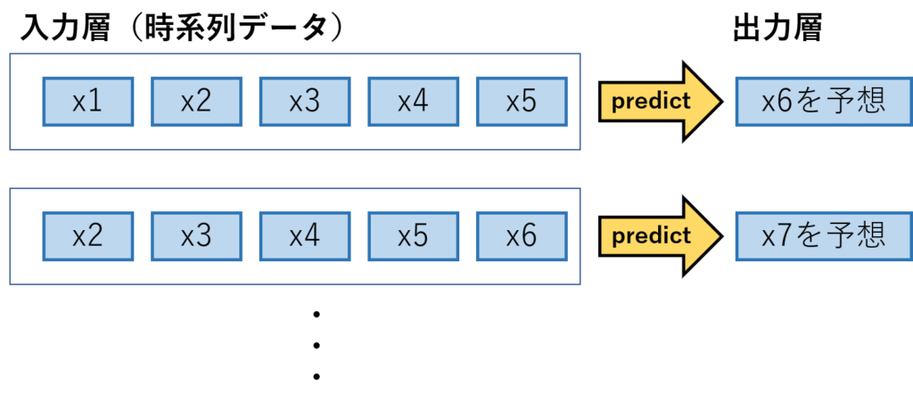
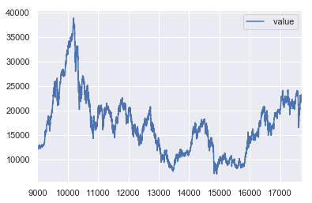
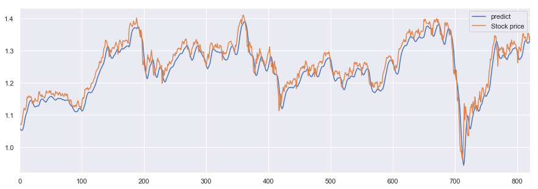
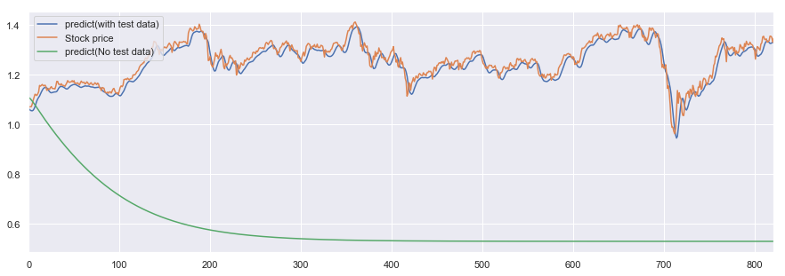

## 概要

時系列データの分析に適したアルゴリズム、LSTMを利用して、みんな大好き株価の予測のモデルをお試しで作ってみました。

時系列データの分析については初心者なので、細かい理論についてはつよつよさんにお任せして、簡単な実装の方法だけ記します。

使い方に間違いあればご指摘ください。

### 21/5/25 追記

思いのほか読まれているのでソースコードをgithubにアップしました。よければご確認ください。

 [GitHub - cpptake/stock\_price\_prediction: predict stock using LSTM(Long Short Term Memory) in Keras predict stock using LSTM(Long Short Term Memory) in Keras - cpptake/stock\_price\_prediction github.com](https://github.com/cpptake/stock_price_prediction)   

## LSTMについて

### LSTM概要

LSTM（**Long Short Term Memory**）は、ニューラルネットワークを利用したアルゴリズムの一つです。

時系列データに適したニューラルネットワークとしてはRNN（Recurrent Neural Network)が有名ですが、LSTMはRNNの弱点である勾配消失問題を解決するために提唱されたRNNの改良版のアルゴリズムだそうです。

詳細はこちらのQiitaの記事がまとまってたのでご覧ください。（[今度こそわかるぞRNN, LSTM編](https://qiita.com/kazukiii/items/df809d6cd5d7d1f57be3)）

ちなみに、ニューラルネットワークを利用しない場合、ARIMAなどのモデルが有名です。余裕あれば実装してみます。

### 入出力の型　イメージ

LSTMには、窓と呼ばれる連続する時系列データをひとまとまりにしたものを入力する必要があります。

イメージし辛いので、入出力の形を下記の図にまとめました。


*LSTM入力層出力層イメージ*

図は窓を「５」に設定し、過去５回分のデータを学習して、次に来る６回目のデータを予想するというモデルの概要になってます。

## 実装

### データ確認

早速実装してみます。

まずは、データのインポートと株価のデータの波形の確認を実施します。

なお、今回予測するデータは日経平均株価のデータを[こちら](http://k-db.com/)から持ってきて利用します。

```python
import pandas as pd
import numpy as np
import matplotlib.pyplot as plt
import seaborn as sns
sns.set()

#株価データのインポート
data = pd.read_csv('dataset/nikkei-225-index-historical-chart-data.csv',header=8)

#前半の部分を削除
data = data.query('index >9000')
data = data.drop(['date'],axis =1)

#データを確認
data.plot()
```


*出力結果（日経平均株価時系列データ）*

細かい上下の動きはありますが、周期性が見られない点が気になります。

LSTMは過去のデータの傾向を利用して、未来を予想するので周期性が見られないと精度が下がってしまうのではないかと懸念されるのですがどうでしょうか。

### 入力データを加工

入力データは前項の説明の通り、数日分のデータを集めた「窓」と呼ばれる形に加工する必要があるので、test,trainのデータをそれぞれ加工していきます。

```python
# ５０日分のデータを１塊とした窓を作る
def _load_data(data, n_prev = 50):  
   
    docX, docY = [], []
    for i in range(len(data)-n_prev):
        docX.append(data.iloc[i:i+n_prev].as_matrix())
        docY.append(data.iloc[i+n_prev].as_matrix())
    alsX = np.array(docX)
    alsY = np.array(docY)

    return alsX, alsY

def train_test_split(df, test_size=0.1, n_prev = 50):  
    
    ntrn = round(len(df) * (1 - test_size))
    ntrn = int(ntrn)
    X_train, y_train = _load_data(df.iloc[0:ntrn], n_prev)
    X_test, y_test = _load_data(df.iloc[ntrn:], n_prev)

    return (X_train, y_train), (X_test, y_test)

#株価の平均値で割ることで正規化を実施
df = data / data.mean()
length_of_sequences = 50
(X_train, y_train), (X_test, y_test) = train_test_split(df, test_size = 0.1, n_prev = length_of_sequences)

#確認
print("X_train = ",X_train.shape)
print("y_train = ",y_train.shape)
print("X_test  = ",X_test.shape)
print("y_test  = ",y_test.shape)
```

```python
#出力結果
X_train =  (7800, 50, 1)
y_train =  (7800, 1)
X_test  =  (822, 50, 1)
y_test  =  (822, 1)
```

教師データの方は、５０個の窓ができてます。大丈夫そうですね。

### いざ実装

前準備が終わったので実装していきます。

実装には信頼と安定のKeras君を利用します。

```python
from keras.models import Sequential  
from keras.layers.core import Dense, Activation  
from keras.layers.recurrent import LSTM
from keras.layers import Dropout

length_of_sequences = X_train.shape[1]
hidden_neurons = 128
in_out_neurons = 1

#LSTMモデル作成
model = Sequential()
model.add(LSTM(hidden_neurons, batch_input_shape=(None, length_of_sequences, in_out_neurons), return_sequences=False))
model.add(Dropout(0.25))#念のためDropout
model.add(Dense(1))  
model.add(Activation("linear")) 

model.compile(loss="mean_squared_error", optimizer="adam")
history = model.fit(X_train, y_train, batch_size=128, epochs=60, validation_split=0.2)
```

```python
#出力結果
・
・
・
Epoch 58/60
6240/6240 [==============================] - 7s 1ms/step - loss: 0.0028 - val_loss: 4.0730e-04
Epoch 59/60
6240/6240 [==============================] - 7s 1ms/step - loss: 0.0027 - val_loss: 3.1193e-04
Epoch 60/60
6240/6240 [==============================] - 8s 1ms/step - loss: 0.0027 - val_loss: 3.8568e-04
```

60epoch回して学習が終了しました。val\_lossも収束してるので学習曲線は割愛します。

実測値と予測値のグラフを書いてみましょう。

```python
# 予測値算出
predicted = model.predict(X_test) 
# 実績と比較
dataf =  pd.DataFrame(predicted)
dataf.columns = ["predict"]
dataf["Stock price"] = y_test
dataf.plot(figsize=(15, 5))
```


*出力結果（予測値と実際の株価）*

めちゃちゃんと予測できてる。と、一見そう見えますがグラフをよく見ると

**予測値（青グラフ）が実測値（オレンジグラフ）を少し遅れて後追いしているだけのように感じられます。**

LSTMでは陥りやすい現象のようで、タイムラグがあるモデルであることから「**Lag Model**（ラグモデル）」と呼ばれてるみたいです。（多少丸まってるのはDropout層が入ってるせいかと思われます。）

### おまけ　教師データなしで未来の予想

最後にちょっと遊んでみます。

自身の予測値を教師データとして利用して、今回作成したモデルで株価の未来を予測してみたいと思います。

ちなみに、こちらのQiitaの記事を参考にしました。

 [初心者のRNN(LSTM) \| Kerasで試してみる - Qiita 時系列データ解析の為にRNNを使ってみようと思い，簡単な実装をして,時系列データとして ほとんど，以下の真似ごとなのでいいねはそちらにお願いします． 深層学習ライブラリKerasでRNNを使ってsin波予測 LSTM で正弦波を予測する CHANGE LOG 2020/... qiita.com](https://qiita.com/sasayabaku/items/b7872a3b8acc7d6261bf) 

こちらの記事ではsin波を再現していますが、sin波は周期性のあるデータなのでLSTMを利用しても再現性が高いと考えられます。

株価みたいな突発性が高いデータですると、予測値が発散するか収束するかになってしまいそうですがどうでしょうか？

```python
#テストデータの最終行を取得
hoge = X_train.shape[0] - 1
future_test = X_train[hoge]

#予測結果をy_pred_summary に入れる
y_pred_summary = np.empty((1))

n = X_test.shape[0]

for step in range(n):
    
    #最新のテストデータで予測値を算出
    test_data = np.reshape(future_test,(1,50,1))
    batch_predict = model.predict(test_data)
    
    #予測値を最新のテストデータにしてテストデータを更新
    future_test = np.delete(future_test, 0)
    future_test = np.append(future_test, batch_predict)
    
    #予測結果を順番に保存
    y_pred_summary = np.append(y_pred_summary, batch_predict)


#これまでの結果と合わせてグラフ化
predicted = model.predict(X_test) 
dataf =  pd.DataFrame(predicted)
dataf.columns = ["predict(with test data)"]
dataf["Stock price"] = y_test

#教師データなしの予測値を追加
dataf["predict(No test data)"] = y_pred_summary

dataf.plot(figsize=(15, 5)).legend(loc='upper left')
```


*出力結果*

**ですよね。**

案の定、株価の予測値は収束して実測値との乖離はエラいことになりました。

そんな簡単に株価の予想ができたら苦労しないですね。調子に乗りました。

## まとめ

- LSTMは周期性のあるデータには向いてるが、ランダム性の高い株価予測は難しい。
- 億り人は遠い。
- Keras君からPytorch君に浮気したい。

## その他　参考文献

 [【入門編】機械学習で仮想通貨の価格予測！KerasでLSTMモデルを構築してビットコインとイーサリアムの翌日の価格を予測する方法 入門編としまして、機械学習で仮想通貨の予測をこれから取り組もうと考えている方が対象です。実際にLSTMを構築してビットコインとイーサリアムの翌日の価格を予測してみましょう。 www.codexa.net](https://www.codexa.net/keras-lstm-cryptos-forecast/) 

[KerasでDeep Learning：LSTMで日経平均株価を予測してみる - データサイエンティスト(仮) 導入 前回までで、画像データに関してDeep Learningを試してきました。画像データは、各データが独立と期待されるようなタイプのデータです。しかしながら、Deep Learningはこのような各データが独立であるような場合だけでしかできないというわけではありません。データ間に相関がある場合の代表例として、時系列デ... tekenuko.hatenablog.com](http://tekenuko.hatenablog.com/entry/2017/07/25/005348)
