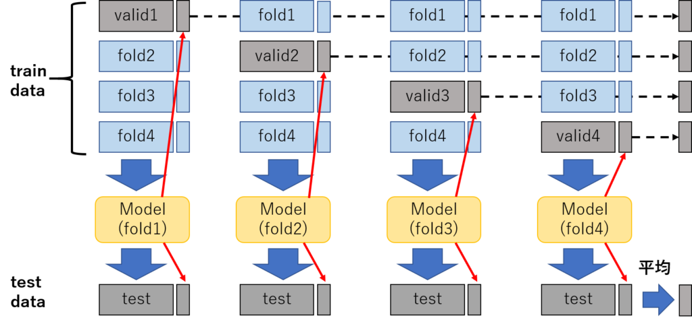
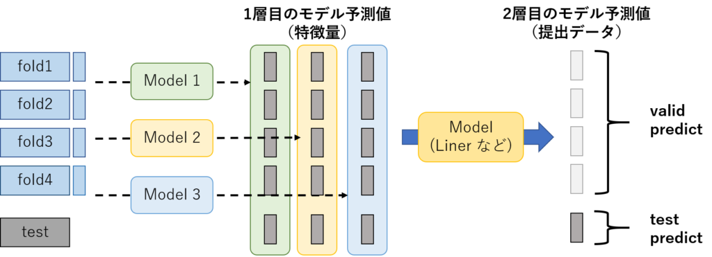

しぃたけ

Kaggleで必須のスタッキングについてまとめます。

## 背景

Kaggleで上位を目指すうえで必須のアンサンブル学習の手法、スタッキングの使い方を図解付きでまとめました。

スタッキング良くわかってない方の参考になればと思います。

参考文献はだいたいこちらです。

[埋め込みコンテンツ](https://www.amazon.co.jp/dp/B07YTDBC3Z)

## スタッキングについて

### 概要

スタッキングはアンサンブル学習の1種で、クロスバリデーションを利用して検証データ（valid data）への予測値を特徴量にして、アンサンブル学習を実施します。

以前、アンサンブル学習で記事を書いたのですが、テストデータの予測値に対して加重平均を行った単純なものですが、スタッキングは検証データに対してアンサンブル学習を行うという違いがあります。

参考までに過去の記事です。

 [【HousePrice】アンサンブル学習使って精度向上した話 しぃ たけKaggle本によく書かれているアンサンブル学習試してみました。概要前回、前処理まで行ったHousePriceのコンペの続きをやっていきます。今回一番やりたいことは、アンサンブル学習を使ってどれくらい... cpptake.com 2020.05.24](http://cpptake.com/archives/221)  

### 手順

スタッキングの手順を、図解と番号で示します。

１．学習データをクロスバリデーションでout-of-foldで学習させ、バリデーションデータへの予測値を作成する。（図1）

2．各foldで学習したモデルでテストデータを予測し、平均を作ったものをテストデータの特徴量とする。（図1）

3．上記の2件をスタッキングしたいモデルの数だけ繰り返す。（図2）

4．上記で作成したモデルの予測値を特徴量として提出データの学習と予測を行う。（Linerモデルが一般的。）（図2）


*図1　スタッキング図解①　fold数=4 の例*


*図2　スタッキング図解②*

ちなみに、検証データから算出した予測値（特徴量）のことを「1層目のデータ」と呼び、「1層目のデータ」を利用して、作成する提出用のデータのことを「2層目のデータ」と呼ぶそうです。

Kaggle業界でもよく使われているので、覚えておいたほうがいいかもです。

## 使ってみた

### データインポート

データセットはCancerデータセット（乳がんデータセット）を利用します。

```python
#データインポート
from sklearn.datasets import  load_breast_cancer
from sklearn.model_selection import  train_test_split
from sklearn.tree import DecisionTreeClassifier
from sklearn.preprocessing import StandardScaler
import pandas as pd

#データloadと標準化
cancer = load_breast_cancer()
scaler_std = StandardScaler()
scaler_std.fit(cancer.data)
std_cancer = scaler_std.transform(cancer.data)

#データフレーム型に変換と分割
df = pd.DataFrame(std_cancer, columns=cancer.feature_names)
target = pd.DataFrame(cancer['target'], columns=['target'])

X_train, X_test, y_train, y_test = train_test_split(df,
                                                    target,
                                                    stratify=target,
                                                    random_state=0)
```

### 1層目のデータ作成

1層目のデータを作成していきます。

まずはクロスバリデーション用の関数を定義します。

関数は下記を引用してます。

 [kagglebook/ch07/ch07-01-stacking.py at master · ghmagazine/kagglebook Contribute to ghmagazine/kagglebook development by creating an account on GitHub. github.com](https://github.com/ghmagazine/kagglebook/blob/master/ch07/ch07-01-stacking.py)  

```plane
from sklearn.metrics import log_loss
from sklearn.model_selection import KFold

# 学習データに対する「目的変数を知らない」予測値と、テストデータに対する予測値を返す関数
def predict_cv(model, train_x, train_y, test_x):
    preds = []
    preds_test = []
    va_idxes = []
    
　　#kfoldパート　分割数は多い方が良いそうなので10を選択
    kf = KFold(n_splits=10, shuffle=True, random_state=71)
    
    # クロスバリデーションで学習・予測を行い、予測値とインデックスを保存する
    for i, (tr_idx, va_idx) in enumerate(kf.split(train_x)):
        tr_x, va_x = train_x.iloc[tr_idx], train_x.iloc[va_idx]
        tr_y, va_y = train_y.iloc[tr_idx], train_y.iloc[va_idx]
        model.fit(tr_x, tr_y, va_x, va_y)
        pred = model.predict(va_x)
        preds.append(pred)
        pred_test = model.predict(test_x)
        preds_test.append(pred_test)
        va_idxes.append(va_idx)
        
    # バリデーションデータに対する予測値を連結し、その後元の順序に並べ直す
    va_idxes = np.concatenate(va_idxes)
    preds = np.concatenate(preds, axis=0)
    order = np.argsort(va_idxes)
    pred_train = preds[order]
    
    # テストデータに対する予測値の平均をとる
    preds_test = np.mean(preds_test, axis=0)
    
    return pred_train, preds_test
```

上記のクロスバリデーションを利用して、1層目のデータを作成していきます。

1層目のデータはXGBoostとニューラルネットワーク（Keras）で作成します。

なお、時間なかったので載せてませんが、Model1XGBとModel1NNは下記の関数を利用しています。

 [kagglebook/ch07/models.py at master · ghmagazine/kagglebook Contribute to ghmagazine/kagglebook development by creating an account on GitHub. github.com](https://github.com/ghmagazine/kagglebook/blob/master/ch07/models.py) 

これらを利用して、検証データとテストデータの精度を検証します。

```plane
from sklearn import metrics       # 精度検証用

# 1層目のモデル（Github参照）
#XGBoost
model_1a = Model1Xgb()
pred_train_1a, pred_test_1a = predict_cv(model_1a, X_train, y_train, X_test)

#KerasNN
model_1b = Model1NN()
pred_train_1b, pred_test_1b = predict_cv(model_1b, X_train, y_train, X_test)

#valid評価
pred_xbg1a = pred_train_1a > 0.5
pred_nn1a  = pred_train_1b > 0.5

#valid正答率
print("xbg valid accuracy：",accuracy_score(y_train, pred_xbg1a))
print("nn valid accuracy：",accuracy_score(y_train, pred_nn1a))

#test評価
pred_xbg1_test = pred_test_1a > 0.5
pred_nn1a_test  = pred_test_1b > 0.5

#test正答率
print("xbg test accuracy：",accuracy_score(y_test, pred_xbg1_test))
print("nn test accuracy：",accuracy_score(y_test, pred_nn1a_test))
```

```plane
#出力データ
xbg valid accuracy： 0.9553990610328639
nn valid accuracy： 0.9812206572769953

xbg cv accuracy： 0.9440559440559441
nn cv accuracy： 0.9440559440559441
```

どちらのモデルも

vaidデータで95%以上の正答率、testデータで94%程度の正答率となりました。

### 2層目モデル作成

最後に、1層目のデータ（予測値）を利用して、アンサンブル学習を実施します。

ちなみに、2層目の予測についてはLinerモデル、もしくはSVMを利用するのが一般的だそうです。今回はLinerモデルを使います。

それでは先ほど作成した、XGBoost、ニューラルネットワークの予測値を利用して、提出用のテストデータの予測を行います。

1層目の予測モデルと比較してどれくらい精度が向上しているのでしょうか？

```plane
# 予測値を特徴量としてデータフレームを作成
train_x_2 = pd.DataFrame({'pred_1a': pred_train_1a, 'pred_1b': pred_train_1b})
test_x_2 = pd.DataFrame({'pred_1a': pred_test_1a, 'pred_1b': pred_test_1b})

# 2層目のモデル　Linerモデルで提出データを予測
model_2 = Model2Linear()
pred_train_2, pred_test_2 = predict_cv(model_2,  train_x_2, y_train, test_x_2)

#valid評価
pred_liner2_valid = pred_train_2 > 0.5
#test評価
pred_liner2_test = pred_test_2 > 0.5

#valid正答率
print("liner valid accuracy：",accuracy_score(y_train, pred_liner2_valid))
#test正答率
print("liner test accuracy：",accuracy_score(y_test, pred_liner2_test))
```

```plane
#出力結果
liner valid accuracy： 0.9788732394366197
liner test accuracy： 0.951048951048951
```

2層目のLinerモデル精度

validデータ　：　97.887%　testデータ　：　95.104%

1層目と2層目の予測モデルの結果を比較するとこんな感じです。

|  |  |  |
| --- | --- | --- |
|  | valid data | test data |
| 1層目　XGBoost | 95.539 % | 94.405 % |
| 1層目　NN | 98.122 % | 94.405 % |
| 2層目　Liner | 97.887 % | 95.104 % |

*予測結果*

2層目のデータの方がtest dataに対する予測値精度が向上するという結果となりました。

## まとめ

アンサンブル学習の手法であるスタッキングについてまとめました。

Kaggleで上位を目指すうえでは避けては通れない道であるので、使いこなしましょう。

[埋め込みコンテンツ](https://www.amazon.co.jp/dp/B088R992TJ)

[埋め込みコンテンツ](https://www.amazon.co.jp/dp/4798058750)
