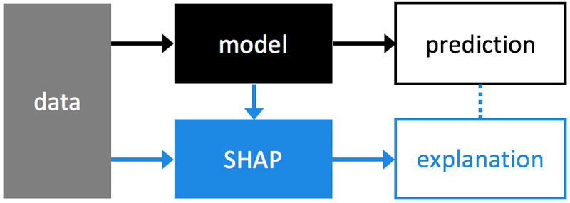
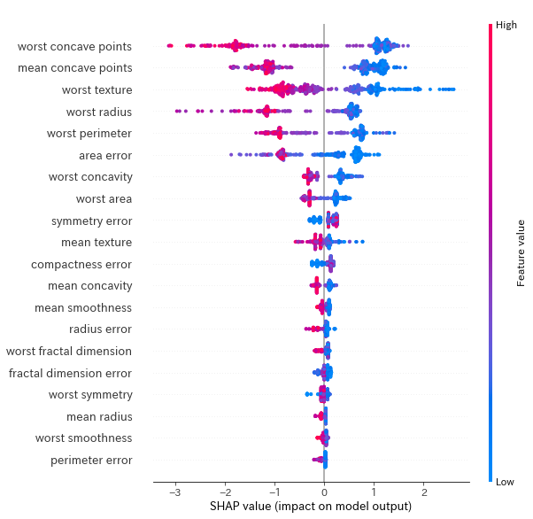
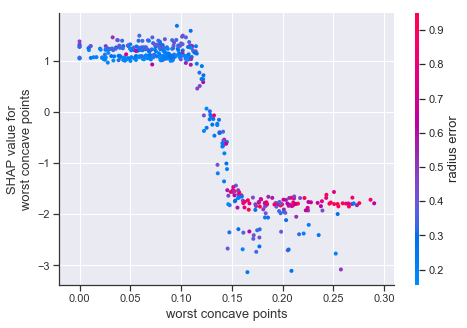
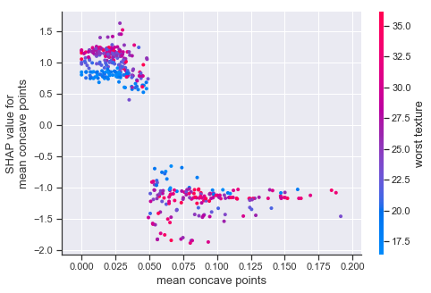
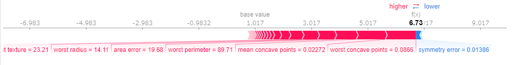
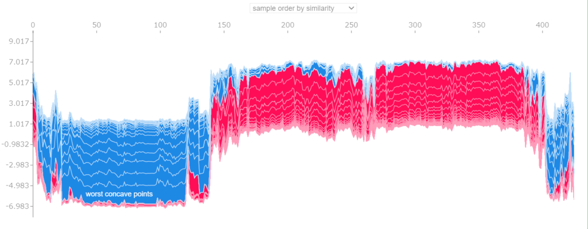

## 背景

近年、機械学習アルゴリズムの複雑化に伴い、予測結果が説明できないことが大きな課題になってます。

今回は、機械学習の予測結果を解釈するための方法の一つである、SHAP値について勉強したのでメモ程度に残しておきます。

なるべく数式は使わずに記事書くので、数学的な背景知りたい方はごめんなさい。

（[SHAP公式](https://shap.readthedocs.io/en/latest/#)、[SHAP値論文](https://t.co/TTo9N17LLc?amp=1)）

[埋め込みコンテンツ](https://www.amazon.co.jp/dp/B07VMQCCBG)

[埋め込みコンテンツ](https://www.amazon.co.jp/dp/B017SMDGAI)

[埋め込みコンテンツ](https://www.amazon.co.jp/dp/B07DC88C26)

## SHAP値

### SHAP値とは

SHAP値はSHapley Additive exPlanationsの略称です。

fitした機械学習のモデルにそれぞれの特徴量がどのように寄与をしたかを説明する値です。

オフィシャルで用意されている概要図が下記です。


*SHAP概要図*

### feature importanceとの違い

特徴量の影響度を測る指標としてfeature importnceが存在しますが、

feature importnceは、モデルを作成する前に、どの特徴量が重要であるかを知るための指標（大域的な説明を与えるアプローチ）

SHAPは、作成したモデルに対して、各特徴量がどのように予測に寄与しているかを知るための指標（局所的な説明を与えるアプローチ）

という風に使う場面は分かれております。

## 使ってみた

### データインポート、SHAPの適用

まずは、SHAPのライブラリをpip installしていきます。

```plane
pip install shap
```

データセットは前回と同様のcancerデータセット、モデルはXGBoostを利用します。

なお、今回利用する「TreeExplainer」は、決定木系のアルゴリズムに適用できるメソッドです。モデルのアルゴリズムによって利用するメソッドが変わるので注意です。

```python
#データインポート
from sklearn.datasets import  load_breast_cancer
from sklearn.model_selection import  train_test_split
import xgboost as XGB
import pandas as pd
import shap

#Cancerデータload
cancer = load_breast_cancer()
 
#データフレーム型に変換と分割
df = pd.DataFrame(cancer.data, columns=cancer.feature_names)
target = pd.DataFrame(cancer['target'], columns=['target'])
 
X_train, X_test, y_train, y_test = train_test_split(df,
                                                    target,
                                                    stratify=target,
                                                    random_state=0)

xgb = XGB.XGBClassifier(random_state=0)
xgb.fit(X_train,y_train)

#TreeExplainer・・・決定木系に利用できるメソッド
explainer = shap.TreeExplainer(xgb)
shap_values = explainer.shap_values(X_train) # X_trainは訓練データのpandas.DataFrame
```

### summary\_plot

前準備が終了したので、寄与度を可視化していきます。

最初にsummary\_plotを利用して、目的変数に対する特徴量の寄与度をみてみましょう。

```plane
shap.summary_plot(shap_values, X_train)
```



横軸にSHAP値、縦軸に特徴量の項目、プロットの色が特徴量の値を表しており、縦軸の上位の項目ほどモデルへの寄与度が高いことを表しています。

今回のモデルでは、**‘worst concave points’、’mean concave points’**などがモデルへの貢献度が高いと表示されています。

また、cancerデータセットは2クラス分類問題であるので上位の特徴量はすべて大きく2つの塊に分かれていることがわかります。

### dependence\_plot

次に先ほど上位に表示された、**‘worst concave points’、’mean concave points’**特徴量をdependence\_plot機能で確認していきます。

```plane
shap.dependence_plot('worst concave points',shap_values, X_train)

shap.dependence_plot('mean concave points',shap_values, X_train)
```





こちらは、横軸に特徴値の値を、縦軸に同じ特徴量に対するShap値をプロットしております。

2クラス分類問題である場合、特徴量とShap値がきれいに分かれているほど、目的変数への影響度も高いと考えられます。

今回でいうと、’mean concave points’の特徴量は特徴量が0.05の辺りでSHAP値が2分割されているため、寄与度が高い特徴量といえそうです。

### force\_plot

最後に、Shap値と特徴変数の寄与度を視覚化するforce\_plotの機能を試します。

```plane
#force_plot表示
shap.force_plot(explainer.expected_value, shap_values[0,:], X_train.iloc[0,:])
```



この機能では、1サンプル毎の予測結果を可視化できます。

予測の過程をみても特定の特徴量が支配的に効いているのではなくまんべんなく多くの特徴量が寄与していることがわかります。

すべてのデータに対する計算過程を見たければ下記のように記述します。

```python
shap.force_plot(base_value=explainer.expected_value, shap_values=shap_values, features=X_train)
```



## まとめ

SHAPを使うと機械学習とモデルと対話するように分析が可能です。

業務などでモデルの解釈性の説明が必要な際には使ってみてください。

[埋め込みコンテンツ](https://www.amazon.co.jp/dp/B07JGP3VC7)

[埋め込みコンテンツ](https://www.amazon.co.jp/dp/B01MYENRVP)

## 参考文献

[埋め込みコンテンツ](https://knknkn.hatenablog.com/entry/2019/05/07/215124)

 [ページが見つかりませんでした – MIIDAS Science Blog research.miidas.jp](https://research.miidas.jp/2019/11/shap%E5%80%A4%E3%81%A7%E8%A7%A3%E9%87%88%E3%81%99%E3%82%8B%E5%89%8D%E3%81%ABpermutation-importance%E3%82%92%E7%9F%A5%E3%82%8B/) [https://www.slideshare.net/RyuichiKanoh/miru2020-tutorial-237272385 t.co](https://t.co/18NM5CNGMe?amp=1) [The Science Behind InterpretML: SHAP Learn more about the research that powers InterpretML from SHAP creator, Scott Lundberg from Microsoft ResearchLearn More:Azure Blog Responsible MLAzure ML The ... learn.microsoft.com](https://channel9.msdn.com/Shows/AI-Show/The-Science-Behind-InterpretML-SHAP) [機械学習における解釈性について こんにちは。Merpay Advent Calendar 2019 の24日目は、メルペイ Machine Learning チームの @yuhi が機械学習における解釈性についてお送りします。目次機械学習における解釈性とはなぜ解釈性が必要 engineering.mercari.com](https://engineering.mercari.com/blog/entry/2019-12-24-070000/#%E3%81%AA%E3%81%9C%E8%A7%A3%E9%87%88%E6%80%A7%E3%81%8C%E5%BF%85%E8%A6%81%E3%81%AA%E3%81%AE%E3%81%8B)
