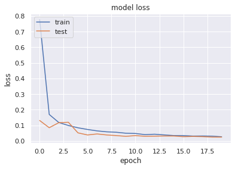
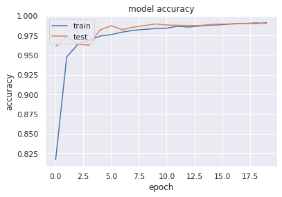
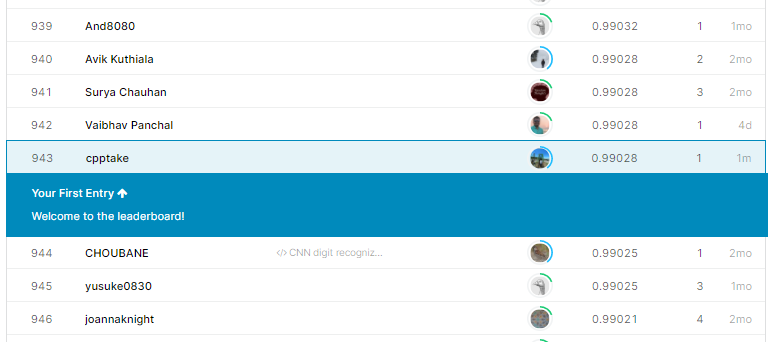

## 概要

ハイパーパラメータのチューニングめんどくさくないですか？

ということで、機械学習モデル作成の際に避けては通れないハイパーパラメータのチューニングを自動化するツール、「optuna」を利用してみました。

kaggleなどでも一般的になってきているツールなので使えるに越したことはなさそうです。

### optunaとは

クソ適当に箇条書きします。

- 機械学習モデルのハイパーパラメータ自動最適化フレームワークだよ
- 株式会社Preferred Networksが開発したMade in Japanのフレームワークだよ
- 最適化したいパラメータとパラメータの範囲を決めておけば、範囲内のパラメータの最適値を探索してくれるすごいやつだよ
- ベイズ最適化を利用してるらしいよ

公式リファレンスは下記を参照ください。

（[optuna公式](https://optuna.readthedocs.io/en/latest/index.html#)、[チュートリアル](https://optuna.readthedocs.io/en/latest/tutorial/index.html)）

[埋め込みコンテンツ](https://www.amazon.co.jp/dp/B079QRQTCR)

[埋め込みコンテンツ](https://www.amazon.co.jp/dp/B07HCSQ48P)

[埋め込みコンテンツ](https://www.amazon.co.jp/dp/B07QXMZ7C8)

### 21/6/11　追記

想像以上に多くの方に読まれてるので、ソースコード公開します。

githubにしようかと思いましたが、kaggleの公開Codeに載せたのでこちらをご参照ください。

 [MNIST CNN(Keras) with optuna visualization【日本語あり】 Explore and run AI code with Kaggle Notebooks \| Using data from Digit Recognizer kaggle.com](https://www.kaggle.com/takeshikobayashi/mnist-cnn-keras-with-optuna-visualization)  

## 使ってみた

### 利用するデータセット

利用するデータセットは以前記事にした、kaggleのMNISTデータセットを利用したDigit Recognizerのコンペのデータを利用して、CNNのパラメータ最適化を実施したいと思います。

 [Digit Recognizer Learn computer vision fundamentals with the famous MNIST data kaggle.com](https://www.kaggle.com/c/digit-recognizer/overview) 

下記に前回の記事を載せときます。この時はパラメータのことを考えないまま適当にモデル作ったので、どれだけ精度向上が見込めるか期待です。

 [【Digit Recognizer】Kerasを使ってCNN作ってMNISTの識別精度向上した話 しぃ たけKerasでCNN（畳み込みニューラルネットワーク）を作成してMNISTデータセットの識別を行ったら99％近い識別率が出せたので記事を書きました。概要前回、MLP（多層パーセプトロン）を使って、Kaggleの... cpptake.com 2020.05.08](http://cpptake.com/archives/161)  

### データインポート&前処理

データインポート、前処理については、過去の記事と同様の処理を行います。

割愛しようかと思いましたが、念のため。

```plane
#データインポート
import pandas as pd
import numpy as np
from sklearn.model_selection import train_test_split
import matplotlib.pyplot as plt

train = pd.read_csv('../input/digit-recognizer/train.csv') 
test = pd.read_csv('../input/digit-recognizer/test.csv')

#　教師データ、テストデータに分類して、float型に変換する。
X_train = (train.iloc[:,1:].values).astype('float32') 
y_train = train.iloc[:,0].values
X_test = test.values.astype('float32')

#精度確認のため、教師データをさらに教師データ、テストデータに分割
X_train2, X_test2, y_train2, y_test2 = train_test_split(X_train,
                                                        y_train, 
                                                        test_size = 0.2,
                                                        train_size = 0.8,
                                                        stratify = y_train)

#データreshape（28×28の行列に変換）
img_rows, img_cols = 28, 28
num_classes = 10

X_train2 = X_train2.reshape(X_train2.shape[0], img_rows, img_cols, 1)
X_test2 = X_test2.reshape(X_test2.shape[0], img_rows, img_cols, 1)

#y_trainのデータをto_categoricalで2値クラスの行列へ変換
y_train2 = keras.utils.to_categorical(y_train2, num_classes)
```

### 最適化するパラメータの範囲を決定

ここから本題のoptunaを使ってみます。

前回のモデルを参考にモデルを構築しますが、最適化したいパラメータを変数にしておきます。

- 畳み込み層の深さ（num\_layer)
- 各畳み込み層のフィルターの形状（num\_filters）
- 全結合層のノード数（mid\_units）
- Dropout率（dropout\_rate）
- 最適化手法（optimizer）

前回の記事では畳み込み層2層のモデルであったので、もう少し層を深くした方が精度が上がるのではないかと思ってます。

```python
import optuna
import keras
from keras.models import Sequential
from keras.layers import Dense, Dropout, Flatten
from keras.layers import Conv2D, MaxPooling2D

img_rows, img_cols = 28, 28
num_classes = 10

#CNNモデルの定義
def create_model(num_layer, mid_units, num_filters,dropout_rate):
    
    model = Sequential()
    model.add(Conv2D(filters=num_filters[0], kernel_size=(3, 3),
                 activation="relu",
                 input_shape=(img_rows, img_cols, 1)))
    for i in range(1,num_layer):
        model.add(Conv2D(filters=num_filters[i], kernel_size=(3,3), padding="same", activation="relu"))
    model.add(MaxPooling2D(pool_size=(2, 2)))
    model.add(Dropout(dropout_rate))
    model.add(Flatten())
    model.add(Dense(mid_units))
    model.add(Dropout(dropout_rate))
    model.add(Dense(num_classes, activation='softmax'))
    
    return model
```

次に、探索するパラメータの範囲を決定します。

今回主に使う関数は下記の4点です。

|  |  |  |
| --- | --- | --- |
| 関数名 | 対象の型 | 説明 |
| suggest\_int | int型 | 指定した範囲の実数値の最適値を探索（実数値） |
| suggest\_uniform | float型　など | 指定した範囲の最適値の最適地を探索（浮動小数点あり） |
| suggest\_discrete\_uniform | int,float型　など | 指定した範囲、間隔で最適値を探索（100～500の範囲を、100刻みで探索　など） |
| suggest\_categorical | カテゴリ変数 | 指定したカテゴリ変数の最適値を探索（”sgd”, “adam”どっちが最適か　など） |

*optuna関数まとめ*

```python
#パラメータ最適化部
def objective(trial):
    print("Optimize Start")
    
    #セッションのクリア
    keras.backend.clear_session()
    
    #畳込み層の数のパラメータ
    num_layer = trial.suggest_int("num_layer", 2, 5)
    
    #全結合層のノード数
    mid_units = int(trial.suggest_discrete_uniform("mid_units", 100, 300, 100))
    
    #各畳込み層のフィルタ数
    num_filters = [int(trial.suggest_discrete_uniform("num_filter_"+str(i), 16, 128, 16)) for i in range(num_layer)]
    
    #Dropout率
    dropout_rate = trial.suggest_uniform('dropout_rate', 0.0, 0.5)
    
    #optimizer
    optimizer = trial.suggest_categorical("optimizer", ["sgd", "adam"])
    
    model = create_model(num_layer, mid_units, num_filters,dropout_rate)
    model.compile(optimizer=optimizer,
          loss="categorical_crossentropy",
          metrics=["accuracy"])
    
    history = model.fit(X_train2, y_train2, verbose=0, epochs=20, batch_size=128, validation_split=0.1)
    
    scores = model.evaluate(X_train2, y_train2)
    print('accuracy={}'.format(*scores))
    
    #検証用データに対する正答率が最大となるハイパーパラメータを求める
    return 1 - history.history["val_accuracy"][-1]
```

これで最適化の準備完了です。

### 最適化

最適化をする際は、「create\_study」を利用してstudyオブジェクトを生成、「optimize」関数で最適化を実行の２STEPを踏む必要があります。

最適化は指定した範囲のパラメータをランダムに振ったモデルを、optimize関数の「n\_traials」数だけ作成し、一番評価値が高かったパラメータを最適値とする。

という方法で実施されます。

```plane
# studyオブジェクト生成
study = optuna.create_study()
# 最適化実行
study.optimize(objective, n_trials=30)#時短のため30回
```

30回の探索が終了したので、studyオブジェクトのbest\_paramsを使って、選ばれたベストパラメータを確認していきます。

```plane
study.best_params
```

```plane
#出力結果
{'num_layer ': 5,
 'num_filter_0': 48.0,
 'num_filter_1': 64.0,
 'num_filter_2': 96.0,
 'num_filter_3': 96.0,
 'num_filter_4': 128.0,
 'mid_units': 100.0,
 'optimizer': 'sgd',
 'dropout_rate'  0.4916904519518987 }
```

上記が今回のベストパラメータでした。畳み込み層の層数（num\_layer）が5になっています。前回のモデルは2層のCNNであったので、一番効いているパラメータである層数を適当に設定しまくったみたいです。

ちなみに上記の最適化をローカル環境で行ったところ、3時間くらいかけてもepochが2回しか回ってなかったので、GPU環境は必須です。

### 最適化モデル作成

最適化後のパラメータを利用して、新しいモデルを作成していきます。

コードは下記です。

```python
#最適paramterのセット
num_filters = [48,64,96,96,128]
mid_units= 100
dropout_rate = 0.4916904519518987
optimizer = 'sgd'

#最適化後のモデル(畳み込み層5層のCNN)
model_best = Sequential()
model_best.add(Conv2D(filters=num_filters[0], kernel_size=(3, 3),activation="relu",input_shape=(img_rows, img_cols, 1)))
model_best.add(Conv2D(filters=num_filters[1], kernel_size=(3,3), padding="same", activation="relu"))
model_best.add(Conv2D(filters=num_filters[2], kernel_size=(3,3), padding="same", activation="relu"))
model_best.add(Conv2D(filters=num_filters[3], kernel_size=(3,3), padding="same", activation="relu"))
model_best.add(Conv2D(filters=num_filters[4], kernel_size=(3,3), padding="same", activation="relu"))
model_best.add(MaxPooling2D(pool_size=(2, 2)))
model_best.add(Dropout(dropout_rate))
model_best.add(Flatten())
model_best.add(Dense(mid_units))
model_best.add(Dropout(dropout_rate))
model_best.add(Dense(num_classes, activation='softmax'))

#最適化手法などを決定
model_best.compile(loss=keras.losses.categorical_crossentropy,
              #optimizer=keras.optimizers.Adadelta(),
              optimizer=optimizer,
              metrics=['accuracy'])

#本番データをreshape
X_train = X_train.reshape(X_train.shape[0], img_rows, img_cols, 1)
X_test = X_test.reshape(X_test.shape[0], img_rows, img_cols, 1)
y_train = keras.utils.to_categorical(y_train, num_classes)

#学習を開始
hist2 = model_best.fit(X_train, y_train,
                 batch_size=128,
                 epochs=20,
                 validation_split=0.1,
                 verbose=1)

scores_best = model_best.evaluate(X_train, y_train)
```

```plane
#出力結果
・
・
・
ETA: 0s - loss: 0.0118 - accuracy: 0.99 - 
ETA: 0s - loss: 0.0119 - accuracy: 0.99 - 
6s 4ms/step - loss: 0.0119 - accuracy: 0.9966
```

accuracyが0.9966（99.66%）でした。

ちなみに前回の記事のモデルも同等の精度でしたが、正直これ以上上がりにくいのでこんなもんかなと思います。

### 学習曲線

最後に過学習（overfitting）、学習不足（underfitting）を確認に学習曲線を図示してみます。

```python
#loss
plt.plot(hist2.history['loss'])
plt.plot(hist2.history['val_loss'])
plt.title('model loss')
plt.ylabel('loss')
plt.xlabel('epoch')
plt.legend(['train', 'test'], loc='upper left')
plt.show()

#Accuracy
plt.figure()
plt.plot(hist2.history['accuracy'])
plt.plot(hist2.history['val_accuracy'])
plt.title('model accuracy')
plt.ylabel('accuracy')
plt.xlabel('epoch')
plt.legend(['train', 'test'], loc='upper left')
plt.show()
```


*lossの学習曲線*


*accuracyの学習曲線*

過学習などの傾向はみられませんでした。というよりもtrainデータとtestデータの精度がほとんど一致してるので、前回よりいい気がします。

### 提出

さあ、結果を確認しましょう。出力用のコードは前回の記事をまるパクリです。

```plane
#テストデータの予測結果を出力（predeict_classes)
y_pred = model_best.predict_classes(X_test_best)
 
my_cnn = pd.DataFrame()
imageid = []
 
for i in range(len(X_test_best)):
    imageid.append(i+1)
    
my_cnn['ImageId'] = imageid
my_cnn["label"] = y_pred
my_cnn.to_csv("./cnn_optuna.csv", index=False)

print('csv書き出し終了')
```

提出結果


*99%超えたなう*

**Score：99.028%　順位：943位/2335位中**

以前作成したモデルと比較するこんな感じです。

|  |  |
| --- | --- |
| model | score |
| MLP(scikit-learn) | 0.95971 |
| CNN(Keras) | 0.98814 |
| CNN(Keras) with optuna | 0.99028 |

ちょっと精度上がった。

## まとめ

機械学習のハイパーパラメータ最適化ツールoptunaを利用して、KerasのCNNモデルの精度が向上することを確認しました。

計算コストは膨大ですが、kaggleなどの精度が求められる分野では武器になりそうなので、今後も使っていきます。

### 関係ないけど

こんな記事見つけました。なんでCNNの記事書いた瞬間にこんなこと言うの。今度使お。

 [画像認識の大革命。AI界で話題爆発中の「Vision Transformer」を解説！ - Qiita 2020/10/24: 公式実装の追加 オミータです。ツイッターで人工知能のことや他媒体の記事など を紹介していますので、人工知能のことをもっと知りたい方などは @omiita\_atiimoをご覧ください！ 他にも次のような記事を書いていますので興味があればぜひ！ ... qiita.com](https://qiita.com/omiita/items/0049ade809c4817670d7) 

[埋め込みコンテンツ](https://www.amazon.co.jp/dp/B07RXHTF65)

[埋め込みコンテンツ](https://www.amazon.co.jp/dp/B084DWX1PV)

[埋め込みコンテンツ](https://www.amazon.co.jp/dp/B07CWNLHJ8)

## 参考文献

ありがとうございます。

 [Optuna+KerasでCNNのハイパーパラメータを最適化 - Qiita はじめに 2018/12/2にPreferred Networksからハイパーパラメータ自動最適化ツール「Optuna」が公開されました。本記事では、ざっくりと使い方を確認しながらfashion mnist分類問題を例にとって、この問題を解くためのCNNのハイパーパラメー... qiita.com](https://qiita.com/ryota717/items/28e2167ea69bee7e250d) 

[埋め込みコンテンツ](https://ossan-ml.hateblo.jp/entry/2019/03/23/203307)
