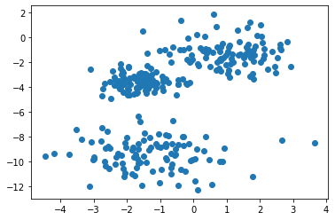
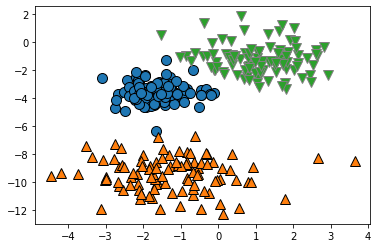
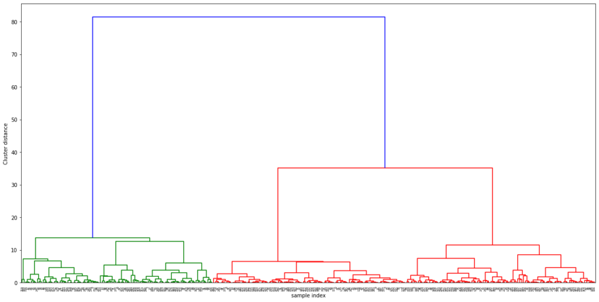
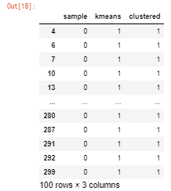

しぃたけ

代表的なクラスタリングの手法の違いについて説明します。

## 概要

こんにちは、しぃたけです。

実務で製造データを分析するとき、データをグループ分けをすることがありその際にクラスタリングをよく活用します。

クラスタリングのアルゴリズムで代表的なものはk-means clusterや階層的クラスターがあると思いますが、使い分けで迷うことがあると思うのでアルゴリズムの違いや、使いやすい方をお勧めしたくて記事にしました。（あくまで持論なので、参考程度にご覧ください。）

参考文献、主にこれです。

[埋め込みコンテンツ](https://www.amazon.co.jp/dp/4873117984)

## アルゴリズムの特徴

### 結論

結論になりますが、自分は実務でクラスタリング（k-means or 階層的クラスター）を使う際は

**階層的クラスターを利用することをお勧めしてます。**

理由は下記の理由でk-meansより階層的クラスタリングのほうが優れていると思うからです。

#### k-means clusterの特徴

- クラスタ数を最初に指定する必要がある。
- 分類結果を図示しにくいため、説明性が低い
- 分類結果に初期値依存性がある。

実務でクラス分けを利用するうえで、上記のような特徴は壁になることが多いです。

実務で利用するデータは分類したいクラスタ数が分かっていない事が多く、あらかじめクラスタ数を決めるk-means clusterの特性は利用しにくかったりします。

また、分類結果が妥当であるかを検討するには、分類の説明性が肝心になってきます。その点でもk-means clusterには使いにくさがあります。

#### 階層的クラスターの特徴

対して階層的クラスタ－はk-meansの特徴の逆になってます。

- クラスタ数を最初に指定しなくてもいい。
- 分類結果をデンドログラムで図示でき、説明性が高い。
- 初期値依存性がない。

分類結果を図示ができるため、分類したいデータのクラスタがいくつ存在するかなど、対話的に分析ができることができるので実務では扱いやすいと感じています。

## やってみた

### データ作成

早速Pythonで実装してみます。

まずはクラスタリングに利用するデータを作成します。

```python
import mglearn
from sklearn.datasets import make_blobs
import matplotlib.pyplot as plt

#ガウス分布で3つのクラスターを作成 分散は適当に設定
X,y = make_blobs(n_samples =300,cluster_std=[1.2,1,0.6],random_state = 2)
fig = plt.figure()
ax = fig.add_subplot(1,1,1)
ax.scatter(X[:,0],X[:,1])
```



3か所、各100点データを作成しました。多少ばらけさせたので、ぱっと見てどこにクラスタがあるかはわかりにくくなってます。

このデータを利用して、k-meansと階層的クラスターでクラスタリングを実施してみます。

### k-means cluser

まずはk-meansで分類を行います。

```plane
from sklearn.cluster import KMeans

#kmeansを実装
y_pred = KMeans(n_clusters = 3,random_state = 0).fit_predict(X)
mglearn.discrete_scatter(X[:,0],X[:,1],y_pred)
```


*k means cluster*

図示してみると、いい感じに分類できてそうですね。

しかし、分類結果は問題なさそうですが、**このように分類の結果を図示できるのは、部類に利用している特徴量が2次元であったので図示ができているだけです。**

一般的に分析に利用するデータの次元数は数十～数百次元くらいあるものが多いかと思います、実際にはこのように分類結果を図示することは難しいです。

というか、2次元データを分類するくらいなら、クラスタリングも必要なくて目視で分類でいいんじゃないかなぁと思います。何にでもアルゴリズムを使えばいいってもんじゃないです。

### 階層的クラスタ―

次に同様のデータを使って、階層的クラスターを実装してみます。

```plane
#階層的クラスタリングはscipyらしい
import scipy.spatial.distance as distance
from scipy.cluster.hierarchy import dendrogram, ward

#ward法で分類
linkage_array = ward(X)

ax = plt.figure(figsize=(20,10)).gca()
dendrogram(linkage_array)
bounds = ax.get_xbound()

plt.xlabel("sample index",fontsize=10)
plt.ylabel("Cluster distance",fontsize=10)
```


*階層的クラスタリング*

縦軸がデータ間の距離、横軸がデータの項目名となっており、縦軸の距離が離れていればいるほどグループ間の距離が遠いことを表しています。

グラフを見ると大きく3つのグループ（緑のグループ、赤の2グループ　計3グループ）があることがわかり、**クラスターの数を最初に指定しなくても3つのグループに分類できることがわかります。**

縦軸の閾値25を切って、３グループに分類した結果を取得します。

```python
from scipy.cluster.hierarchy import linkage, fcluster

# クラスタ分けするしきい値を決める。3分割したいので25に設定。
threshold = 25
linkage_array = linkage(X, method='ward', metric='euclidean')

# クラスタリング結果の値を取得
clustered = fcluster(linkage_array, threshold, criterion='distance')
```

このように階層的クラスターは対話的にクラスタ数を選ぶことができます。

### 精度確認

最後にそれぞれのクラスタリングの結果を確認しときます。

```python
#分類結果と正解データの比較
import pandas as pd

dfy = pd.DataFrame(y)
df_kmean = pd.DataFrame(y_pred)
dfclus = pd.DataFrame(clustered)

print('元データのクラス数：',dfy.value_counts())
print('k-meansの分類結果：',df_kmean.value_counts())
print('階層的クラスタ分類結果：',dfclus.value_counts())
```

```plane
#出力結果
元データのクラス数： 
2    100
1    100
0    100
dtype: int64
k-meansの分類結果： 
0    104
1     99
2     97
dtype: int64
階層的クラスタ分類結果： 
2    101
1    100
3     99
dtype: int64
```

正解データは3クラスのデータが、各クラス100個づつ存在しますが、k-meansも階層的クラスタも各クラスのデータ数は100前後なのでかなり精度よく分類できていると思われます。

念のため、正しく分類されてるか確認しときます。

```plane
df1 = pd.concat([dfy, df_kmean, dfclus],axis = 1)
df1.columns=['sample', 'kmeans', 'clustered']

#sampleが0のデータのみサブセット
df1.query('sample== 0')
```



k-meansの分類結果と階層的クラスターの分類結果は見たところ一致してるので、精度は同じくらいであると考えられます。精度が同じなのであれば説明性が高い方を使いたいかなぁ。

## まとめ

k-meansと階層的クラスターの比較をしました。

精度は同じくらいだったので、説明性が高く、クラスタ数の指定もない階層的クラスターをお勧めします。

また、クラスタリングの手法としては、SOM（自己組織化マップ）、混合分布モデルなどほかにもアルゴリズムあるので気が向いたら実装してみます。

[埋め込みコンテンツ](https://www.amazon.co.jp/dp/4627849710)
