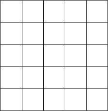
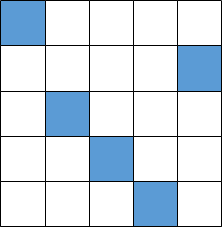
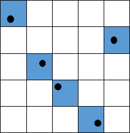
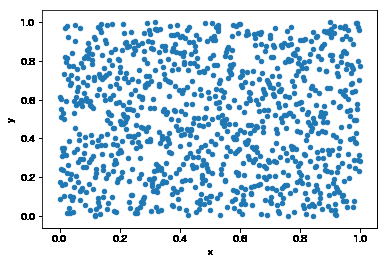
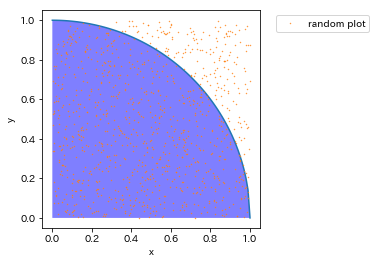
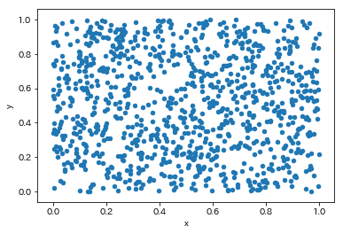

## 概要

業務でモンテカルロ法を使う事があった際、会社のつよつよさんに

「乱数発生させるときは、ラテン超方格法を利用すると精度が上がるよ」

というアドバイスをもらったので、実装してみました。メモとして残します。

## ラテン超方格法について

### 何それ

ややこしい数式は避けて、概要だけまとめます。

- 多変数の層別サンプリング手法のひとつだよ
- 一様分布に比べて偏りが少ないから、少ないn数で精度が出せるよ。
- 実験計画法などでよく利用されているよ。

なお、ラテン超方格法の説明については[こちら](https://qiita.com/nabenabe0928/items/906ce2ad511833609b38)の記事を参考にしてます。

### 図で理解する

一般的な一様分布は決められた範囲内を疑似乱数を発生させてサンプリングを行いますが、ラテン超方格法は下記の手順で乱数を発生させます。

- 範囲内をグリッドで区切る



- 列から行がかぶらないように1列づつグリッドを選択



- グリッド内で乱数発生



なるほど、この方法ならよりばらつきが少なくサンプルが取れそう。

## 円周率近似実装

ということで実装して精度検証してみます。

精度検証の方法は下記のnishipyさんの記事を参考に、**モンテカルロ法を用いた円周率近似を用いて一様分布とラテン超方格法の場合で比較をしていきたいと思います。**

  [\[Python\]モンテカルロ法で円周率を近似してみる NishipyPython歴2ヶ月位の私が、とあるきっかけで、モンテカルロ法を思い出しました。懐かしいのでPythonで実装してみて、円周率(π)を近似してみます。図を描く練習にもなりました。1. きっかけPythonを勉強するにあたって、 nishipy.com](https://nishipy.com/archives/326) 

下記の手順で円周率の近似は行います。

- 0～1の範囲で乱数を発生させる。（ラテン超方格法 or 一様分布）
- 円の四分の一のサイズの半径１の扇型を描画し、扇形の外にある点の個数と内側にある個数をカウント
- （扇形の中にある点の個数/全部の点の個数）×４　で円周率を計算

### ラテン超方格法

まずはラテン超方格法を実装します。なお、あらかじめpyDOE2のpip installは必要なので済ませてください。

```plane
import pyDOE2 as doe
from sklearn.preprocessing import MinMaxScaler
import pandas as pd

#レンジの設定
boundary = pd.DataFrame({'x':[0,1],'y':[0,1]})

# 1000サンプル作成
lhs = doe.lhs(2, samples=1000, criterion='center',random_state=1)

scaler = MinMaxScaler()
min_max = scaler.fit(boundary)

#プロット
value = pd.DataFrame(min_max.inverse_transform(lhs), columns=boundary.columns)
value.plot.scatter(x='x', y='y')
```


*ラテン超方格法*

まずはサンプル数1000で実装しました。ぱっと見普通の乱数と変わらなそう。

次に原点からの距離を計算して、各店が円の内側にあるか、外側にあるかを判定します。

```python
import math
n_in = 0
n_out = 0

x = value['x']
y = value['y']

#中心からの距離が1よりも大きいかどうかで場合分け
for i, j in zip(x, y):
    if math.hypot(i, j) < 1:
        n_in += 1
    else:
        n_out += 1
print("内: {} 個".format(n_in))
print("外: {} 個".format(n_out))
```

```plane
＃出力結果
内: 792 個
外: 208 個
```

円の内外の判定ができたので、最後に円周率を計算します。

```plane
l = np.linspace(0, 1, 100)
plt.plot(l, np.sqrt(1-l**2))
plt.gca().set_aspect('equal', adjustable='box')
plt.xlabel("x")
plt.ylabel("y")
plt.fill_between(l,0,np.sqrt(1-l**2),facecolor='b',alpha=0.5)
plt.plot(x, y, 'o', markersize=0.4, label="random plot")
plt.legend(bbox_to_anchor=(1.05, 1), loc='upper left')

#プロットが扇形部分どれだけ入っているか判定
pi_closed = 4 * n_in / (n_in + n_out)
print("円周率近似値: {:.3f}".format(pi_closed))
```

```plane
#出力結果
円周率近似値: 3.168
```


*ラテン超方格での乱数と扇形図*

**円周率の近似値は3.168になりました。**

サンプル数1000にしてはそこそこ精度があるのではないでしょうか？

### 一様分布

比較のため、一様分布を使って円周率の計算をしてみます。

```plane
import numpy as np
import matplotlib.pylab as plt
x = np.random.rand(1000)
y = np.random.rand(1000)

value2 = pd.DataFrame({'x':x,'y':y})
value2.plot.scatter('x','y')
```


*一様分布*

ぱっと見はラテン超方格法と変わりないですが、よく見ると粗密の塊がラテン超方格法よりも多い気もします。

あとは先ほどと同様の処理をして円周率を近似します。コードは前節と同じなので詳細は割愛します。

```plane
#一様分布の円周率近似値
pi_closed = 4 * n_in / (n_in + n_out)
print("一様分布　円周率近似値: {:.3f}".format(pi_closed))
```

```plane
#出力結果
一様分布　円周率近似値: 3.268
```

近似値が3.268であったので、ラテン超方格法の方が精度が高いということがわかります。

### サンプル数変更して精度確認

最後にサンプル数を変更した結果を下記に示します。サンプル数上げるとどちらも精度が上がっていきますが、全体的な精度はラテン超方格法の方が高いです。

|  |  |  |
| --- | --- | --- |
| サンプル数 | ラテン超方格法　円周率近似値 | 一様分布　円周率近似値 |
| 100 | 3.200 | 3.080 |
| 1000 | 3.168 | 3.268 |
| 10000 | 3.136 | 3.128 |
| 100000 | 3.143 | 3.144 |

## まとめ

ラテン超方格法、少ないサンプルでも精度が出るので、興味あれば使ってください。

## 参考文献

 [https://www.jstage.jst.go.jp/article/japt/76/3/76\_233/\_pdf www.jstage.jst.go.jp](https://www.jstage.jst.go.jp/article/japt/76/3/76_233/_pdf) [高次元乱数ベクトル生成〜Latin Hypercube Sampling・ラテン超方格サンプリング〜 - Qiita はじめに 高次元空間の問題の一つとして，球面集中現象が存在します．球面集中現象とは高次元空間では点の密度が 次元超立方体の表面において大きくなる現象を指します．この現象によって，高次元空間での探索やモンテカルロ法利用時に中心付近でのサンプル数が少なくなってしまうと... qiita.com](https://qiita.com/nabenabe0928/items/906ce2ad511833609b38) [OpenMDAOでラテン超方格サンプリング - Qiita ラテン超方格サンプリング(LHS)とは 多変数の層別サンプリング手法のひとつであり,n個の実験数を指定した場合，各変数をn個の区間に分割し,区間からランダムに値を取りだしランダムに組み合わせていく実験計画法である. 文章だとよくわからないのでpyDOEなるモジュールがあっ... qiita.com](https://qiita.com/TatsuyaKatayama/items/7bcf863bad444c6ad901)
