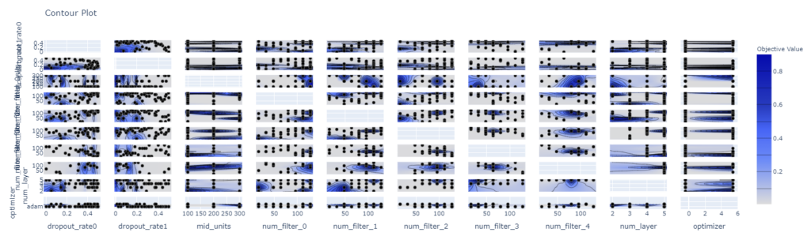
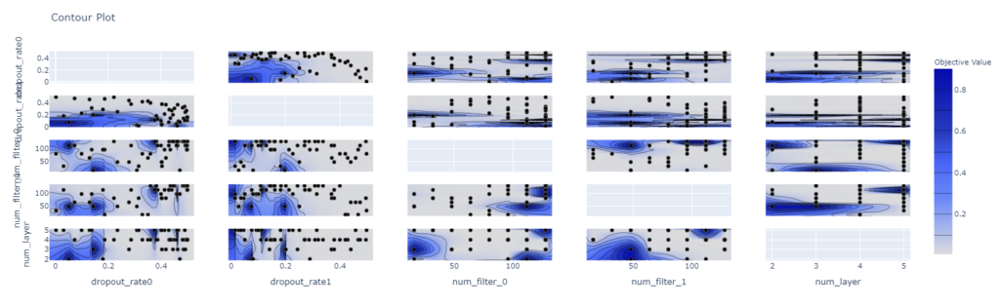
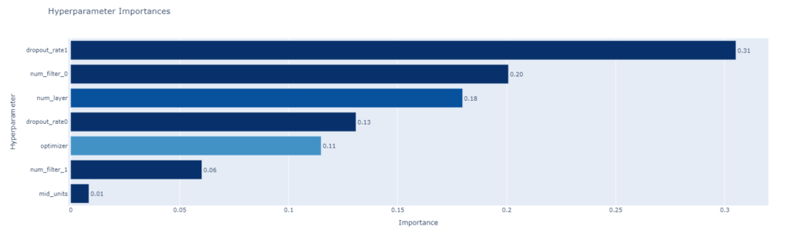
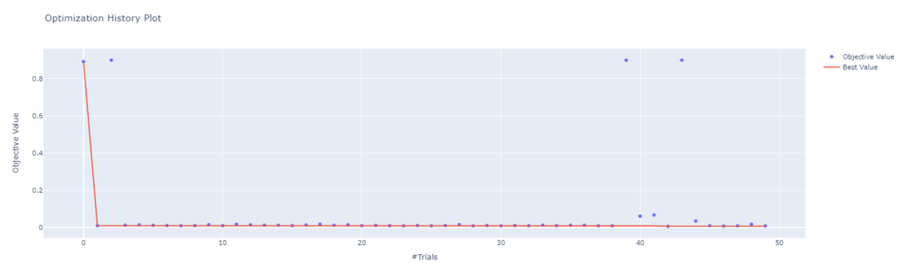
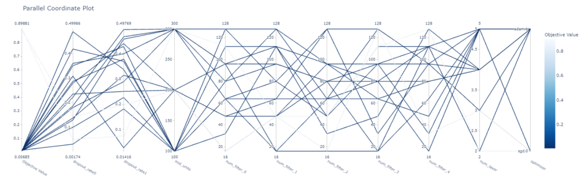
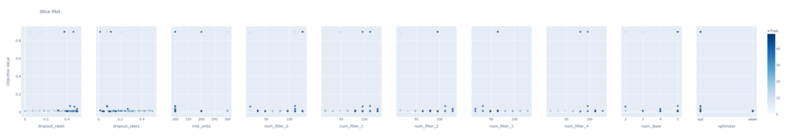

## 概要

最近kaggleのJaneStreetコンペが終了しました。

今回のJaneStreetコンペで自分たちのチームではoptunaが大活躍したので、optunaを利用した最適パラメータの探索結果図示の方法と、パラメータ決定の方法について記事にさせていただきます。

optunaはすごく便利なツールなので、皆さんぜひ使ってください。

## optunaについて

株式会社Preferred Networksのハイパーパラメータ最適化ツールです。

詳しくは過去のこちらの記事をご参照ください。

[optunaでCNNのパラメータチューニングしてみる。MNISTコンペ精度向上添え。 概要ハイパーパラメータのチューニングめんどくさくないですか？ということで、機械学習モデル作成の際に避けては通れないハイパーパラメータのチューニングを自動化するツール、「optuna」を利用してみました。kaggle... cpptake.com 2020.10.12](https://cpptake.com/archives/629)

過去の記事ではベストパラメータを単純に探索しただけの使い方しかしておりませんでしたが、JaneStreetコンペでは探索結果を図示本当に効いていそうなパラメータを探して選定を実施しました。

その際には「visualization」メソッドを利用して探索したのでその際のノウハウを記載します。

今回はoptunaの公式リファレンスを参考にしながら記事書いてるので、詳細は[こちら](https://optuna.readthedocs.io/en/stable/tutorial/10_key_features/005_visualization.html?highlight=visualization%E3%80%80plot_contour)の公式リファレンスをご確認ください。

### 6/11 追記

思ったよりも読まれているので、kaggleの公開Codeに投稿したNotebookを晒しておきます。よければご覧ください。upvoteもらえると嬉しいです。

 [MNIST CNN(Keras) with optuna visualization【日本語あり】 Explore and run AI code with Kaggle Notebooks \| Using data from Digit Recognizer kaggle.com](https://www.kaggle.com/takeshikobayashi/mnist-cnn-keras-with-optuna-visualization)    

## やってみる

### モデル定義

下記に手順を記していきます。

作成するモデルは前回のOptunaの記事で作成したモデルとほとんど変わらないCNNのモデル、データセットはMNISTです。データ読み込み部などは割愛します。

最低化するパラメータは　num\_layer, mid\_units, num\_filters, dropout\_rateになります。

```python
##　モデル定義

import optuna
import keras
from keras.models import Sequential
from keras.layers import Dense, Dropout, Flatten
from keras.layers import Conv2D, MaxPooling2D

img_rows, img_cols = 28, 28
num_classes = 10

#CNN
#define the CNN model
def create_model(num_layer, mid_units, num_filters,dropout_rate):
    
    model = Sequential()
    model.add(Conv2D(filters=num_filters[0], kernel_size=(3, 3),
                 activation="relu",
                 input_shape=(img_rows, img_cols, 1)))
    model.add(MaxPooling2D(pool_size=(2, 2)))
    for i in range(1,num_layer):
        model.add(Conv2D(filters=num_filters[i], kernel_size=(3,3), padding="same", activation="relu"))
    
    model.add(MaxPooling2D(pool_size=(2, 2)))
    model.add(Dropout(dropout_rate[0]))
    model.add(Flatten())
    model.add(Dense(mid_units))
    model.add(Dropout(dropout_rate[1]))
    model.add(Dense(num_classes, activation='softmax'))
    
    return model
```

### 最適化する目的変数をセットと最適化

次にoptunaで最適化する目的変数を設定します。こちらも過去の記事のものをベースに作成するので詳細はそちらを確認ください。

```plane
def objective(trial):
    print("Optimize Start")
    
    #セッションのクリア
    #clear_session
    keras.backend.clear_session()
    
    
    #畳込み層の数のパラメータ
    #number of the convolution layer
    num_layer = trial.suggest_int("num_layer", 2, 5)
    
    #FC層のユニット数
    #number of the unit
    mid_units = int(trial.suggest_discrete_uniform("mid_units", 100, 300, 100))
    
    #各畳込み層のフィルタ数
    #number of the each convolution layer filter
    num_filters = [int(trial.suggest_discrete_uniform("num_filter_"+str(i), 16, 128, 16)) for i in range(num_layer)]
    
    #活性化関数
    #activation = trial.suggest_categorical("activation", ["relu", "sigmoid"])
    
    #Dropout率
    dropout_rate = [0] * 2
    dropout_rate[0] = trial.suggest_uniform('dropout_rate'+str(0), 0.0, 0.5)
    dropout_rate[1] = trial.suggest_uniform('dropout_rate'+str(1), 0.0, 0.5)
    
    #optimizer
    optimizer = trial.suggest_categorical("optimizer", ["sgd", "adam"])
    
    model = create_model(num_layer, mid_units, num_filters,dropout_rate)
    model.compile(optimizer=optimizer,
          loss="categorical_crossentropy",
          metrics=["acc"])
    
    history = model.fit(X_train, y_train, verbose=0, epochs=20, batch_size=128, validation_split=0.1)
    
    scores = model.evaluate(X_train, y_train)
    print('accuracy={}'.format(*scores))
    
    #検証用データに対する正答率が最大となるハイパーパラメータを求める
    return 1 - history.history["val_acc"][-1]
```

最後に、crete\_studyを作成し、optimizeで目的変数を最適化していきます。n\_trial（探索回数）はとりあえず50回で回してみます。これで準備完了です。

```plane
study = optuna.create_study()
study.optimize(objective, n_trials=50)
```

### 最適化結果の視覚化

ようやく本題です。今回はOptunaのVisualization機能を利用します。

optunaのtrials内には各でtrialで得られた目的変数の値が格納されています。

#### plot\_contour

plot\_contourメソッドを利用すると、各パラメータにおける目的変数の値がヒートマップで表示されます。

```plane
optuna.visualization.plot_contour(study)
```



図示にはplotlyを利用したインタラクティブな視覚化がされています。

今回はパラメータを10水準くらい振って見にくくなったので、パラメータを絞りたいと思います。

図示するパラメータを絞る際は、pramsの変数にパラメータ名を記載すると確認できます。

```plane
optuna.visualization.plot_contour(study, params=["dropout_rate1","num_filter_0","num_layer","dropout_rate0","num_filter_1"])
```



少し見やすくなりました。

目的変数の値が等高線のように表示されるのでどのパラメータの時に、目的変数がどのような結果であったかが非常にわかりやすい機能です。

この機能で最適、ロバストなパラメータの位置を探索するのが非常に楽になります。

#### plot\_param\_importances

どのパラメータが効いていたか表すメソッドです。

```plane
optuna.visualization.plot_param_importances(study)
```



dropout\_rate1が一番効いてるみたいです。

感覚的には、決定木のfeature\_importanceと同じような使い方ができるかと思います。

#### plot\_optimization\_history

最適化の履歴を確認するplot\_optimization\_historyメソッドです。

縦軸が目的変数、横軸が最適化のトライアル数になってます。オレンジの折れ線が最良の目的変数の値となっており、何回目のトライアルでベストパラメータが出たのかわかりやすくなってます。

今回のモデルでは早めに収束してますが本来はもう少しばらつくはず。

```plane
optuna.visualization.plot_optimization_history(study)
```



#### plot\_parallel\_coordinate

こちらはあまり利用してないですが、パラメータの食い合わせとと目的変数の結果を図示するメソッドです。

目的変数はスコアがいいほど濃い色で表示されているので、下記を見るとoptimizerがsdgの時は結果がよくなかったことがわかります。

```plane
optuna.visualization.plot_parallel_coordinate(study)
```



#### plot\_slice

こちらもあまり使ってませんが、各パラメータの値と目的変数の結果をプロットするメソッドです。

```plane
optuna.visualization.plot_slice(study)
```



## まとめ　おすすめ

OptunaのVisualization機能を使った最適化結果の図示方法についてまとめました。

最適なパラメータを選ぶ際は、ベストのパラメータだけではなくロバスト性も考えたパラメータを選定する必要があるので、最適化結果の図示は非常に重要です。

パラメータ選定の際のおすすめの使い方としては、

plot\_param\_importancesで重要度を確認した後、plot\_contour重要度の高いパラメータにしぼったヒートマップを作成することで効率よくパラメータ選定が行えるのでよかったら利用してみてください。
