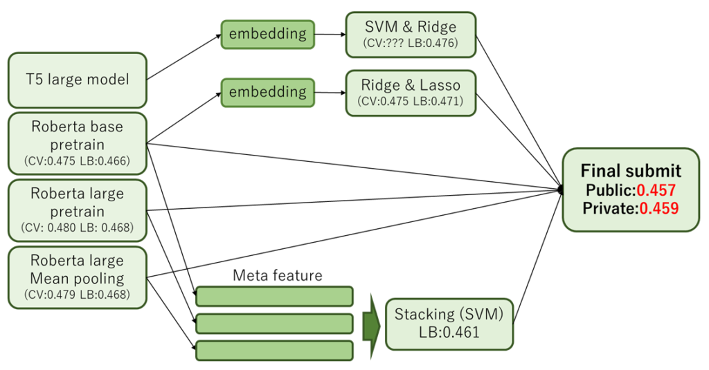

しぃたけ

走り切ると強くなれるので、ジャンル問わず面白そうなコンペは参加してみましょう！

## 最初に

> shakedownして銀圏から追い出されましたがどうにかメダル圏内。。  
> 友人のnishipyさんにメダル献上できたので個人的には満足です！ [pic.twitter.com/LaScvrG35x](https://t.co/LaScvrG35x)
> 
> — しぃたけ (@cpp\_take) [August 3, 2021](https://twitter.com/cpp_take/status/1422348332391833612?ref_src=twsrc%5Etfw)

友人のnishipyさん([@iamnishipy](https://twitter.com/iamnishipy?s=20))と参加したkaggleのCommonLitコンペで銅メダルを獲得しました。

Public LBでは銀圏内だったものの、最後にshake downして銅圏に落ちしてしまいましたが、初めて参加した自然言語処理コンペでメダル獲得できたので、取り組みの方法の記録を残したいと思います。やる気あればgithubにコード公開しようと思います。

ちなみに今回一番言いたい事としては、

**初めて参加する分野（画像、自然言語、音声 etc..）でも走り切ればそれなりにできるようになるよ！**ということです。これから初めての分野のコンペに参加される方の後押しになれればと思います。

### 自分のレベル

なお、コンペ参加前の自分のレベル感は以下の通りです。

- kaggle expert（金1　銅１　金は強い方とチームを組んだため）
- 自然言語処理初心者
- BERT? Transformer? 何か聞いたことある程度

このような状態だったため、コンペ序盤はわからないことだらけで挫折しそうでした。

### コンペ概要

参加したのは下記の「CommonLit Readability Prize」で、文章の読みやすさを予測し、精度を評価する自然言語処理コンペです。trainデータの文章に読みやすさの点数が付与されており、testデータの読みやすさを予測するという回帰問題のコンペとなってます。詳細は下記。

 [CommonLit Readability Prize Rate the complexity of literary passages for grades 3-12 classroom use kaggle.com](https://www.kaggle.com/c/commonlitreadabilityprize/overview)  

コンペ中は、数値化された読みやすさというよくわからん評価指標、途中からCVとLBが一致しないなど細かい事にも悩まされましたが詳細は割愛します。

### 8/14 追記

解法のコードをgithubに公開しました。雑な管理ですが興味あればご参照ください。

 [GitHub - cpptake/CommonLit Contribute to cpptake/CommonLit development by creating an account on GitHub. github.com](https://github.com/cpptake/CommonLit)   

## コンペの取り組み方

### 解法

はじめに、今回のコンペで最終サブに利用したモデルのパイプラインを紹介します。下記が最終サブモデルのパイプライン図と、その時のソースコードのリンク先です。

◆パイプライン

*final submit model pipeline*

◆解法の公開Notebook

 [Checking your browser - reCAPTCHA www.kaggle.com](https://www.kaggle.com/takeshikobayashi/bronze-medal-solution-roberta-stacking-ensemble) 

最初に今回の記事で、自分達のチームが工夫した点を下記の2点紹介します。

- **EmbeddingをSVM,Ridge,Lassoの組み合わせて線形回帰**
- **Stackingとその他のモデルの予測結果をブレンド**

#### SVM,Ridge,Lassoの組み合わせについて

[こちら](https://www.kaggle.com/maunish/clrp-roberta-svm)のNotebookなどでBERT系モデルのEmbeddingのデータをSVMなどの線形モデルで回帰するという手法がよく使われていました。

この手法の回帰モデルのSVMだけでなくRidgeやLassoに変更したらどうなるのか？という疑問を持ち、いろいろ実験してみたところ上記の図にある「SVM & Ridge」「Ridge & Lasso」という組み合わせが最適であるという結論になりました。

この方法で単独モデルのスコアがこのように変化しました。**（CV：0.002pt　LB：0.003pt 改善**）

#### Stackingについて

Stackingは以前、[この記事](https://cpptake.com/archives/586)でお試し実装しており本番で使える場面がないかなぁと思っていたところだったので、今回のコンペで利用できて非常に満足しております。

今回紹介している自分たちのチームのモデルでは3モデルのStackingとなってます。もっとモデル数を増やして実験もしてみたのですが、LB上で一番スコアがよかったのが上記3モデルのStackingだったので最終サブにはそれを選びました。

また、Stackingと他モデルのブレンドをした理由としては、**初めて実装するStackingに自信がなかったためです。**

初めて実装するStackingなので、「もしかしたらOverfitしてるかも？」みたいな不安が頭をよぎって安全策として単独モデルとブレンドしました。（結果的にStackingだけのサブがPrivate scoreが一番高い銀圏サブであったため、自分を信じておけばよかったとちょっと後悔してます。）

### 初の自然言語処理コンペへの取り組み方

最初に書いた通り、自分は今回のコンペが自然言語処理の初めての取り組みだったので基礎的な用語などもわからず苦労したことも多かったです。そのような際に自分が取り組んだことは大きく下記の2点です。

- **Disuccusion、公開Notebookの読み込み**
- **外部のリソースを利用して勉強**

#### Disuccusion、公開Notebookの読み込み

この部分は以前書いたIndoorコンペの記事にも共通しておりますが、**基礎知識がないコンペの場合、最初にやるべきはこの一点に尽きると思います。**

最初は自然言語処理何それおいしいのって感じでしたが、Disuccusionを読んでいると「なんとなくBERT系のモデルを使えばいいのかな？」ということが見えてきて、公開Notebookでそれっぽいコードを読んでみる。という流れで学び始めました。

意識低い方法かもしれませんが、初めて参加する分野なんて、実際実力は足りてないのが当然なので仕方ないですよね。とりあえず、前回のコンペの記事貼っときます。

[kaggle expertになったのでIndoorコンペ、1週間で銅メダル取るためにやったことまとめます しぃたけkaggle初心者向きですはじめにKaggleExpertになりました先日参加していたIndoorコンペで銅メダルを獲得して、念願のKaggle Expertに昇格しました。Kaggle始め... cpptake.com 2021.05.23](https://cpptake.com/archives/791)

#### 外部のリソースを利用して勉強

Disuccusionや公開Noteだけでは、理解できない部分が出てくると思います。文章も英語ばかりなのでニュアンスが分からない部分も多いです。

その時はググりまくって、理解を深めることに徹していました。

特に、BERTやTransformerなどのモデル部分のわからない点は、下記のようなyoutubeの動画を使って勉強してました。下記のAlcia Solid Projectさんの動画などはアルゴリズムの概念をわかりやすく解説していただけるので非常におすすめです。

【深層学習】BERT – 実務家必修。実務で超応用されまくっている自然言語処理モデル【ディープラーニングの世界vol.32】#110 #VRアカデミア #DeepLearning

また、BERT関連の書籍などは下記のものが評価が高いので書籍お探しの方は参考にしてください。

[埋め込みコンテンツ](https://www.amazon.co.jp/dp/B098J9M4PP)

### 反省点

最後に1点、反省点ですが

**Disuccusionなどオープンな内容などが全てだと思い込んでしまったことです。**

多くのDisuccusion、公開NoteではRoberta、Roberta-largeが使われていたため、自然言語処理に知見がない自分としては「Roberta系がこのコンペの正解なんだ」と思ってしまったのですが、実際にはRoberta以外のほかのモデルを多数組み合わせた人が上位に入賞されていました。（上位では30種類以上のモデルをアンサンブルしている方が多かった。）

ある程度Disuccusion、公開Notebookで傾向が分かればそれ以降はオリジナルの解法を追加していく形でモデルに多様性を出していく方法で今後は自分も取り組んでいきたいです。

### 余談：Do everything

余談ですが、kaggle業界に「**Do everything**」という諺があります。**思いついた解法は全部試してみろ！**という意味だそうです。

今回のコンペでも、実装してみたいモデルはいくつかあったのですが、DisuccusionにRoberta系のモデルしかなかったため、使わずに終わってしまったというものもたくさんありました。

この諺の通りすべて実装できて入れば、銀圏には入れていたと思うので次回からはこの言葉を胸に刻んで取り組んでいきます。

## まとめ

CommonLitコンペの自チーム解法と、未経験の分野のコンペに挑戦するときの心構えを記録しておきました。

自分のような人間でもどうにかメダル圏内には潜り込めたので、新しい分野に飛び込む勇気が出ない方のお役に立てればと思います。

気になる点あればコメントお待ちしております。
