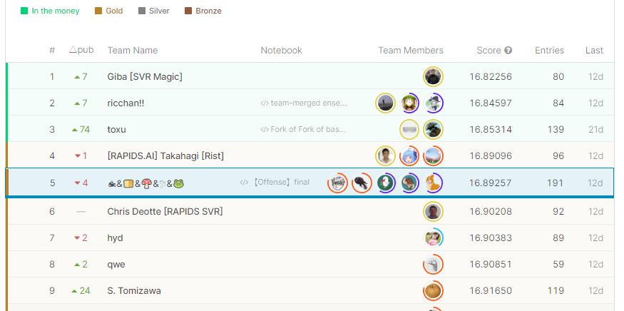
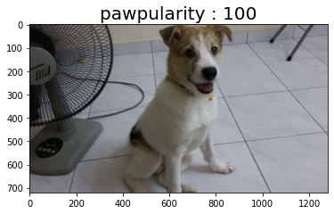
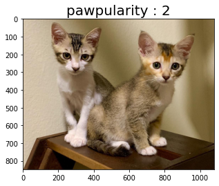
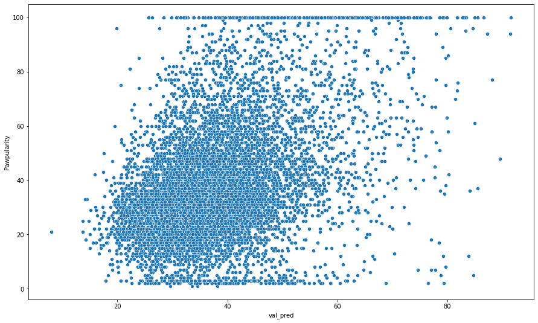
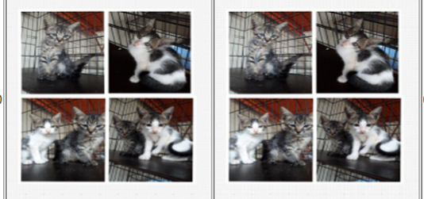
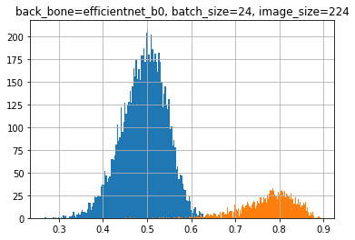
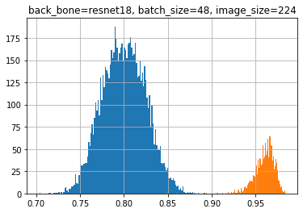

## 金メダルを獲得しました

先日終了した「PetFinder.my – Pawpularity Contest」コンペで5位に入賞し、金メダルを獲得しました。



今回のコンペでメダルを取れたのはひとえに、チームの皆様が強かったからなので、あまり調子に乗ったオレオレソリューションではなく、自分がこのコンペで取り組んだことを自分用にまとめていこうと思います。コードもチームメイトと共用で使っていたものが多いのであまり記事には残してないのでご了承ください。

## コンペについて

### PetFinder.my – Pawpularity Contest

今回参加したコンペは下記の「PetFinder.my – Pawpularity Contest」コンペで、捨て犬、捨て猫などのマッチングサイトを運営しているPetfinder社（[公式HP](https://www.petfinder.my/)）がホストでした。このコンペは画像からペットの魅力度を表す「pawpularity」と呼ばれるスコアを予測する回帰問題コンペで、画像から正しい「pawpularity」を予測することで、犬猫のマッチング確率の改善が期待され、一匹でも多くの犬猫の廃棄を減らすことができるという非常に社会的意義のあるコンペだと思い、参加しました。

 [PetFinder.my - Pawpularity Contest Predict the popularity of shelter pet photos kaggle.com](https://www.kaggle.com/c/petfinder-pawpularity-score)  

### 特徴

最初はやる気を持って参加したのですが、下記の問題点に早速ぶつかりました。

- よくわからん評価指標「pawpularity」
- 相関しない目的変数と予測結果

#### よくわからん評価指標「pawpularity」

今回のコンペはPetFinderのプラットフォーム内で利用されている、ペットの可愛さ、魅力度を表す「pawpularity」という指標を与えられた画像から推定するコンペだったのですが、この「pawpularity」という指標がクセモノで、画像とどんな相関があるのか全く分からない指標となってました。試しにPawpularityが100点（満点）の画像と2点（最低点）の画像を並べてみるとこんな感じです。


*Pawpularity＝100*


*Pawpularity＝2*

どっちもかわいい。

感覚的には何がいいのか全く分からないデータになっているということが分かります。人間でもよくわからんデータを本当に予測できるのか？と疑問に思いながらコンペを始めた瞬間に感じた記憶があります。

#### 相関しない目的変数と予測結果

上記の通り、画像と「Pawpularity」にどんな関係があるかぱっと見でわからないままモデルを作り始めました。下記の図はBaselineとして、とりあえずefficientnet b0で回帰モデルを作って、目的変数と予測結果を散布図で表したものです。


*目的変数と予測結果の散布図*

ほとんど相関していません。

これは統計の教科書に出てくる無相関のお手本みたいなグラフになるのではないかと思いながら取り組んでいました。モデルの作り方が悪いのでは？と思われた方もおられるかもしれませんが、コンペ終盤でもこの傾向は大きく改善しませんでした。

### チームマージ

こんな感じでよくわからん評価指標と闘っていたら、Twitterで仲良くしていただいているyukiさん（[@yuki93753711](https://twitter.com/yuki93753711?s=20)）、shoku-panさん（[@shoku\_pan\_pan](https://twitter.com/shoku_pan_pan?s=20)）からお誘いを受け、チームマージすることになりました。

その後、johannyjm1さん（[@johannyjm1](https://twitter.com/johannyjm1?s=20)）、かえるるるさん（[@kaeru\_nantoka](https://twitter.com/kaeru_nantoka?s=20)）がチームに加わり最終的に5人チームになりました。全員強い方だったのでついていくのに必死でした。

> 動物を守るチームに混ぜていただくことになりました。よろしくお願いします。 [pic.twitter.com/HwAG6tUmqk](https://t.co/HwAG6tUmqk)
> 
> — しぃたけ (@cpp\_take) [November 16, 2021](https://twitter.com/cpp_take/status/1460581649440133121?ref_src=twsrc%5Etfw)

## 取り組み

### チームのソリューション

チームメイトのかえるるるさんが作成してくれた我々のチームの最終サブのソリューションが下記になります。

 [PetFinder.my - Pawpularity Contest Predict the popularity of shelter pet photos kaggle.com](https://www.kaggle.com/c/petfinder-pawpularity-score/discussion/300928) 

我々のチームはコンペ中盤で、Petfinder社が3年前にKaggleで開催していたコンペ「[PetFinder.my Adoption Prediction](https://www.kaggle.com/c/petfinder-adoption-prediction)」（以下、Petfinder1）で使われている画像と今回コンペの画像が重複していることを発見し、重複画像に対して、Petfinder1で提供されているデータを特徴量を追加してスコアを底上する、という方法をとっておりました。

（ちなみに、前回コンペとの画像重複を特徴量として利用するのは、自分がチームに入れていただく前からアイデアとして持っておられたので自分の成果ではないです。）

例を挙げると、下記の2枚の画像で左側が今回コンペ（Petfinder2）の画像、右側が前回コンペ（Petfinder1）のコンペの画像となっており、全く同じ画像が紛れ込んでいるのが分かり、調べてみるとtrainデータの中だけで1600件以上の画像がかぶっていることが分かりました。


*左：今回コンペ画像　　右：前回コンペ画像*

そのため、我々のチームの大きな方針としては

「過去コンペのデータから有用な特徴量をいかに取得できるか」という方針があり、自分も多くの時間を過去コンペからの特徴抽出に費やしました。

### 自分の活動

自分が行った実験としては、公開Notebookや他のコンペの情報を参考に様々なモデル（efficient net , swin tranceformer , resnet etc…）を試して、CVの向上に寄与しないかなど試しましたが、誰もがやっている画像モデル作成部分は割愛して、下記について記載しようと思います。

- albumentations、MixupなどのDataAugumentation手法の実装
- 犬種、猫種判別モデル、年齢予測モデル　の作成
- 重複画像判別モデルの精度改善

#### albumentations、MixupなどのDataAugumentation手法の実装

公開Notebookなどで、さまざまな画像のAugumentationの手法が挙げられており、それに習いalbumentationsなどのDataAugumentationの手法を試しておりました。（HorizontalFlip、VerticalFlip、ColorJitter　など）

またその中で、Mixupでスコアが上昇したという情報が[Discussion](https://www.kaggle.com/c/petfinder-pawpularity-score/discussion/288223)に上がっており、実装を行いました。（[Mixup論文](https://arxiv.org/pdf/2111.09833.pdf)）実装時のコードは下記になってます。

```python
def mixup_data(x, y, mixup_alpha = 1.0):
    if mixup_alpha > 0:
        lam = np.random.beta(mixup_alpha, mixup_alpha)
    else:
        lam = 1
    
    batch_size = x.size()[0]
    index = torch.randperm(batch_size).cuda()
    
    mixed_x = lam * x + (1 - lam) * x[index, :]
    y_a, y_b = y, y[index]
    
    return mixed_x, y_a, y_b, lam
```

Mixupは簡単に言うと2つの訓練サンプルのペアを混合して新たな訓練サンプルを作成するdata augmentation手法の1つです。これまで知らない手法でしたが、チームメイトに教えてもらいながら実装を進めました。

ちなみに、モデルはswin\_large,efficientnetｍなどにMixup実装したのですが、この手法では我々のモデルは精度向上しませんでした。

#### 犬種、猫種判別モデル、年齢予測モデル　の作成

コンペ中盤は過去コンペのデータから特徴量を抽出する方法を探索していました。

その中でも、チームの中で議論になっていたのが過去コンペのデータから犬種猫種判別モデル、ペットの年齢予測モデルを作り、今回コンペの画像データに対しての予測結果を特徴量として活用できないか？という点です。

上記の仮説を実証するために、犬種猫種、年齢判別モデルを作成しました。

犬種猫種判別モデルは、画像の他クラス分類問題として、年齢判別モデルは年齢データをBinning処理をした後、回帰問題としてモデルを作成しました。

犬種猫種判別モデルについては、AUC = 0.9程度の精度まで追い込むことができ、スコア向上に使えるかと思っていたのですが、結果上記の特徴量ではLBの向上は見られず最終サブには選ばれませんでした。

#### 重複画像判別モデルの精度改善

我々のチームの肝である、重複画像判別モデルはtimm.create\_modelのembedding層のデータを特徴ベクトルとして、Petfinder2の画像とPetfinder1の画像の類似度を計算し、類似度が高い画像を重複画像とみなすという方法で計算していました。

当時の自分は知らなかったのですが、下記のようにtimm.create\_modelの「num\_classes=0」に指定するとemmbedding層のデータが取得できるそうです。

```python
model = timm.create_model(BACK_BONE, num_classes=0, pretrained=True)
```

当初はBACKBONEとして「efficientnet b0」を利用していました。下記のグラフが efficientnet b0でのPetfinder1,2での画像の類似度をヒストグラムにしたものになってます（橙色が重複ありの画像、青色が重複なしの画像）。きれいに分離できてますが、よく見ると画像は重複しているのに類似度が低いデータも散見され、100％きれいな重複確認ができていませんでした。（f1 score : 0.981 程度）


*efficientnet b0の類似度ヒストグラム*

上記の点を、BACKBONEの変更などで改善できないか実験を行った結果、「resnet 18」を用いると精度が改善されることを発見しました。

下記のヒストグラムがresnet 18を用いた類似度判別モデルですが、efficientnet b0よりきれいに分離ができていることが分かります。（f1 score : 0.996 程度）


*resnet 18の類似度ヒストグラム*

## 反省点

上記のように、こまごました実験を行い特徴抽出やモデルの変更などで、スコア向上に貢献できないか、いろいろ実験を進めていましたが、いろいろと反省点も見えてきたので記録しておきます。

### 仕事の繁忙期とコンペが被りまくった

個人的には、これが一番しんどかったです。

11月中頃にチームマージさせていただいたのですが、12月中旬くらいから仕事が忙しくなりはじめ、毎日21～22時くらいに仕事が終わることが常態化し始めました。

仕事が終わるとチームのSlackに追いきれないほどの情報が書き込まれていて、チームの状況を理解するのに仕事後の時間を費やしたりしておりました。この時期の稼働してもらってるほかのチームメイトへの申し訳なさは半端ではなかったです。

**Kaggleは気持ちと時間に余裕がある時しかできないのだなぁと深く感じました。**

### 関連コンペの上位ソリューションに疎い

つよつよな方々はアイデアの引き出しが多いです。

自分では思いつかないようなアイデアを出していただくことが多いかったのですが、これらのアイデアの源泉は、過去の関連コンペで上位入賞したチームのソリューションに詳しいかどうかに大きく依存していると思いました。

例えば、DataAugumentationで詰まった時は[SETI](https://www.kaggle.com/c/seti-breakthrough-listen)何位のこのソリューションがあるよ。同じようなモデルが[Landmark](https://www.kaggle.com/c/landmark-retrieval-2021)のこのソリューションにあったよ。など、困りごとのヒントになるようなソリューションをチームメイトにすぐに紹介してもらえることが多く、経験の差を感じました。

これまで自分は自分が参加したコンペのソリューションしか読んでなかったのですが足りてなかったみたいです。参加してないコンペも積極的に見ていこうと思いました。

## 最後に

つよつよなチームメイトのおかげで身の丈に合わない金メダルを獲得してしまいました。あと銀一枚でMaster昇格になってしまい焦ってますが、精進したいと思います。

また、本当にこれだけは言いたいのが「**Kaggleは気持ちと時間に余裕がある時しかできない**」ってことです。

今回のコンペは仕事が多忙の中続けるのが非常にしんどい状況でした。こんな状況でも自分を見捨てず一緒にコンペを進めてくれていたチームメイトの皆さんには感謝です。（残業明けの10時過ぎにチームのWeb会議に参加して他愛のもない会話をする時間が癒しの時間でした。）

これからは時間と気持ちに余裕をもってから、次のコンペを進めていこうと思います。
