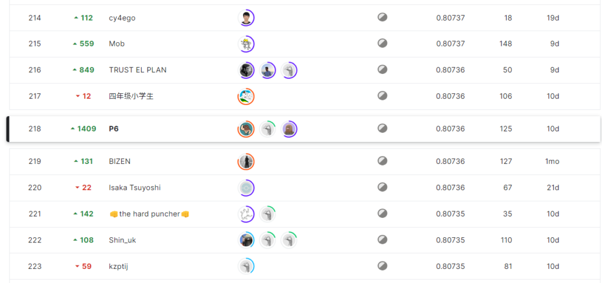
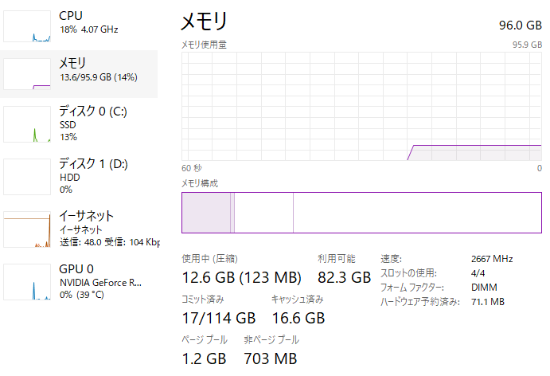

## kaggle masterになりました

> Masterになってました！  
> これまでチーム組んでくださった方ありがとうございます！  
> 今の実力で名乗りたくないですが、名前負けしないようにこれからも精進してきます！ [pic.twitter.com/RUxGqZ2qds](https://t.co/RUxGqZ2qds)
> 
> — しぃたけ (@cpp\_take) [August 27, 2022](https://twitter.com/cpp_take/status/1563315406969835523?ref_src=twsrc%5Etfw)

今回のAMEXコンペで銀メダルを獲得し、Kaggle Masterに昇格しました！肝心の金メダルについてはチームメイトの皆さんのおかげなので実力的にはまだまだですが、昇格できて素直にうれしいです。

Masterの振り返り記事はまた気が向いたときに書くとして、今回はAMEXコンペの解法について書かせてもらおうと思います。

## AMEXコンペについて

### コンペ概要

今回参加したコンペは、「American Express – Default Prediction」という、クレジットカードの使用履歴からユーザーが債務不履行に陥るかどうかを予測するテーブルデータコンペです。（コンペ概要は下記）

 [American Express - Default Prediction Predict if a customer will default in the future kaggle.com](https://www.kaggle.com/competitions/amex-default-prediction) 

タスクはテーブルデータを使ったシンプルは二値分類のタスクになっており、初心者でも参加しやすいと考え、初心者の友人と一緒に参加しました。

コンペ全体としては下記のような特徴がありました。自分がこれまでの参加したコンペでは見られない特徴だったのでなかなかつらかったです。

- データセットが大きく、KaggleNotebookではメモリに乗らない
- データが匿名化されており、意味のある特徴量が作りにくい
- LBのスコアに差が見られない

上記の特徴に対して行った対策は後述いたします。

### 結果

結果は　**1627位　から　1409位ShakeUpして218位でした。**

Publicの順位がずっとメダル圏外にいたので、結果見て1409位のShakeUpには笑ってしまいました。

*初の４桁ShakeUp*

## 解法

### 方針

LBの詰まり具合から、1．リークは見られなさそう、2．magic featureは見られなさそう、という観点からアンサンブルゲーになると予想していたので、

**「特徴量とモデルをいっぱい作る　→　アンサンブル」**

という方針を早めに決めていました。

最終的に我々のチームは、17個のシングルモデルをStackingとBlendingでアンサンブルしたものを最終サブに選びました。

### シングルモデル

作成して、アンサンブルに使ったシングルモデルは下記の17個です。GBDT系のモデルについては、[こちら](https://www.kaggle.com/code/ragnar123/amex-lgbm-dart-cv-0-7977)のNotebookの特徴量をベースに、オリジナルの特徴量を足していくという方法でモデリングを行い、NN系のモデルについてはGPUのメモリの都合上、少なめの特徴量だけでモデリングを行いました。

また、BigShake が予想されたため、代表的なモデルはSeedBlendを実施してモデルの堅牢性を高める小細工も使いました。

作成した特徴量の詳細については、次章に記載します。

|  |  |  |  |  |
| --- | --- | --- | --- | --- |
| Model | Feature | CV | Public | Private |
| LightGBM | 1462 cols   (base feature) | 0.797291 | 0.79875 | 0.80696 |
| LightGBM | 1472 cols   (base + kmeans) | 0.795879 | 0.79744 | 0.80567 |
| LightGBM（seed blend） | 2011 cols   (base + c3) | 0.797531 | 0.79864 | 0.80555 |
| LightGBM（seed blend） | 2023 cols   (base + c3 + statedate) | 0.797778 | 0.79769 | 0.80533 |
| XGBoost（seed blend） | 2011 cols   (base + c3) | 0.794019 | 0.79605 | 0.80410 |
| XGBoost | 1472 cols   (base + kmeans) | 0.794141 | 0.79899 | 0.78922 |
| XGBoost ([pyramid](https://www.kaggle.com/code/roberthatch/pyramid-on-statement-dates-notebook)) | 1581 cols | 0.796986 | 0.79768 | 0.80572 |
| CatBoost（seed blend） | 2011 cols   (base + c3) | 0.794842 | 0.79616 | 0.80412 |
| CatBoost | 2023 cols   (base + c3 + statedate) | 0.794548 | 0.79643 | 0.80385 |
| Tabnet | 435 cols | 0.788358 | 0.78294 | 0.79021 |
| GRU | raw data | 0.786781 | 0.79836 | 0.79836 |
| Deeptable（seed blend） | 435 cols | 0.789538 | 0.79104 | 0.80046 |
| LSTM | raw data | 0.786104 | 0.78764 | 0.79637 |
| Transformer | raw data | 0.786781 | 0.78940 | 0.79862 |
| Logistic Regression | 2011 cols   (base + c3) | 0.782316 | 0.77861 | 0.78986 |
| Logistic Regression | 2023 cols   (base + c3 + statedate) | 0.782395 | 0.77847 | 0.78992 |

*シングルモデルスコア*

### アンサンブル

アンサンブルは前述のシングルモデルを利用して、StackingとBlendingでアンサンブルを実施しました。CVとしてはBlendingの方が高くなったのですが、LBのスコアはStackingの方が高くなりました。Blendingの方はCVにOverfitしていただけのようです。

|  |  |  |  |  |
| --- | --- | --- | --- | --- |
| Method | CV | Public | Private | remarks |
| Stacking | 0.80002 | 0.79964 | 0.80736 | 分類器にはRidge Classifierを利用 |
| Blending | 0.80029 | 0.79939 | 0.80724 | Optunaを用いて重みの調整 |

*最終サブスコア*

## やったこと

### RAMの増設

まずローカルマシンのRAMを３２G　→　９６Gに改造しました。データがRAMに乗らない問題はこのコンペの共通課題だったと思うので金にものを言わせて解決しました。データの省メモリ化？金で殴れば必要ありません。

### 特徴量

今回のコンペは特徴量が匿名化されており、意味のある特徴量を作成するのは困難であったため、特徴量作成パートはほとんどおまじないのような作業になりました。いろいろ試したのですが、ベースの特徴量以外に、最終サブに使った特徴量は下記のものになります。

#### C3 (tsfresh)

チームメイトに教えてもらった時系列特徴量自動作成のライブラリのtsfreshを活用しました。時系列関係の統計量を指定すると自動で特徴量を作成してくれます。

今回はいろいろ試した結果「C3」と呼ばれる特徴量が少し効いたので最終サブにも利用しました。tsfreshの使い方については時間あったら記事にしてみようと思います。

 [tsfresh — tsfresh 0.21.2.post0.dev2+g6af3c00 documentation tsfresh.readthedocs.io](https://tsfresh.readthedocs.io/en/latest/)  

#### kmeans cluster

kmeansのクラスタリング結果とクラスター中心までの距離を特徴量に利用しました。これを入れると単独モデルの精度は下がったのですがアンサンブルに入れると少し精度が上がったので最終サブには利用しました。

#### statedate（日付特徴量）

[こちら](https://www.kaggle.com/code/romaupgini/statement-dates-to-use-or-not-to-use)のNotebookで紹介されていた日付特徴量を実装しました。CVが小数点第4位以下で向上しました。

## 反省点

一番の反省点は**シングルモデルの精度向上に取り組む時間を取れなかったことです。**

方針をアンサンブル＋特徴量で攻めると決めたため、優先度が「シングルモデル＜モデルの数」となっており公開Notebookに毛が生えた程度のモデル作成しかできませんでした。

コンペに本腰を入れ始めたのが遅かったのもあるのですが、上位陣のSolutionを読んでいると単独モデルでCVが0.8を越えるモデルを作っておられる方もおられたので、アンサンブルに逃げてしまった風に感じ反省しました。

## 最後に

結果的にKaggleMasterになることができましたが、肝心の金メダルはつよつよな皆さんにとってもらったものなので、実力的にはまだまだだと思ってます。これからも精進を続けてこのコミュニティに貢献できるように頑張っていきたと思います。
