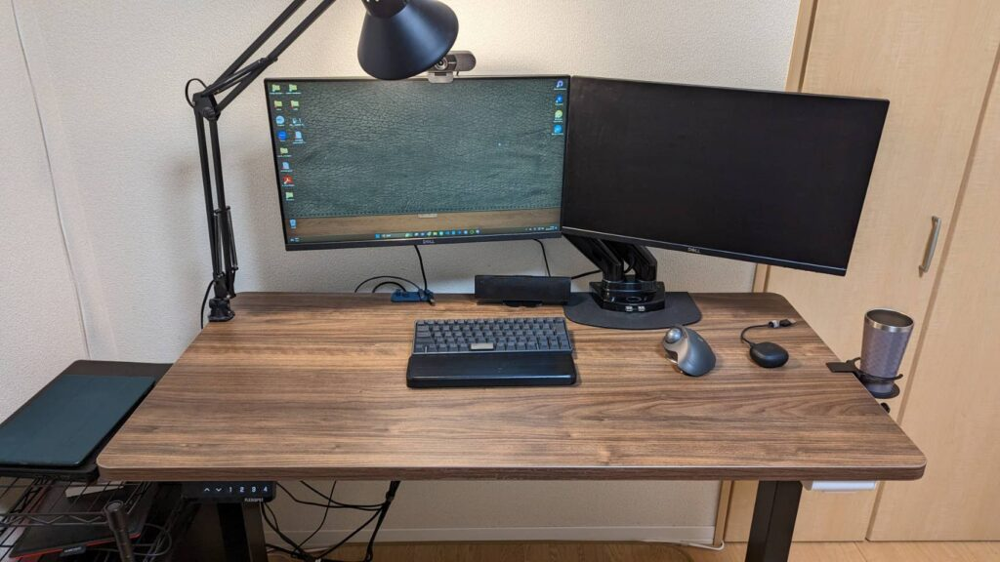

## はじめに

### AWS Certified Solutions Architect – Associateに合格しました。

> SAA受かってました！今後も精進していきます！ [@awscloud](https://twitter.com/awscloud?ref_src=twsrc%5Etfw). [https://t.co/gWlaj1xYLs](https://t.co/gWlaj1xYLs)
> 
> — しぃたけ (@cpp\_take) [January 13, 2023](https://twitter.com/cpp_take/status/1613735805196943365?ref_src=twsrc%5Etfw)

先日AWS Certified Solutions Architect – Associate（以下SAA）に合格しました！自分のスキルセットとしてクラウド、インフラ周りの知見が足りていなかったので今回受験したのですが、チャレンジしてよかったと思っております。

この記事では自分がSAA合格までに実施した勉強方法について記載したいと思います。ちなみに、勉強期間は1か月半程度です。これから受験される方の参考になれば幸いです。

### 私のスペック

受験前の自分の実力は下記のとおりです。

- 事業会社データサイエンティスト（Not IT,Web系）
- EC2,S3は触ったことある。ELB？AutoScaling？何それ？

業務ではデータ分析用のサーバーとしてEC2、S3を扱うことはありますが、それ以外のサービスについては名前も聞いたことがないという状況からのスタートでした。

## 勉強方法

### 教材を使ったサービスの体系的な学習

AWSの概要を理解できていない自分はまずは試験範囲のサービスの基礎を体系的に勉強するところから始めました。基礎の学習には主に下記のUdemyを使って勉強しました。

 [Error click.linksynergy.com](https://click.linksynergy.com/deeplink?id=xdM/auQhfCk&mid=47984&murl=https%3A%2F%2Fwww.udemy.com%2Fcourse%2Faws-uoyc%2F) 

上述の通り、自分はEC2,S3以外のサービスは使ったことがなかったため、AWSのサービス全体像を把握するには、これらの動画教材を利用した勉強が非常に効率的だと感じました。AWS関連の講座はいくつかありますが、この講座は口コミ評価も高く安心して受講することができました。（自分は社内の制度で無料で受講することができました。）

また、友人に紹介してもらったこちらの書籍も学習に使いました。こちらは個別のサービスの特徴などを調べる辞書のような使い方をしておりました。

[埋め込みコンテンツ](https://www.amazon.co.jp/dp/4815607389)

### 問題集をひたすら解く

サービスの全体像が分かったら、問題集を永遠に解き続けてました。SAAの試験は4～5択問題であるため、合格のためには問題の傾向を知って対策をするのが一番です。

主に使っていたサービスは下記の2点です。

こちらのTechstockはフォロワーさんに教えていただいたAWS認定試験の問題集のサービスで、1000件以上の模擬問題集を解くことができます。まずは問題になれるためにこの問題集を2周ほど実施しました。

[https://techstock.jp techstock.jp](https://techstock.jp)

次に、Udemyの模擬試験問題集を解きました。

こちらの問題はやや難易度が高い問題が集められており試験直前に解いたところ点数が悪く自身がなくなってしまったのですが、結果的に合格したのであまり気にしなくてよかったやつでした。皆さんも受講される際はお気を付けください。

 [Error click.linksynergy.com](https://click.linksynergy.com/deeplink?id=xdM/auQhfCk&mid=47984&murl=https%3A%2F%2Fwww.udemy.com%2Fcourse%2Faws-knan%2F)  

## 試験当日の流れ

### 試験前

自分は自宅のPCから受験することができる「[OnVUE](https://www.pearsonvue.co.jp/Clients/Amazon-Web-Services/Online-Proctored.aspx)」を利用したWeb試験の方式でテストを受験しました。

テストの前にはシステム、ネットワークの要件確認、不要なソフトウエアが裏で動作していないかなどの確認を行い、次に試験の中の作業環境（PC周り）の撮影、身分証明書の確認を行いました。

特に作業環境の撮影は4方向からの作業環境を撮影して写真を送る必要がありました。自分は下記の4枚の写真を送った結果、使わない二枚目のディスプレイは反対向けるように指示をされました。

ちなみに飲み物は持ち込みOKらしく、試験中にはコーヒー飲みながら受験してました。

*試験官に送付したPC周りの画像例　この後右のディスプレイは反対に向けるように指示を食らう。*

### 試験中

試験はオンライン上で選択肢を選ぶという形で実施しました。問題の難易度としては、勉強してきた問題集の難易度と大きく変わらないもので、試験時間は40分ほど残して完答することができました。問題集を解けるようにしておけば、問題なく受かるちょうどいい難易度であると思います。

ちなみに、試験中はWebカメラとマイクを常にONにする必要がある状態となっており、怪しい動きがあったら試験管から指摘が入るという仕様でした。

その結果自分は、**試験の問題を声に出して読み上げていると試験管から注意されるというイベントが発生したので皆さんはお気を付けください。**

## 勉強中で苦労した点

最後に勉強をしていて苦労した点についてまとめます。

### 使ったことないサービス多すぎ問題

SAAの試験はAWSを利用して大規模なWebサービスなどを開発する人向けの問題が出題されることが多く、自分のようなAWSをデータ分析用のサーバーとして利用するユーザーではサービスの使い方がイメージできないことが多かったです。

そのためイメージができないサービスについては、実際にAWSのマネジメントコンソールからサービスの画面を実際に利用してみてサービスの内容をイメージしやすくできるように工夫をするとよいかと思いました。

### 専門用語、同じような言葉多過ぎ問題

AWSのサービスは数、似たような言葉の用語が非常に多いため最初は戸惑っておりました。（例：IAMユーザー、IAMロール、IAMポリシー、AMI　など）

これらの問題は、問題集を解きまくり力技で覚えました。皆さん気を付けてください。

## 最後に

自分のSAA取得の取り組みや、試験の方法などについてまとめました。

これからSAAを受験される方の力になれればと思います。
